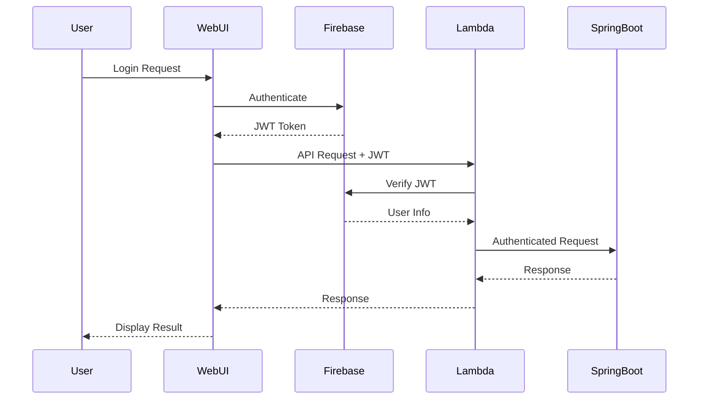

# ADR-002: Firebase Authentication Strategy

## Status
Accepted

## Context
The Personal Vacation Optimizer requires a secure, scalable authentication system that can handle user registration, login, and authorization across multiple services (Spring Boot, AWS Lambda, Web UI) while maintaining simplicity for personal use.

## Decision
We will use Firebase Authentication as the primary identity provider with JWT-based authorization across all services.

## Rationale

### Firebase Authentication Benefits:
- **Zero Infrastructure**: Fully managed service with no maintenance overhead
- **Multiple Providers**: Support for email/password, Google, Facebook, etc.
- **Security**: Industry-standard security practices and compliance
- **SDK Integration**: Rich client SDKs for web and mobile
- **Cost Effective**: Generous free tier suitable for personal projects

### JWT Token Strategy:
- **Stateless**: No server-side session storage required
- **Distributed**: Tokens work across all microservices
- **Secure**: Cryptographically signed by Firebase
- **Standardized**: Industry-standard format

## Implementation

### Authentication Flow:


### Token Verification:
- **Lambda Authorizers**: Custom authorizers verify JWT tokens
- **Spring Boot**: Custom security filter validates Firebase tokens
- **Web UI**: Firebase SDK handles token management

### Authorization Levels:
- **Public**: Health checks, documentation
- **Authenticated**: All vacation planning operations
- **Admin**: System administration (not currently implemented)

## Architecture Components

### Firebase Configuration:
```javascript
// Web UI Configuration
const firebaseConfig = {
  projectId: "aitravelagent-5211d",
  // Additional config from environment
};
```

### Lambda Authorizer:
```javascript
// JWT verification in Lambda
export const handler = async (event) => {
  const token = extractToken(event);
  const decodedToken = await firebase.auth().verifyIdToken(token);
  return generatePolicy(decodedToken.uid, 'Allow', event.methodArn);
};
```

### Spring Boot Security:
```java
// Firebase JWT filter
@Component
public class FirebaseAuthenticationFilter implements Filter {
  public void doFilter(ServletRequest request, ServletResponse response, FilterChain chain) {
    String token = extractBearerToken(request);
    FirebaseToken decodedToken = FirebaseAuth.getInstance().verifyIdToken(token);
    // Set authentication context
  }
}
```

## Security Considerations

### Token Security:
- **HTTPS Only**: All token transmission over encrypted connections
- **Short Expiration**: Tokens expire after 1 hour
- **Refresh Tokens**: Automatic renewal in web UI
- **Validation**: Strict signature and claims validation

### Error Handling:
- **Graceful Degradation**: Fallback to limited functionality on auth failures
- **Clear Messages**: User-friendly error messages
- **Logging**: Security events logged for monitoring
- **Rate Limiting**: Protection against brute force attacks

### Data Privacy:
- **Minimal Claims**: Only necessary user information in tokens
- **User Consent**: Clear privacy policy and data usage
- **Data Retention**: Configurable user data retention policies

## Consequences

### Positive:
- **Simplified Management**: No user database to maintain
- **Security**: Proven security implementation
- **User Experience**: Familiar authentication flows
- **Scalability**: Handles authentication at any scale
- **Multi-Service**: Single identity across all components

### Negative:
- **Vendor Lock-in**: Dependency on Firebase/Google
- **Network Dependency**: Requires internet for token verification
- **Cost Scaling**: Costs may increase with heavy usage
- **Limited Customization**: Constrained by Firebase capabilities

### Mitigation Strategies:
- **Token Caching**: Cache validated tokens to reduce Firebase calls
- **Graceful Fallback**: Basic functionality without authentication
- **Monitoring**: Track authentication metrics and costs
- **Migration Plan**: Document strategy for potential migration

## Implementation Guidelines

### Web UI Integration:
- Use Firebase SDK for authentication UI
- Implement persistent login state
- Handle token refresh automatically
- Provide clear sign-out functionality

### Lambda Authorizer:
- Implement efficient token verification
- Cache Firebase public keys
- Return structured authorization policy
- Log authentication events

### Spring Boot Integration:
- Custom security configuration
- Firebase token validation filter
- User context injection
- Authorization-based endpoint protection

### Error Scenarios:
- Invalid tokens return 401 Unauthorized
- Expired tokens trigger refresh flow
- Network errors provide fallback responses
- Rate limiting for authentication attempts

## Monitoring and Analytics

### Key Metrics:
- Authentication success/failure rates
- Token verification performance
- User session duration
- Authentication method usage

### Alerting:
- High authentication failure rates
- Unusual login patterns
- Token verification errors
- Service availability issues

## Related ADRs
- ADR-001: Microservices Architecture
- ADR-003: Multi-Criteria Decision Analysis Implementation
- ADR-004: Observability and Monitoring Strategy