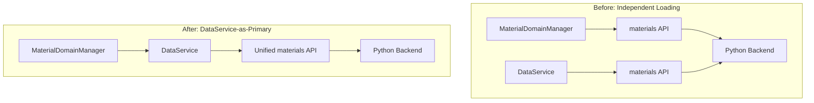

# ADR-001: DataService for Unified Data Loading

> **Status:** Accepted  
> **Date:** May 25, 2025  
> **Authors:** Development Team  
> **Supersedes:** Previous independent API loading patterns

## Context

Elite Utility Suite originally had a problem where multiple parts of the frontend were making duplicate API calls to the backend, leading to:

1. **Duplicate Network Requests**: MaterialDomainManager and DataService both making separate calls to `get_materials_database`
2. **Performance Issues**: Same data being fetched and processed multiple times
3. **Race Conditions**: Concurrent requests for the same data
4. **Inconsistent State**: Different parts of the app potentially having different data
5. **Backend Inefficiency**: Python backend processing the same requests repeatedly

### Specific Problem

The materials system was particularly affected:
- Frontend made separate calls for 'ship' and 'foot' materials database
- Backend ignored context parameters and returned same complete database twice  
- MaterialDomainManager processed identical data multiple times
- Created duplicate entries in UI (234 → 222 materials after fix)

## Decision

We have decided to implement a **DataService-as-Primary** pattern where:

1. **DataService** becomes the primary data coordinator for the entire application
2. **Domain Managers** get data FROM DataService instead of making independent API calls
3. **Unified Backend Endpoints** provide complete datasets in single calls
4. **Request Deduplication** prevents multiple requests for the same data
5. **Intelligent Caching** with TTL and invalidation strategies

### Architecture



### Implementation Details

1. **DataService** loads data once during application initialization
2. **Domain Managers** check DataService cache before making new requests
3. **Backend** provides unified endpoints (e.g., `get_all_materials_data`)
4. **Frontend** uses single API call instead of multiple separate calls
5. **Caching** prevents redundant requests with proper invalidation

## Alternatives Considered

### Alternative 1: Fix Parameter Passing
**Option:** Fix backend to properly handle 'ship'/'foot' context parameters
**Rejected because:** Still results in multiple API calls and separate processing

### Alternative 2: Request Merging
**Option:** Merge multiple requests at the API client level
**Rejected because:** Complex to implement and doesn't solve root architectural issue

### Alternative 3: Shared Cache Only
**Option:** Implement shared cache without changing loading patterns
**Rejected because:** Doesn't prevent duplicate requests, only duplicate processing

### Alternative 4: Event-Based Loading
**Option:** Use events to coordinate loading between systems
**Rejected because:** Adds complexity and potential race conditions

## Consequences

### Positive
- ✅ **Eliminated Duplicate Requests**: Single API call for complete dataset
- ✅ **Better Performance**: Reduced network traffic and processing
- ✅ **Consistent Data**: Single source of truth for all domains
- ✅ **Cleaner Architecture**: Clear separation of concerns
- ✅ **Easier Testing**: Centralized data loading is easier to mock and test
- ✅ **Better Error Handling**: Centralized error handling and retry logic

### Negative
- ⚠️ **Increased Complexity**: DataService becomes more critical component
- ⚠️ **Potential Bottleneck**: All data loading goes through single service
- ⚠️ **Migration Effort**: Required updating existing domain managers

### Neutral
- 🔧 **Learning Curve**: Developers need to understand new patterns
- 🔧 **Documentation**: Required comprehensive documentation of new patterns

## Implementation

### Phase 1: DataService Foundation ✅
```typescript
class DataService {
  private materialsDataCache = { data: null, promise: null };
  
  async initialize() {
    // Load critical data at startup
    await Promise.all([
      this.fetchData('materialsAll'),
      this.fetchData('synthesisData'),
      this.fetchData('materialsInventory'),
      this.fetchData('favorites')
    ]);
  }
}
```

### Phase 2: Domain Manager Integration ✅
```typescript
class MaterialDomainManager {
  async initialize() {
    // Get data FROM DataService instead of independent API calls
    const data = DataService.getMaterialsData();
    if (!data) {
      // DataService handles the actual API calls
      await DataService.fetchData('materialsAll');
    }
    this.processData(DataService.getMaterialsData());
  }
}
```

### Phase 3: Unified Backend Endpoints ✅
```python
# Instead of separate ship/foot calls
def get_all_materials_data(self):
    return {
        'materials': {
            'ship': self.get_ship_materials_db(),
            'foot': self.get_foot_materials_db()
        },
        'inventory': self.get_inventory(),
        'synthesis': self.get_synthesis_data(),
        'favorites': self.get_favorites()
    }
```

## Monitoring & Metrics

### Success Metrics
- **API Call Reduction**: Reduced from ~4-6 calls to 1 call for materials data
- **Load Time Improvement**: Faster application initialization
- **Memory Usage**: Reduced memory footprint from duplicate data
- **Error Rate**: Lower error rates due to fewer network requests

### Monitoring Points
1. **DataService Cache Hit Rate**: Monitor how often cached data is used
2. **API Response Times**: Track backend response times for unified endpoints
3. **Error Patterns**: Monitor for failures in centralized loading
4. **Memory Usage**: Track memory consumption of cached data

## Future Considerations

### Possible Enhancements
1. **Background Refresh**: Periodic data refresh without user intervention
2. **Selective Invalidation**: More granular cache invalidation strategies
3. **Offline Support**: Enhanced offline capabilities with persistent caching
4. **Real-time Updates**: WebSocket or polling for real-time data updates

### Expansion to Other Domains
The DataService pattern can be extended to other domains:
- **Ship Data**: Unified ship and fleet information loading
- **Player Data**: Commander and statistics consolidation
- **Settings**: Configuration and preferences management

## Related Decisions
- **ADR-002**: Domain-Driven Architecture (planned)
- **ADR-003**: React Hook Patterns (planned)
- **ADR-004**: Backend API Design (planned)

## References
- [Architecture Overview](../overview.md)
- [Domain System Guide](../../guides/domain-guide.md)  
- [DataService Implementation](../../../../gui/services/DataService.ts)
- [MaterialDomainManager Integration](../../../../gui/domains/materials/MaterialDomainManager.ts)

---

**Review Notes:**
- This ADR was created retroactively to document implemented decisions
- Pattern has proven successful in production
- Recommended for adoption in other domains
- Consider as template for future architectural decisions
