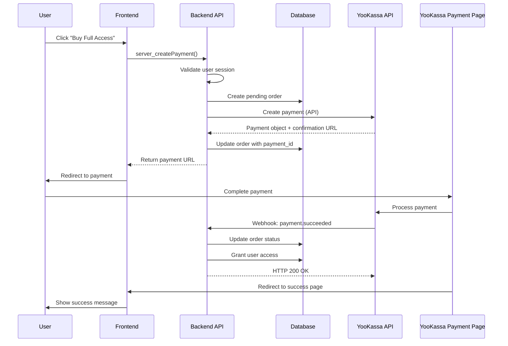
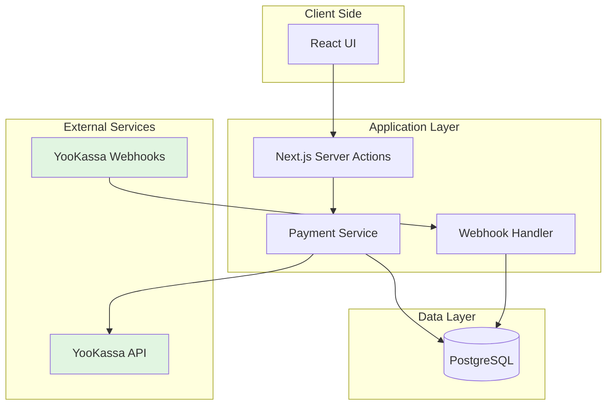
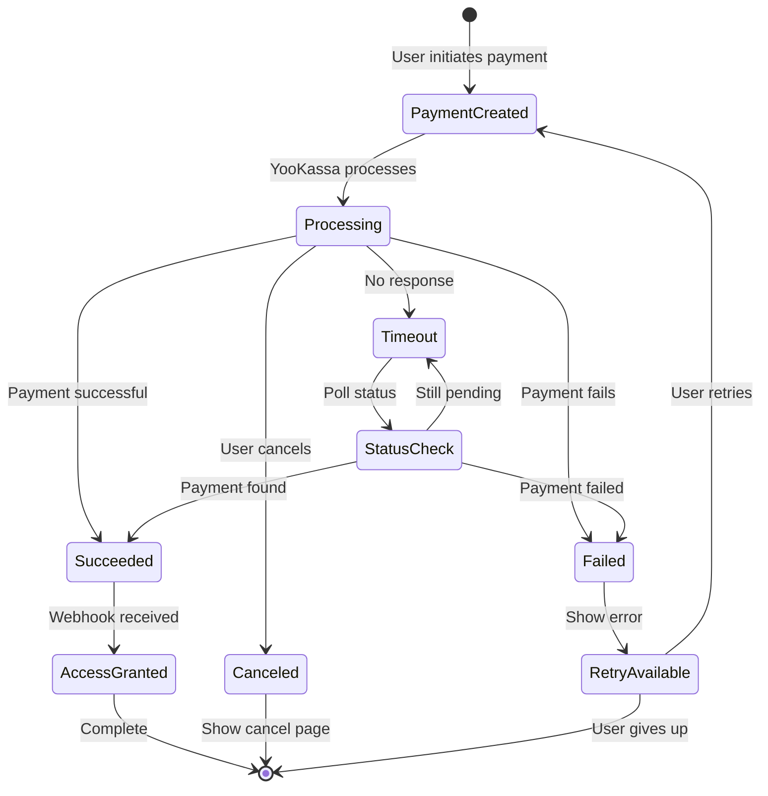

# ADR-004: YooKassa Payment Integration for One-Time Payment Model

**Status:** Implemented  
**Date:** 2024-12-27  
**Author:** Development Team  
**Updated:** 2025-01-03  

## Context and Problem Statement

We need to implement a payment system for our UX/UI analysis service that supports a one-time payment model (4,999₽ for lifetime access). YooKassa has been selected as our payment provider due to its:
- Wide adoption in Russia
- Support for multiple payment methods
- Robust API and webhook system
- PCI DSS compliance
- Reasonable transaction fees

## Decision

We have integrated YooKassa payment gateway using their REST API v3 with webhook notifications for payment status updates.

## Architecture Overview

### High-Level Payment Flow



### System Architecture



### Implementation Structure

The payment system implements a one-time payment model where users pay 4,999₽ for lifetime access to all features.

## Implementation Files

### Backend
- `/src/services/payment/yookassa.service.ts` - YooKassa API client
- `/src/dal/payment.ts` - Payment data access layer
- `/src/actions/payment.ts` - Server actions for payment operations
- `/src/app/api/payment/webhook/route.ts` - Webhook handler

### Frontend
- `/src/components/payment/PaymentButton.tsx` - Payment initiation button
- `/src/app/payment/success/page.tsx` - Payment success page
- `/src/app/billing/purchase/page.tsx` - Purchase page
- `/src/hooks/usePaymentStatus.ts` - Payment status checking hook

### Database
Updated `prisma/schema.prisma` with:
- `PaymentOrder` model
- `UserAccess` model
- `WebhookEvent` model
- `PaymentStatus` enum

## Database Schema

```prisma
model PaymentOrder {
  id               String    @id @default(cuid())
  userId           String
  paymentId        String?   @unique // YooKassa payment ID
  idempotenceKey   String    @unique @default(uuid())
  amount           Decimal   @db.Decimal(10, 2)
  currency         String    @default("RUB")
  status           PaymentStatus @default(PENDING)
  paymentMethodType String?
  createdAt        DateTime  @default(now())
  updatedAt        DateTime  @updatedAt
  paidAt           DateTime?
  metadata         Json?     @db.JsonB
  
  user             User      @relation(fields: [userId], references: [id], onDelete: Cascade)
  userAccess       UserAccess?
  
  @@index([userId])
  @@index([paymentId])
  @@index([status])
}

model UserAccess {
  id               String    @id @default(cuid())
  userId           String    @unique
  paymentOrderId   String    @unique
  accessGrantedAt  DateTime  @default(now())
  accessType       String    @default("lifetime")
  isActive         Boolean   @default(true)
  metadata         Json?     @db.JsonB
  
  user             User      @relation(fields: [userId], references: [id], onDelete: Cascade)
  paymentOrder     PaymentOrder @relation(fields: [paymentOrderId], references: [id])
}

model WebhookEvent {
  id               String    @id @default(cuid())
  eventId          String    @unique
  eventType        String
  paymentId        String?
  payload          Json      @db.JsonB
  processed        Boolean   @default(false)
  processedAt      DateTime?
  createdAt        DateTime  @default(now())
  
  @@index([paymentId])
}

enum PaymentStatus {
  PENDING
  PROCESSING
  SUCCEEDED
  CANCELED
  FAILED
  REFUNDED
}
```

## Environment Variables

```env
# YooKassa Configuration
YOOKASSA_SHOP_ID=your_shop_id
YOOKASSA_SECRET_KEY=your_secret_key

# Application URLs
NEXT_PUBLIC_APP_URL=https://yourdomain.com

# Payment Configuration
PAYMENT_AMOUNT=4970.00
PAYMENT_CURRENCY=RUB
PAYMENT_DESCRIPTION=UX/UI Анализатор - Полный доступ
```

## Setup Instructions

1. **Install Dependencies**
   ```bash
   pnpm add axios uuid
   pnpm add -D @types/uuid
   ```

2. **Run Database Migration**
   ```bash
   pnpm prisma migrate dev
   ```

3. **Configure YooKassa**
   - Sign up at https://yookassa.ru
   - Get your Shop ID and Secret Key
   - Configure webhook URL: `https://yourdomain.com/api/payment/webhook`
   - Enable required payment methods

4. **Configure Webhook IP Whitelisting**
   YooKassa uses IP whitelisting for webhook security. Add these IPs:
   - 185.71.76.0/27
   - 185.71.77.0/27
   - 77.75.153.0/25
   - 77.75.156.11
   - 77.75.156.35
   - 77.75.154.128/25
   - 2a02:5180::/32

## Core Implementation

### Payment Service (`src/services/payment/yookassa.service.ts`)

The YooKassa service provides methods for creating payments, checking payment status, and handling refunds. It uses axios for HTTP requests with basic authentication.

### DAL Layer (`src/dal/payment.ts`)

The payment DAL follows the same pattern as other DAL files in the project, with a class-based structure and proper error handling:

```typescript
// Database Operations Layer
class PaymentDatabase {
  // Methods for payment order operations
  async createPaymentOrder(data: {...}) { ... }
  async getPaymentOrderByPaymentId(paymentId: string) { ... }
  async updatePaymentOrder(paymentId: string, data: {...}) { ... }
  
  // Methods for user access management
  async getUserAccess(userId: string) { ... }
  async grantUserAccess(userId: string, paymentOrderId: string) { ... }
  async revokeUserAccess(userId: string) { ... }
  
  // Methods for webhook event logging
  async logWebhookEvent(data: {...}) { ... }
  async markWebhookProcessed(eventId: string) { ... }
}

// Main DAL Class
export class PaymentDAL {
  private db: PaymentDatabase;
  constructor() {
    this.db = new PaymentDatabase();
  }
  // ... proxy methods
}

// Export singleton instance
export const paymentDAL = new PaymentDAL();
```

### Server Actions (`src/actions/payment.ts`)

Server actions handle payment creation and status checking:
- `server_createPayment()` - Creates a payment order and redirects to YooKassa
- `server_getPaymentByOrderId()` - Checks payment status from database

### Webhook Handler (`src/app/api/payment/webhook/route.ts`)

The webhook handler:
- Validates request IP (YooKassa IP whitelist)
- Logs webhook events to database
- Processes payment status changes
- Grants/revokes user access based on payment status

## Payment Flow

1. **Initiation**
   - User clicks PaymentButton
   - Server action creates order with unique ID
   - Creates payment in YooKassa
   - Redirects to YooKassa payment page

2. **Processing**
   - User completes payment on YooKassa
   - YooKassa sends webhook notification
   - Webhook handler updates order status
   - Grants user access on successful payment

3. **Completion**
   - User returns to success page
   - Page checks order status from database
   - Auto-redirects to profile after 2 seconds

## Testing


When test mode is enabled:
- All API requests go to `https://api.yookassa.ru` with test credentials
- Test payments don't involve real money
- Test transactions appear in a separate section of YooKassa dashboard
- The same Shop ID and Secret Key work for both test and production modes

### Implementation Details

```typescript
// src/config/payment.config.ts
export const paymentConfig = {
  shopId: process.env.YOOKASSA_SHOP_ID!,
  secretKey: process.env.YOOKASSA_SECRET_KEY!,
  // ... other config
};
```

**Important**: YooKassa uses the same API endpoint for both test and production modes. The differentiation is made by the test mode setting in your YooKassa dashboard, not by using different endpoints or credentials.

### Test Environment Details

- **API Endpoint**: Same as production (`https://api.yookassa.ru`)
- **Test Shop ID**: Use your regular Shop ID
- **Test Secret Key**: Use your test secret key from YooKassa dashboard
- **Test Webhook Secret**: Configure separately for test environment

### Test Cards

YooKassa provides various test cards to simulate different payment scenarios:

#### Successful Payments
| Card Number | Card Type | 3D Secure | Description |
|-------------|-----------|-----------|-------------|
| 5555555555554477 | MasterCard | Yes | Successful payment with 3D Secure |
| 5555555555554444 | MasterCard | No | Successful payment without 3D Secure |
| 4111111111111111 | Visa | Yes | Successful payment with 3D Secure |

#### Failed Payments
| Card Number | Card Type | Error | Description |
|-------------|-----------|-------|-------------|
| 5555555555554592 | MasterCard | 3D Secure fail | 3D Secure authentication failure |
| 5555555555554535 | MasterCard | Insufficient funds | Payment declined due to insufficient funds |
| 4111111111111112 | Visa | Card declined | General card decline |

#### Special Test Scenarios
| Amount | Result | Use Case |
|--------|--------|----------|
| 10,001.00 RUB | Payment fails | Test payment failure handling |
| 10,002.00 RUB | Insufficient funds | Test insufficient funds scenario |
| Any other amount | Success | Normal successful payment |

**Note**: For all test cards, use:
- **Expiry Date**: Any future date (MM/YY)
- **CVV**: Any 3 digits
- **Cardholder Name**: Any name

### Testing Payment Flow

#### 1. Basic Payment Test
```bash

# Test flow:
1. Navigate to `/billing/purchase`
2. Click "Купить полный доступ за 4,999₽"
3. You'll be redirected to YooKassa test payment page
4. Use test card 5555555555554477
5. Complete 3D Secure (any code works in test mode)
6. Verify redirect to `/payment/success`
7. Check database for:
   - PaymentOrder with status SUCCEEDED
   - UserAccess record created
```

#### 2. Failed Payment Test
```bash
# Use test card for decline
1. Navigate to `/billing/purchase`
2. Initiate payment
3. Use test card 5555555555554535
4. Payment will be declined
5. User redirected to cancel page
6. Verify PaymentOrder status is FAILED
```

#### 3. Webhook Testing
```bash
# YooKassa will send test webhooks to your configured URL
# Ensure your webhook endpoint is accessible

# Test webhook flow:
1. Make a test payment
2. YooKassa sends webhook to /api/payment/webhook
3. Verify webhook is processed:
   - Check WebhookEvent table
   - Verify PaymentOrder status updated
   - Verify UserAccess granted/revoked
```

### Testing Different Payment Methods

YooKassa test mode supports various payment methods:

1. **Bank Cards**: Use test cards listed above
2. **YooMoney Wallet**: Test wallet provided in payment form
3. **SberPay**: Test credentials in payment form
4. **QIWI**: Test phone number in payment form

### Common Test Scenarios

#### 1. Successful Payment
```typescript
// Expected flow:
PaymentOrder: PENDING → PROCESSING → SUCCEEDED
UserAccess: Created with accessGrantedAt timestamp
WebhookEvent: Logged with eventType "payment.succeeded"
```

#### 2. Cancelled Payment
```typescript
// User cancels on YooKassa page
PaymentOrder: PENDING → CANCELED
UserAccess: Not created
WebhookEvent: Logged with eventType "payment.canceled"
```

#### 3. Failed Payment
```typescript
// Payment declined by bank
PaymentOrder: PENDING → PROCESSING → FAILED
UserAccess: Not created
WebhookEvent: Logged with eventType "payment.canceled"
```

### Testing Commands

```bash
# Test payment endpoint (development only)
# Grant test access
curl -X POST http://localhost:3000/api/test-payment \
  -H "Content-Type: application/json" \
  -H "Cookie: your-auth-cookie" \
  -d '{"action": "grant_access"}'

# Revoke test access
curl -X POST http://localhost:3000/api/test-payment \
  -H "Content-Type: application/json" \
  -H "Cookie: your-auth-cookie" \
  -d '{"action": "revoke_access"}'

# Check payment status
curl -X GET "http://localhost:3000/api/payment/status?orderId=ORDER_ID"

# Simulate webhook (local testing)
curl -X POST http://localhost:3000/api/payment/webhook \
  -H "Content-Type: application/json" \
  -d '{
    "type": "notification",
    "event": "payment.succeeded",
    "object": {
      "id": "PAYMENT_ID",
      "status": "succeeded",
      "paid": true,
      "amount": {
        "value": "4970.00",
        "currency": "RUB"
      }
    }
  }'
```

**Note**: The `/api/test-payment` endpoint is only available in development mode and requires authentication.

### Verifying Test Results

After running tests, verify:

1. **Database Records**:
   ```sql
   -- Check payment orders
   SELECT * FROM "PaymentOrder" WHERE "userId" = 'TEST_USER_ID';
   
   -- Check user access
   SELECT * FROM "UserAccess" WHERE "userId" = 'TEST_USER_ID';
   
   -- Check webhook events
   SELECT * FROM "WebhookEvent" ORDER BY "createdAt" DESC LIMIT 10;
   ```

2. **YooKassa Dashboard**:
   - Log in to YooKassa
   - Go to Payments → Test payments (separate from production payments)
   - Verify test transactions appear
   - Test payments will be clearly marked as "Test"

3. **Application Logs**:
   - Check payment creation logs
   - Verify webhook processing logs
   - Review any error logs
   - Test mode indicators in logs

### Transitioning to Production

Before going live:

1. **Complete Testing Checklist**:
   - [ ] Successful payment flow tested
   - [ ] Failed payment handling tested
   - [ ] Webhook processing verified
   - [ ] Refund functionality tested (if enabled)
   - [ ] All payment methods tested

2. **Switch to Production**:
   - Update credentials to production values
   - Disable test mode in YooKassa dashboard
   - Update webhook URL to production

3. **Production Verification**:
   - Make a small real payment
   - Verify webhook received
   - Check user access granted
   - Test refund with small amount

## Security Considerations

- All payment operations require authenticated sessions
- Webhook endpoints validate source IP addresses
- Idempotency keys prevent duplicate payments
- No card data is stored in our database
- Database transactions ensure data consistency

## Error Handling



## Troubleshooting

### Common Issues

1. **Payment creation fails**
   - Check environment variables
   - Verify YooKassa credentials
   - Check user session

2. **Webhook not received**
   - Verify webhook URL configuration
   - Check IP whitelisting
   - Review YooKassa webhook logs

3. **Success page shows error**
   - Check order ID in URL
   - Verify database connectivity
   - Check webhook processing

## Monitoring

Key metrics to monitor:
- Payment conversion rate
- Webhook processing time
- Failed payment reasons
- Average time to grant access

## Future Enhancements

1. **Email Notifications**
   - Send payment confirmation emails
   - Send access granted notifications
   - Send payment failure alerts

2. **Additional Payment Methods**
   - Support for recurring payments
   - Support for different pricing tiers
   - Support for promotional codes

3. **Enhanced Analytics**
   - Payment funnel tracking
   - Conversion optimization
   - A/B testing for payment flow

## References

- [YooKassa Payment Process Documentation](https://yookassa.ru/developers/payment-acceptance/getting-started/payment-process)
- [YooKassa Testing and Going Live](https://yookassa.ru/developers/payment-acceptance/testing-and-going-live/testing)
- [YooKassa Webhook Integration](https://yookassa.ru/developers/using-api/webhooks)
- [YooKassa API Reference](https://yookassa.ru/developers/api)
- [PCI DSS Compliance Guide](https://www.pcisecuritystandards.org/)