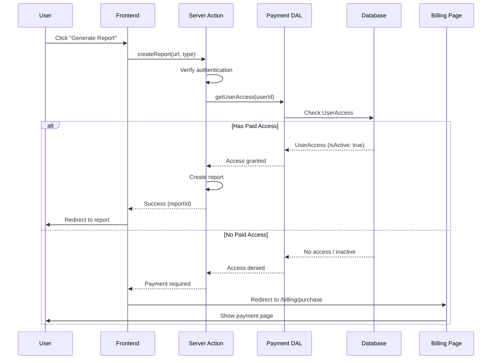
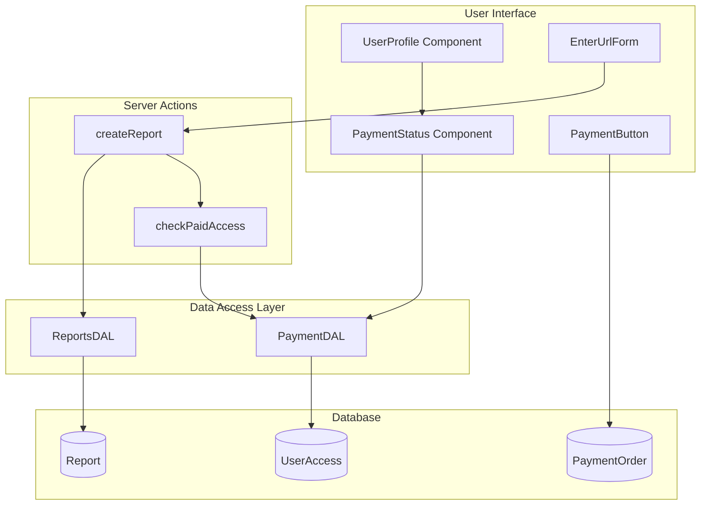
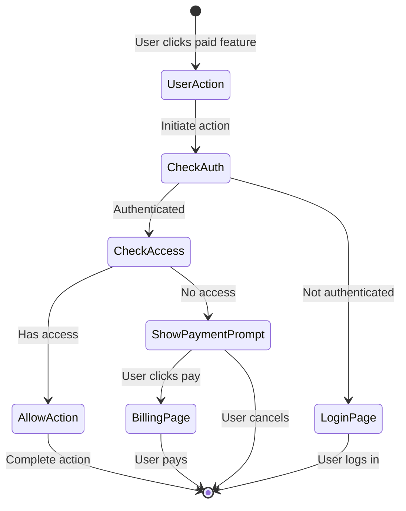

# ADR-005: Paid Access Control Implementation

**Status:** Proposed  
**Date:** 2025-01-03  
**Author:** Development Team  

## Context and Problem Statement

Following the successful implementation of YooKassa payment integration (ADR-004), we need to implement access control mechanisms to:
1. Block report generation for users without paid access
2. Display payment status in the user's personal account
3. Redirect users to the billing page when they attempt to use paid features without access

The system uses a one-time payment model where users pay 4,999₽ for lifetime access to all features.

## Decision

We will implement a comprehensive paid access control system that integrates seamlessly with the existing architecture, providing clear feedback to users about their access status and guiding them to purchase when needed.

## Architecture Overview

### Access Control Flow



### Component Architecture



## Implementation Details

### 1. Access Control in Report Generation

#### Update `src/actions/report.ts`
```typescript
"use server";

import { auth } from "~/server/auth";
import { ReportType } from "~/types/report";
import { redirect } from "next/navigation";
import { paymentDAL } from "~/dal/payment";
import { reportService } from "~/service/report-service";

export async function createReport(
  url: string, 
  type: ReportType = ReportType.SMART_AGENT
): Promise<CreateReportResult> {
  const session = await auth();
  
  if (!session?.user?.id) {
    redirect("/login");
  }

  // Check paid access
  const userAccess = await paymentDAL.getUserAccess(session.user.id);
  
  if (!userAccess?.isActive) {
    // Return payment required response
    return {
      success: false,
      error: "Payment required",
      requiresPayment: true,
      redirectUrl: "/billing/purchase?action=click_buy"
    };
  }

  // User has access, proceed with report creation
  return reportService.createReport(session.user.id, url, type);
}
```

#### Update `src/components/EnterUrlForm.tsx`
```typescript
const onSubmit = async (e: FormData) => {
  const url = e.get("url")?.toString();
  
  if (!url) {
    setError("URL is required");
    return;
  }

  setIsLoading(true);
  setError(null);

  try {
    const result = await createReport(url, selectedType);

    if (result.success && result.reportId) {
      router.push(`/report?reportId=${result.reportId}`);
    } else if (result.requiresPayment) {
      // Redirect to billing page with action parameter
      router.push(result.redirectUrl ?? "/billing/purchase?action=click_buy");
    } else {
      setError(result.error ?? 'Не удалось запустить анализ');
      setIsLoading(false);
    }
  } catch (error) {
    setError(error instanceof Error ? error.message : 'Произошла неизвестная ошибка');
    setIsLoading(false);
  }
};
```

### 2. Payment Status in Personal Account

#### Create `src/components/PaymentStatus.tsx`
```typescript
"use client";

import { type UserAccess } from "@prisma/client";
import { PaymentButton } from "~/components/payment/PaymentButton";
import clsx from "clsx";

interface PaymentStatusProps {
  userAccess: UserAccess | null;
  className?: string;
}

export function PaymentStatus({ userAccess, className }: PaymentStatusProps) {
  const hasAccess = userAccess?.isActive;

  return (
    <div className={clsx(
      "rounded-lg border p-4",
      hasAccess ? "border-green-500/50 bg-green-900/20" : "border-orange-500/50 bg-orange-900/20",
      className
    )}>
      <div className="flex items-center justify-between">
        <div>
          <h3 className="text-lg font-semibold text-white">
            Статус доступа
          </h3>
          <p className={clsx(
            "text-sm mt-1",
            hasAccess ? "text-green-400" : "text-orange-400"
          )}>
            {hasAccess 
              ? "✓ Полный доступ активен" 
              : "⚠ Требуется оплата для доступа к отчетам"}
          </p>
          {hasAccess && userAccess.accessGrantedAt && (
            <p className="text-xs text-gray-400 mt-2">
              Активирован: {new Date(userAccess.accessGrantedAt).toLocaleDateString('ru-RU')}
            </p>
          )}
        </div>
        
        {!hasAccess && (
          <PaymentButton className="ml-4 bg-orange-500 hover:bg-orange-600 text-white font-medium py-2 px-4 rounded-lg transition-colors">
            Получить доступ
          </PaymentButton>
        )}
      </div>
    </div>
  );
}
```

#### Update `src/app/me/page.tsx`
```typescript
import { redirect } from "next/navigation";
import { Inter } from "next/font/google";
import clsx from "clsx";
import { auth } from "~/server/auth";
import { paymentDAL } from "~/dal/payment";
import fontStyles from "~/common/styles/fonts.module.css";
import { getUserReportGroups } from "~/dal/reports";
import ReportList from "~/components/ReportList";
import UserProfile from "~/components/UserProfile";
import { PaymentStatus } from "~/components/PaymentStatus";

const inter = Inter({ subsets: ["latin"] });

export default async function ProfilePage() {
  const session = await auth();

  if (!session?.user) {
    redirect("/");
  }

  const { user } = session;
  
  // Fetch user access status
  const userAccess = await paymentDAL.getUserAccess(user.id);
  
  // Fetch user report groups
  const reportGroups = await getUserReportGroups(user.id);

  return (
    <div className={clsx("relative w-full flex flex-col min-h-screen pt-12", inter.className)}>
      <div className="container mx-auto px-4 py-8 pt-10 md:pt-[2%]">
        <UserProfile user={user} />
        
        {/* Payment Status Section */}
        <PaymentStatus userAccess={userAccess} className="mb-8" />

        <h2 className={clsx(fontStyles.lending_h2, "mb-6 relative text-left")}>
          Ваши UX/UI отчеты
          <span className="absolute bottom-0 left-0 h-1 w-full bg-orange-500"></span>
        </h2>

        {!userAccess?.isActive && reportGroups.length === 0 && (
          <div className="text-center py-12 bg-gray-800/50 rounded-lg border border-gray-700">
            <p className="text-gray-400 mb-4">
              Для создания отчетов необходим полный доступ
            </p>
            <PaymentButton className="bg-blue-600 hover:bg-blue-700 text-white font-medium py-2 px-6 rounded-lg transition-colors">
              Получить полный доступ за 4,999₽
            </PaymentButton>
          </div>
        )}

        <ReportList reportGroups={reportGroups} />
      </div>
    </div>
  );
}
```

### 3. Global Access Control Hook

#### Create `src/hooks/usePaidAccess.ts`
```typescript
"use client";

import { useEffect, useState } from "react";
import { useRouter } from "next/navigation";
import { useSession } from "next-auth/react";

interface UsePaidAccessOptions {
  redirectTo?: string;
  requireAuth?: boolean;
}

export function usePaidAccess(options: UsePaidAccessOptions = {}) {
  const { data: session, status } = useSession();
  const router = useRouter();
  const [hasAccess, setHasAccess] = useState<boolean | null>(null);
  const [loading, setLoading] = useState(true);

  const { 
    redirectTo = "/billing/purchase?action=click_buy",
    requireAuth = true 
  } = options;

  useEffect(() => {
    async function checkAccess() {
      if (status === "loading") return;

      if (requireAuth && !session) {
        router.push("/login");
        return;
      }

      if (session?.user?.id) {
        try {
          const response = await fetch("/api/user/access");
          const data = await response.json();
          
          setHasAccess(data.hasAccess);
          
          if (!data.hasAccess && redirectTo) {
            router.push(redirectTo);
          }
        } catch (error) {
          console.error("Failed to check access:", error);
          setHasAccess(false);
        }
      }
      
      setLoading(false);
    }

    void checkAccess();
  }, [session, status, redirectTo, requireAuth, router]);

  return { hasAccess, loading, session };
}
```

### 4. API Endpoint for Access Checking

#### Create `src/app/api/user/access/route.ts`
```typescript
import { NextResponse } from "next/server";
import { auth } from "~/server/auth";
import { paymentDAL } from "~/dal/payment";

export async function GET() {
  const session = await auth();
  
  if (!session?.user?.id) {
    return NextResponse.json({ hasAccess: false }, { status: 401 });
  }

  const userAccess = await paymentDAL.getUserAccess(session.user.id);
  
  return NextResponse.json({
    hasAccess: userAccess?.isActive ?? false,
    accessType: userAccess?.accessType,
    grantedAt: userAccess?.accessGrantedAt,
  });
}
```

### 5. Protected Page Wrapper

#### Create `src/components/RequirePaidAccess.tsx`
```typescript
"use client";

import { usePaidAccess } from "~/hooks/usePaidAccess";
import { PaymentButton } from "~/components/payment/PaymentButton";

interface RequirePaidAccessProps {
  children: React.ReactNode;
  fallback?: React.ReactNode;
  message?: string;
}

export function RequirePaidAccess({ 
  children, 
  fallback,
  message = "Эта функция требует полного доступа"
}: RequirePaidAccessProps) {
  const { hasAccess, loading } = usePaidAccess();

  if (loading) {
    return (
      <div className="flex items-center justify-center py-12">
        <div className="h-8 w-8 animate-spin rounded-full border-4 border-blue-600 border-t-transparent" />
      </div>
    );
  }

  if (!hasAccess) {
    return fallback ?? (
      <div className="text-center py-12 bg-gray-800/50 rounded-lg border border-gray-700">
        <p className="text-gray-300 mb-4">{message}</p>
        <PaymentButton className="bg-blue-600 hover:bg-blue-700 text-white font-medium py-2 px-6 rounded-lg transition-colors">
          Получить полный доступ за 4,999₽
        </PaymentButton>
      </div>
    );
  }

  return <>{children}</>;
}
```

## Database Schema (Already Implemented)

The required database schema is already in place from ADR-004:

```prisma
model UserAccess {
  id               String    @id @default(cuid())
  userId           String    @unique
  paymentOrderId   String    @unique
  accessGrantedAt  DateTime  @default(now())
  accessType       String    @default("lifetime")
  isActive         Boolean   @default(true)
  metadata         Json?     @db.JsonB
  
  user             User      @relation(fields: [userId], references: [id], onDelete: Cascade)
  paymentOrder     PaymentOrder @relation(fields: [paymentOrderId], references: [id])
}
```

## Security Considerations

1. **Server-Side Validation**: All access checks must be performed on the server side
2. **Session Verification**: Always verify user session before checking access
3. **Consistent Error Messages**: Don't reveal whether a user exists when access is denied
4. **Rate Limiting**: Implement rate limiting on access check endpoints
5. **Audit Trail**: Log all access attempts and denials for security monitoring

## Error Handling

### Access Denied Flow


## Testing Strategy

### Unit Tests
1. Test access control in report creation
2. Test payment status component rendering
3. Test redirect behavior when access is denied

### Integration Tests
1. Test full flow from action attempt to billing redirect
2. Test access grant after successful payment
3. Test access revocation scenarios

### E2E Tests
1. Test user journey from signup to payment to report creation
2. Test various payment failure scenarios
3. Test access persistence across sessions

## Migration Plan

1. **Phase 1**: Deploy access control without enforcement
   - Log access attempts but allow all actions
   - Monitor for issues

2. **Phase 2**: Enable soft enforcement
   - Show warnings but allow access
   - Collect user feedback

3. **Phase 3**: Full enforcement
   - Block access for non-paying users
   - Monitor conversion rates

## Monitoring and Analytics

Track the following metrics:
- Conversion rate from access denied to payment
- Drop-off rate at payment prompt
- Time from first access denial to payment
- Most common features triggering payment prompt

## Future Enhancements

1. **Free Trial Period**
   - Allow X free reports before requiring payment
   - Time-based trial (e.g., 7 days)

2. **Tiered Access**
   - Different access levels for different prices
   - Feature-specific pricing

3. **Referral System**
   - Grant temporary access for successful referrals
   - Discount codes for referred users

4. **Grace Period**
   - Allow brief access after payment failure
   - Send reminder emails before revoking access

## References

- [ADR-004: YooKassa Payment Integration](./04.%20YooKassa%20Payment%20Integration.md)
- [Next.js Authentication Guide](https://nextjs.org/docs/authentication)
- [React Server Components Best Practices](https://nextjs.org/docs/app/building-your-application/rendering/server-components)
