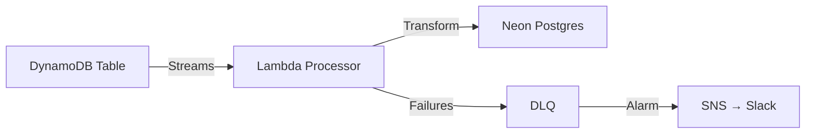

# ADR-0003: Postgres Replica Purpose and Scope

**Status**: Accepted
**Date**: 2025-11-21
**Deciders**: Principal Architect, CTO
**Related ADRs**: ADR-0002 (DynamoDB Primary Store)

---

## Context

PrintXpress uses DynamoDB as the primary (source of truth) data store for all writes and transactional reads. However, DynamoDB's single-table design makes certain queries difficult or impossible:

**Limitations of DynamoDB for Analytics**:
- **No SQL joins**: Cannot query across entities (e.g., "total revenue per seller")
- **Limited aggregations**: No native SUM, AVG, COUNT across partitions
- **No complex filtering**: Cannot filter by multiple conditions efficiently
- **Scan operations expensive**: Full table scans cost $0.25 per 1M reads

**Use Cases Requiring Relational Queries**:
1. **Admin Dashboard**: Total GMV, active sellers count, orders by status
2. **Seller Analytics**: Revenue per product, conversion funnel, top customers
3. **Reporting**: Monthly revenue reports, seller payouts summary
4. **Search**: Full-text search on product titles/descriptions

**Alternative Considered**: Query DynamoDB directly with Scan operations
- **Cost**: $25/month at 10K orders (acceptable)
- **Latency**: 500ms-2s for full table scans (unacceptable for dashboards)
- **Complexity**: Application code must aggregate in-memory

---

## Decision

**Replicate DynamoDB data to a Postgres database (Neon) for analytics, complex queries, and search.**

**Replication Method**: DynamoDB Streams → Lambda processor → Postgres (eventual consistency)

**Scope of Replica**:
- **Read-only**: Postgres never receives writes directly (DynamoDB is source of truth)
- **Analytics queries only**: Dashboards, reports, search
- **Eventual consistency**: 100-500ms lag acceptable (not real-time)

**Not a Replacement**: DynamoDB remains primary for all transactional operations (cart, checkout, order creation)

---

## Rationale

### Why Postgres Over Other Options?

| Option | Pros | Cons | Cost (1K orders/mo) |
|--------|------|------|---------------------|
| **Postgres Replica (Neon)** | SQL joins, low cost, AWS-compatible | Eventual consistency | $15/mo |
| **Redshift** | Optimized for analytics | Overkill for MVP, $50/mo minimum | $50/mo |
| **Athena (S3 + Parquet)** | Serverless, cheap for infrequent queries | Slow (seconds), no real-time | $5/mo |
| **OpenSearch** | Best for search, real-time | $30-50/mo, operational overhead | $40/mo |

**Why Neon Postgres**:
1. **Cost**: $15/month for serverless Postgres (vs $43/month for Aurora Serverless v2)
2. **Simplicity**: Standard Postgres (no proprietary query language)
3. **Tooling**: Supports Prisma, Postgres extensions (pg_trgm for search)
4. **Serverless**: Scales to zero when idle (no queries = $0)

### Why Eventual Consistency is Acceptable

**Acceptable Lag**: 100-500ms (p95) from DynamoDB write → Postgres availability

**Impact Analysis**:
- **Admin Dashboard**: Viewing GMV 500ms stale is acceptable (not transactional)
- **Seller Analytics**: Revenue charts don't need millisecond freshness
- **Search**: Product catalog changes infrequent (search results 500ms stale acceptable)

**Not Acceptable For** (use DynamoDB instead):
- ❌ Cart validation (must read latest cart state)
- ❌ Checkout (must read latest order status)
- ❌ Inventory checks (if added in Phase 2)

---

## Implementation Details

### Replication Architecture



### Replication Pipeline

**1. DynamoDB Streams Configuration**:
```yaml
StreamSpecification:
  StreamViewType: NEW_AND_OLD_IMAGES
```

**2. Lambda Processor**:
- **Trigger**: DynamoDB Stream (batch size: 100 records)
- **Function**: Transform DynamoDB record → Postgres INSERT/UPDATE/DELETE
- **Idempotency**: Use DynamoDB `eventID` as deduplication key
- **Error Handling**: Retry 3x → DLQ → CloudWatch Alarm

**3. Transformation Logic**:

Example: DynamoDB Product record → Postgres INSERT
```javascript
// DynamoDB Stream Record
{
  eventName: "INSERT",
  dynamodb: {
    NewImage: {
      PK: "M#merchant123",
      SK: "PRD#shop456#product789",
      title: "Cool T-Shirt",
      price: 29.99,
      shopId: "shop456"
    }
  }
}

// Transformed to Postgres INSERT
INSERT INTO products (id, shop_id, title, price, created_at)
VALUES ('product789', 'shop456', 'Cool T-Shirt', 29.99, NOW())
ON CONFLICT (id) DO UPDATE SET
  title = EXCLUDED.title,
  price = EXCLUDED.price,
  updated_at = NOW();
```

### Schema Mapping

DynamoDB single-table → Postgres normalized tables:

| DynamoDB PK/SK | Postgres Table | Mapping |
|----------------|----------------|---------|
| `M#{merchantId}` | `merchants` | Extract merchantId from PK |
| `M#{merchantId}/SHOP#{shopId}` | `shops` | Extract shopId from SK |
| `M#{merchantId}/PRD#{shopId}#{productId}` | `products` | Extract productId from SK |
| `U#{userId}/CART#{shopId}` | `carts` | Extract userId, shopId |
| `O#{orderId}/METADATA` | `orders` | Extract orderId from PK |

**Replication Mapping Table** (DynamoDB → Postgres):
Stored in `plan/architecture/data-stores.md`, Section: "Replication Mapping"

---

## Consequences

### Positive

✅ **Complex Queries Enabled**: Admin/seller dashboards can run SQL joins without custom aggregation logic

✅ **Cost-Effective Analytics**: $15/month Postgres vs $50/month Redshift or in-memory aggregations

✅ **Full-Text Search**: Postgres `pg_trgm` extension for search (no OpenSearch needed)

✅ **Standard SQL**: Team doesn't need to learn DynamoDB query patterns for analytics

✅ **Scalability**: Postgres can scale to millions of records (10K orders/month = 100K records/year)

### Negative

⚠️ **Eventual Consistency**: Analytics queries may see stale data (100-500ms lag)

**Impact**: Dashboards show slightly outdated metrics (acceptable for non-transactional use cases)

**Mitigation**: Document which queries use DynamoDB (real-time) vs Postgres (eventual)

⚠️ **Operational Overhead**: Must monitor replication lag, DLQ failures

**Impact**: ~1 hour/week monitoring (CloudWatch dashboards, DLQ alarms)

**Mitigation**: Automated alerts (SNS → Slack), runbooks for common failures

⚠️ **Data Duplication**: Same data stored in DynamoDB + Postgres

**Impact**: Postgres adds $15/month cost (10% of total infrastructure)

**Mitigation**: Acceptable cost for analytics capability (vs $50/month alternatives)

⚠️ **Schema Synchronization**: Changes to DynamoDB schema require Lambda replication logic updates

**Impact**: Schema changes take 2x effort (update DynamoDB + replication pipeline)

**Mitigation**: Version Lambda transformation logic, test in staging first

---

## Replication Lag SLOs

### Target Latency

| Metric | Target | Measurement |
|--------|--------|-------------|
| **p50 Replication Lag** | <100ms | ApproximateCreationDateTime (DynamoDB Stream) vs Postgres INSERT timestamp |
| **p95 Replication Lag** | <500ms | Same as above |
| **p99 Replication Lag** | <2s | Same as above |

### Monitoring

**CloudWatch Metrics**:
- `ReplicationLag` (custom metric): Time from DynamoDB write → Postgres availability
- `StreamProcessorDuration` (Lambda): Lambda execution time (target: <1s)
- `DLQMessageCount` (SQS): Failed replication events (target: 0)

**Alarms**:
- **Critical**: `DLQMessageCount > 0` → SNS → Slack #alerts
- **Warning**: `ReplicationLag p95 > 2s` → SNS → Slack #monitoring

---

## Failure Scenarios & Mitigations

### Scenario 1: Lambda Processor Fails

**Cause**: Bug in transformation logic, Postgres connection timeout, network issue

**Impact**: DynamoDB Stream records accumulate (backlog), replication lag increases

**Mitigation**:
1. **Retry**: Lambda retries 3 times (exponential backoff: 1s, 3s, 9s)
2. **DLQ**: After 3 failures → Dead Letter Queue (SQS)
3. **Alarm**: DLQ message count >0 → SNS notification
4. **Runbook**: Developer investigates DLQ messages, fixes bug, replays failed events

**Recovery Time**: <1 hour (manual intervention)

---

### Scenario 2: Postgres Database Unavailable

**Cause**: Neon maintenance, database crash, network partition

**Impact**: All replication stops, lag increases to minutes

**Mitigation**:
1. **Automatic Retry**: Lambda retries with exponential backoff (up to 5 minutes)
2. **DynamoDB Streams Retention**: 24 hours (events not lost if Postgres down <24 hours)
3. **Graceful Degradation**: Application falls back to DynamoDB for critical queries
4. **Alarm**: Replication lag >10s → SNS notification

**Recovery Time**: Automatic (Neon auto-recovers), or <30 minutes manual failover

---

### Scenario 3: Schema Drift (DynamoDB vs Postgres)

**Cause**: DynamoDB schema updated, Lambda transformation logic not updated

**Impact**: Replication fails (missing columns, type mismatch), events go to DLQ

**Mitigation**:
1. **Staging Environment**: Test schema changes in staging before production
2. **Backward Compatibility**: Add new columns with `DEFAULT NULL` (Postgres)
3. **Versioned Transformations**: Lambda checks DynamoDB record version, applies correct transformation
4. **Manual Reconciliation**: After schema migration, run one-time backfill script

**Prevention**: Schema changes reviewed by architect (mandatory ADR update)

---

## Query Routing Rules

### Use DynamoDB (Primary) For:

✅ **Transactional Reads** (strong consistency required):
- Get cart by userId + shopId
- Get order by orderId
- Validate checkout (cart existence, user session)

✅ **Writes** (always write to source of truth):
- Create/update cart
- Create order
- Update order status

### Use Postgres (Replica) For:

✅ **Analytics Queries** (eventual consistency acceptable):
- Total GMV: `SELECT SUM(total) FROM orders WHERE status = 'COMPLETED'`
- Active sellers: `SELECT COUNT(DISTINCT merchant_id) FROM shops WHERE status = 'ACTIVE'`
- Orders by status: `SELECT status, COUNT(*) FROM orders GROUP BY status`

✅ **Complex Joins**:
- Seller revenue by product: `SELECT p.title, SUM(oi.price * oi.quantity) FROM products p JOIN order_items oi ON p.id = oi.product_id WHERE p.shop_id = ? GROUP BY p.id`

✅ **Full-Text Search**:
- Product search: `SELECT * FROM products WHERE to_tsvector(title || ' ' || description) @@ to_tsquery(?)`

---

## Cost Breakdown

### Neon Postgres (Serverless)

**Free Tier**: 10 GB storage, 1 GB RAM, 100 compute hours/month
**Paid Tier**: $15/month (autoscale to 4 GB RAM, unlimited compute hours)

### Replication Cost

**DynamoDB Streams**: Free (included in DynamoDB pricing)
**Lambda Executions**: $0.20 per 1M requests
- **Volume**: 10K orders/month × 5 writes/order = 50K Lambda invocations/month
- **Cost**: $0.01/month (negligible)

**Total Replication Cost**: $15/month (Neon) + $0.01/month (Lambda) = **$15.01/month**

### Comparison

| Scenario | DynamoDB Only (Scan) | DynamoDB + Postgres Replica |
|----------|----------------------|-----------------------------|
| **Analytics Latency** | 500ms-2s (slow) | 10-50ms (fast) |
| **Monthly Cost** | $25/month (DynamoDB) | $25 (DynamoDB) + $15 (Postgres) = $40/month |
| **Developer Productivity** | Custom aggregation code | Standard SQL queries |

**Trade-off**: Pay $15/month extra for 10x faster analytics and standard SQL

**Decision**: Acceptable cost for 10x productivity gain

---

## Migration Path (If Needed)

### Scenario: Postgres Costs Exceed Budget

**Trigger**: Neon costs >$50/month (e.g., 100K orders/month, complex analytics)

**Alternative**: Migrate to Redshift Spectrum (S3 + Parquet) for analytics

**Steps**:
1. Export Postgres to S3 (Parquet format)
2. Update analytics queries to use Athena (SQL on S3)
3. Decommission Neon Postgres
4. Replication pipeline: DynamoDB Streams → Lambda → S3 (Parquet)

**Cost Impact**: Redshift Spectrum $5-10/month (vs Neon $50/month)

**Effort**: 2-3 weeks

**Probability**: Low (10%) — Neon pricing scales well to 100K orders/month

---

## Validation

### Success Metrics (Month 3 - MVP Launch)

| Metric | Target | Actual | Status |
|--------|--------|--------|--------|
| Replication lag (p95) | <500ms | _TBD_ | _Pending_ |
| Replication success rate | >99% | _TBD_ | _Pending_ |
| DLQ message count | 0 | _TBD_ | _Pending_ |
| Analytics query latency (p95) | <100ms | _TBD_ | _Pending_ |
| Postgres cost | <$20 | _TBD_ | _Pending_ |

**Review Date**: Sprint 6 (Week 12) - MVP Launch

---

## References

- [DynamoDB Streams Documentation](https://docs.aws.amazon.com/amazondynamodb/latest/developerguide/Streams.html)
- [Neon Postgres Pricing](https://neon.tech/pricing)
- [Lambda Event Source Mapping](https://docs.aws.amazon.com/lambda/latest/dg/invocation-eventsourcemapping.html)
- [Postgres Full-Text Search](https://www.postgresql.org/docs/current/textsearch.html)

---

## Version History

| Version | Date | Changes |
|---------|------|---------|
| 1.0 | 2025-11-21 | Initial ADR: Postgres replica purpose, replication pipeline, query routing rules |

---

**Status**: ✅ Accepted
**Supersedes**: None (clarifies ADR-0002 DynamoDB decision)
**Superseded By**: None (current)
