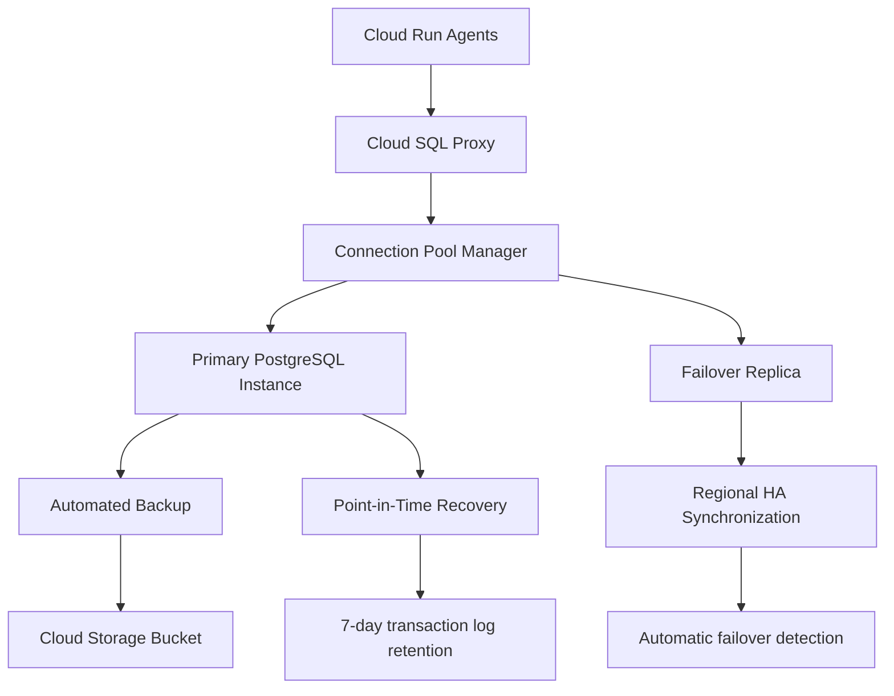

# ADR-003: Cloud SQL PostgreSQL Transactional Database
@requirement:[EARS-REQ-DB-001](../ears/EARS-REQ-DB-001_transactional_state.md)
@prd:[PRD-INF-003](../prd/PRD-INF-003_operational_database.md)
@sys:[SYS-INF-003](../sys/SYS-INF-003_postgresql_architecture.md)
@contract:[CTR-003_CLOUD_SQL](../../../specs/contracts/CTR-003_CLOUD_SQL.md)

## Status
**Status**: Accepted
**Date**: 2025-10-24
**Decision Makers**: [Infrastructure Team, Data Engineering]
**ADR Author**: [Cline AI Assistant]
**Last Updated**: 2025-10-24

## Context

### Problem Statement
The options trading system requires transactional state management for 11 autonomous agents with ACID guarantees, high availability, and sub-second query performance while supporting complex trading state transitions and audit requirements.

### Background
Distributed agents need centralized state coordination to prevent data inconsistencies. Traditional databases introduce scaling limitations, while NoSQL databases lack transactional guarantees required for financial operations.

### Driving Forces
- ACID transactions for reliable trading state management
- Sub-second query performance for real-time trading decisions
- Complete audit trails meeting SOC 2 compliance requirements
- Regional high availability with point-in-time recovery

### Constraints
- **Performance**: <10ms query latency, 99.9th percentile <50ms
- **Reliability**: 99.99% uptime with 7-day point-in-time recovery
- **Consistency**: ACID compliance for all trading state operations
- **Capacity**: Support millions of positions and orders per month

## Decision

### Chosen Solution
Implement Cloud SQL PostgreSQL 15 with high availability and automated backups for transactional state:

**Architecture**: Regional HA with automated failover between availability zones
**Schema Design**: Normalized relational schema with optimized indexing strategy
**Connection Management**: Cloud SQL Proxy with connection pooling for all agents
**Backup Strategy**: Daily snapshots with 30-day retention and PITR window

### Key Components
- **Trading Sessions**: Session state management with status tracking
- **Portfolio Positions**: Real-time position data with Greeks snapshots
- **Orders Table**: Complete order lifecycle tracking and execution details
- **Risk Limits**: Dynamic risk parameter configuration with versioning

### Implementation Approach
- PostgreSQL 15 with performance-optimized configuration
- Automated backups with multi-region failover capability
- Connection pooling at application layer with prepared statements
- Row-level security for multi-tenant agent isolation

## Requirements Satisfied

### Primary Requirements

| Requirement ID | Description | How This Decision Satisfies It |
|----------------|-------------|-------------------------------|
| EARS-REQ-DB-001 | Transactional State Management | ACID PostgreSQL guarantees |
| PRD-INF-003 | Operational Database Design | Relational schema optimization |
| SYS-INF-003 | High Availability Database | Regional HA with automated failover |
| CTR-003 | Cloud SQL Service Contracts | Connection pooling and performance SLAs |

### Non-Functional Requirements
- **Performance**: Optimized queries with sub-second response times
- **Reliability**: 99.99% uptime with comprehensive disaster recovery
- **Security**: Encrypted connections and row-level security controls
- **Compliance**: Complete audit logging for regulatory requirements

## Consequences

### Positive Outcomes

**Data Integrity:**
- ACID transactions prevent inconsistent trading states
- Referential integrity maintains data relationships
- Audit logging enables complete transaction traceability

**Performance Benefits:**
- Optimized indexing provides sub-second query performance
- Connection pooling enables efficient resource utilization
- Prepared statements reduce query execution overhead

### Negative Outcomes

**Scaling Limitations:**
- Relational joins can become expensive with complex queries
- Vertical scaling constraints compared to NoSQL alternatives
- Connection limits may require careful management at scale

**Operational Complexity:**
- Schema migrations require careful planning and testing
- Backup and restore operations have service-level timing constraints

## Architecture Flow

## Implementation Assessment

### Complexity Evaluation
- **Overall Complexity**: Medium-High - Schema design and performance optimization
- **Development Effort**: 4-6 weeks for schema design, migration scripts, and testing
- **Operational Complexity**: Medium - Monitoring performance and managing backups

### Dependencies
- Google Cloud SQL service in target region
- Cloud Storage for automated backup storage
- Monitoring infrastructure for database performance metrics
- Application-specific connection pool implementations

### Resources
- **Compute Budget**: $400-600/month for db-custom-2-7680 instance
- **Storage Budget**: $200-400/month for 100GB SSD storage
- **Network Budget**: $100-200/month for cross-region replication
- **Backup Budget**: $50-100/month for daily snapshots retention

### Failure Modes & Recovery
- **Instance Failures**: Automatic failover to replica within 60 seconds
- **Storage Full**: Automated scaling and alert-driven capacity management
- **Connection Exhaustion**: Application-level connection pooling and monitoring
- **Data Corruption**: Point-in-time recovery from transaction logs

## Impact Analysis

### Affected Components
- **Direct Impact**: All agents requiring transactional state operations
- **Data Models**: Core entity definitions for trading sessions, positions, orders
- **Migration Scripts**: Database schema evolution procedures
- **Connection Management**: Proxy configuration and pooling strategies

### Migration Strategy
- **Phase 1**: Schema design and initial table creation
- **Phase 2**: Connection proxy deployment and testing
- **Phase 3**: Backup and recovery procedure validation
- **Phase 4**: Performance testing and production monitoring setup

### Testing Requirements
- **Schema Tests**: Referential integrity and constraint validation
- **Performance Tests**: Query optimization and connection pooling efficiency
- **Reliability Tests**: Failover scenarios and recovery procedures
- **Security Tests**: Row-level security and access control validation

## Security

### Data Protection
- Data at rest encrypted with customer-managed keys
- Network encryption using TLS 1.3 for all connections
- VPC Service Controls perimeter for data loss prevention

### Access Control
- Service account authentication through Cloud SQL proxy
- Row-level security for multi-agent data isolation
- Fine-grained database permissions with least privilege principle

### Compliance
- Complete audit logging for all database operations
- 30-day backup retention for compliance requirements
- Encryption key rotation according to security policies

## Traceability

### Upstream Sources
- **Database Requirements**: ../../../docs/architecture/gcp_infrastructure_architecture.md
- **Transactional Needs**: ../../../docs/architecture/option_strategy_architecture.md
- **Performance Targets**: Sub-second latency for trading state queries

### Downstream Artifacts
- **Database Schema**: DDL scripts for all tables, indexes, and constraints
- **Migration Scripts**: Database versioning and migration procedures
- **Connection Libraries**: Python connection pooling implementations
- **Monitoring Dashboards**: Database performance and health metrics

### Validation Artifacts
- **Performance Benchmarks**: Query latency and throughput measurements
- **Reliability Tests**: HA failover and recovery time validation
- **Security Assessments**: Penetration testing and access control audits

## Related Decisions

**Depends On**:
- ADR-005: Terraform Infrastructure as Code
- ADR-006: VPC Service Controls Security

**Supersedes**: NoSQL databases for transactional requirements
**Related**:
- ADR-004: BigQuery Analytics Warehouse
- ADR-007: Workload Identity IAM
- ADR-010: Cloud Monitoring Observability

---

**Template Version**: 1.0
**Last Reviewed**: 2025-10-24
**Next Review**: 2025-12-24
