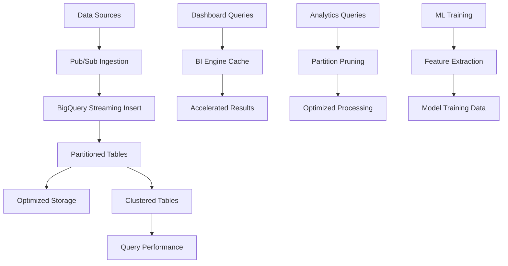

# ADR-004: BigQuery Analytics Warehouse
@requirement:[EARS-REQ-DW-001](../ears/EARS-REQ-DW-001_analytics_data_layer.md)
@prd:[PRD-INF-004](../prd/PRD-INF-004_analytics_warehouse.md)
@sys:[SYS-INF-004](../sys/SYS-INF-004_bigquery_architecture.md)
@contract:[CTR-004_BIGQUERY](../../../specs/contracts/CTR-004_BIGQUERY.md)

## Status
**Status**: Accepted
**Date**: 2025-10-24
**Decision Makers**: [Data Engineering Team]
**ADR Author**: [Cline AI Assistant]
**Last Updated**: 2025-10-24

## Context

### Problem Statement
The options trading system requires high-performance analytical data warehouse capable of processing millions of market data records, ML feature vectors, and trading telemetry with sub-second query performance while maintaining cost efficiency for complex analytical workloads.

### Background
Traditional data warehouses are expensive and slow to scale, while cloud data warehouses often compromise on performance or cost. The system needs serverless analytical capabilities with petabyte-scale capacity and intelligent cost optimization.

### Driving Forces
- Petabyte-scale analytical processing for backtesting and ML training
- Sub-second query performance for real-time trading insights
- Cost-efficient storage and compute with automatic scaling
- Unified analytics platform for all trading data types

### Constraints
- **Performance**: <1 second analytical queries, <10 seconds complex ML aggregations
- **Cost**: $<1/TB/month storage with compute auto-scaling
- **Scale**: Support billions of market data rows and ML feature vectors
- **Reliability**: 99.999% availability with automatic disaster recovery

## Decision

### Chosen Solution
Implement BigQuery as the analytics warehouse with partitioned/clustered tables and intelligent storage optimization:

**Table Partitioning**: INGESTION_TIME partitioned for time-series data
**Clustering**: Symbol-based clustering for market data query optimization
**Storage Classes**: Automatic tiering for cost-optimized lifecycle management
**Performance Optimization**: BI Engine for dashboard acceleration and caching

### Key Components
- **Market Data Tables**: Historical prices, options chains, volume data
- **Backtest Results**: Strategy performance validation and simulation results
- **Agent Telemetry**: Logs, metrics, and traces for ML training pipelines
- **ML Features**: Pre-computed feature vectors for predictive modeling

### Implementation Approach
- Ingestion-time partitioning for all time-series analytical data
- Optimized clustering keys for common query patterns
- Scheduled data lifecycle policies for cost control
- BI Engine caching for dashboard and reporting acceleration

## Requirements Satisfied

### Primary Requirements

| Requirement ID | Description | How This Decision Satisfies It |
|----------------|-------------|-------------------------------|
| EARS-REQ-DW-001 | Analytical Data Processing | BigQuery columnar query engine |
| PRD-INF-004 | Analytics Warehouse Architecture | Partitioned/clustered table design |
| SYS-INF-004 | High-Performance Analytics | BI Engine acceleration and optimization |
| CTR-004 | BigQuery Service Contracts | Query performance and data freshness SLAs |

### Non-Functional Requirements
- **Performance**: Sub-second analytical queries with intelligent caching
- **Scalability**: Auto-scaling compute with virtually unlimited storage capacity
- **Cost Efficiency**: Pay-per-query model with automatic storage tiering
- **Reliability**: Multi-region replication with comprehensive disaster recovery

## Consequences

### Positive Outcomes

**Performance Benefits:**
- Columnar storage provides fast analytical query performance
- BI Engine caching accelerates dashboard and reporting loads
- Auto-scaling compute handles peak analytical workloads
- Partition pruning optimizes large dataset queries

**Cost Optimization:**
- Pay-for-use compute model with automatic scaling
- Intelligent storage tiering reduces long-term retention costs
- Query optimization minimizes compute resource consumption

### Negative Outcomes

**Cost Complexity:**
- Complex queries can become expensive without proper optimization
- Storage costs grow linearly with data volume
- BI Engine caching adds additional cost layer for high-demand dashboards

**Data Management:**
- Time-to-availability for new data requires ingestion optimization
- Schema evolution requires careful planning to avoid performance degradation

## Architecture Flow

## Implementation Assessment

### Complexity Evaluation
- **Overall Complexity**: Medium - Query optimization and partitioning design
- **Development Effort**: 3-4 weeks for table design, ingestion pipelines, and optimization
- **Operational Complexity**: Low-Medium - Cost monitoring and query performance tracking

### Dependencies
- BigQuery service enabled in target region
- Pub/Sub integration for streaming data ingestion
- BI Engine activation for performance acceleration
- Cost management tools for budget tracking and optimization

### Resources
- **Storage Budget**: $100-300/month for TB-scale data with tiering
- **Query Budget**: $200-500/month for analytical workloads
- **Streaming Budget**: $50-150/month for real-time data ingestion
- **BI Engine Budget**: $100-200/month for dashboard acceleration

### Failure Modes & Recovery
- **Query Timeouts**: Automatic query retry with exponential backoff
- **Storage Quotas**: Automated alerting and data lifecycle management
- **Ingestion Failures**: Dead letter queues with replay capabilities
- **Regional Outages**: Cross-region replication with automatic failover

## Impact Analysis

### Affected Components
- **Direct Impact**: All analytical workloads and reporting systems
- **Data Pipelines**: Ingestion workflows for market data and telemetry
- **Analytics Tools**: Business intelligence and ML training pipelines
- **Monitoring**: Query performance and cost optimization dashboards

### Migration Strategy
- **Phase 1**: Schema design and table partitioning strategy
- **Phase 2**: Data ingestion pipeline development and testing
- **Phase 3**: Query optimization and performance tuning
- **Phase 4**: BI Engine configuration and dashboard migration

### Testing Requirements
- **Ingestion Tests**: Data pipeline reliability and throughput validation
- **Query Tests**: Performance optimization and cost efficiency verification
- **Reliability Tests**: Regional failover and data recovery procedures
- **Integration Tests**: End-to-end analytical workflow validation

## Security

### Data Protection
- Data at rest encrypted with Google-managed keys
- Column-level encryption for sensitive trading data
- VPC Service Controls for data loss prevention perimeter

### Access Control
- Fine-grained IAM roles for dataset and table access
- Service account authentication for programmatic access
- Row-level security through dataset authorization patterns

### Compliance
- Complete audit logging for all query and data access operations
- Data retention policies compliant with regulatory requirements
- Encryption key management with automatic rotation

## Traceability

### Upstream Sources
- **Analytics Requirements**: ../../../docs/architecture/gcp_infrastructure_architecture.md
- **Data Processing Needs**: ../../../docs/architecture/option_strategy_architecture.md
- **Performance Targets**: Sub-second analytics for trading insights

### Downstream Artifacts
- **Table Schemas**: DDL definitions with partitioning and clustering
- **Ingestion Pipelines**: Data streaming and batch loading procedures
- **Query Libraries**: Optimized analytical query implementations
- **Cost Dashboards**: Usage monitoring and budget tracking views

### Validation Artifacts
- **Performance Benchmarks**: Query latency and throughput measurements
- **Cost Analysis**: Usage optimization and budget validation reports
- **Data Quality Tests**: Completeness, accuracy, and freshness validations

## Related Decisions

**Depends On**:
- ADR-002: Cloud Pub/Sub Event Architecture
- ADR-005: Terraform Infrastructure as Code

**Supersedes**: Traditional on-premises data warehouses
**Related**:
- ADR-003: Cloud SQL PostgreSQL Database
- ADR-021: Performance Analytics Agent
- ADR-010: Cloud Monitoring Observability

---

**Template Version**: 1.0
**Last Reviewed**: 2025-10-24
**Next Review**: 2025-12-24
