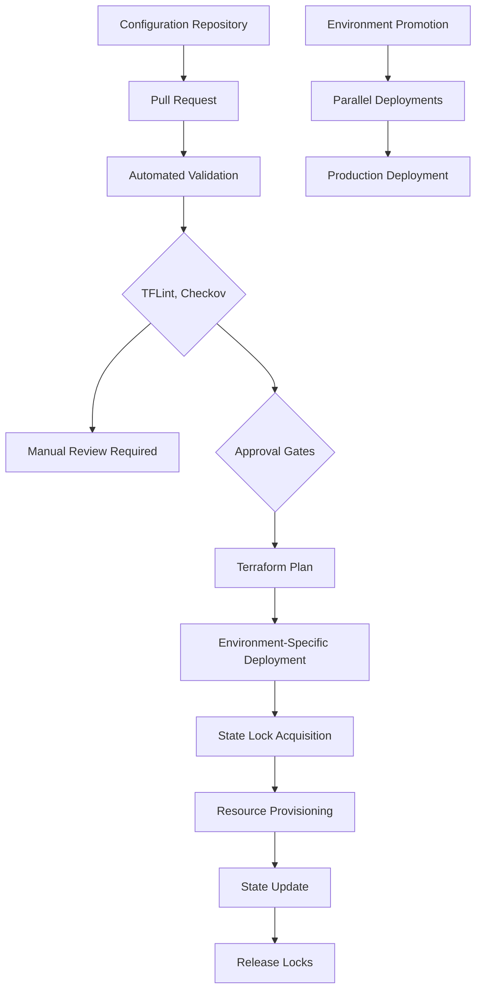

# ADR-005: Terraform Infrastructure as Code
@requirement:[EARS-REQ-IA-001](../ears/EARS-REQ-IA-001_infrastructure_automation.md)
@prd:[PRD-INF-005](../prd/PRD-INF-005_infrastructure_lifecycle.md)
@sys:[SYS-INF-005](../sys/SYS-INF-005_terraform_automation.md)
@contract:[CTR-005_TERRAFORM](../../../specs/contracts/CTR-005_TERRAFORM.md)

## Status
**Status**: Accepted
**Date**: 2025-10-24
**Decision Makers**: [DevOps Team, Cloud Engineering]
**ADR Author**: [Cline AI Assistant]
**Last Updated**: 2025-10-24

## Context

### Problem Statement
The multi-agent options trading system requires automated, version-controlled infrastructure provisioning with immutable deployments, multi-environment support, and zero-downtime updates while ensuring complete traceability of infrastructure changes.

### Background
Manual infrastructure management is error-prone and inconsistent across environments. Infrastructure drift and configuration inconsistencies can lead to production incidents and security vulnerabilities.

### Driving Forces
- Immutable infrastructure with version-controlled deployments
- Multi-environment consistency (development, staging, production)
- Zero-downtime deployments and automated rollbacks
- Complete infrastructure change traceability and auditing

### Constraints
- **Consistency**: Identical infrastructure across all environments
- **Reliability**: Terraform state locking prevents concurrent modifications
- **Security**: Infrastructure privileged access with least privilege controls
- **Performance**: Rapid provisioning while maintaining governance controls

## Decision

### Chosen Solution
Implement Terraform with remote state management and automated governance controls:

**State Management**: GCS-backed remote state with locking and versioning
**Module Architecture**: Reusable components for service-specific infrastructure
**Environment Configuration**: Hierarchical variable management with overrides
**Change Validation**: Automated linting, validation, and policy enforcement

### Key Components
- **Remote State**: GCS storage with state locking and multi-environment isolation
- **Reusability Modules**: Service-specific Terraform modules (Cloud Run, Pub/Sub, etc.)
- **Validation Checks**: TFLint, Checkov, and custom policy validation
- **Change Approval**: Automated PR-based deployment workflows

### Implementation Approach
- Hierarchical module structure with shared and service-specific components
- Remote state backends with environment-specific state buckets
- Automated validation pipelines with governance gates
- Service account-based Terraform execution with least privilege

## Requirements Satisfied

### Primary Requirements

| Requirement ID | Description | How This Decision Satisfies It |
|----------------|-------------|-------------------------------|
| EARS-REQ-IA-001 | Infrastructure Automation | Terraform declarative provisioning |
| PRD-INF-005 | Infrastructure Lifecycle Management | Version-controlled infrastructure |
| SYS-INF-005 | Terraform State Management | Remote GCS backend with locking |
| CTR-005 | Terraform Deployment Contracts | Module interfaces and validation requirements |

### Non-Functional Requirements
- **Reliability**: State locking prevents concurrent infrastructure changes
- **Consistency**: Reusable modules ensure environment parity
- **Security**: Least privilege execution and automated compliance validation
- **Maintainability**: Modular design enables component-level updates

## Consequences

### Positive Outcomes

**Operational Benefits:**
- Infrastructure changes versioned and peer-reviewed through Git
- Automated deployment pipelines reduce manual errors
- Reusable modules accelerate new environment provisioning
- State locking prevents conflicting infrastructure changes

**Governance Benefits:**
- Automated policy validation before deployment
- Complete audit trail of all infrastructure changes
- Cost optimization through automated resource management
- Security compliance enforced through infrastructure as code

### Negative Outcomes

**Learning Curve:**
- Complex module parameterization and variable hierarchy
- HCL language syntax and Terraform-specific patterns
- State manipulation complexity for advanced use cases

**Operational Overhead:**
- Remote state management adds dependency on Cloud Storage
- Module versioning requires careful change management
- Validation pipelines add deployment time complexity

## Architecture Flow

## Implementation Assessment

### Complexity Evaluation
- **Overall Complexity**: Medium-High - Module design and state management
- **Development Effort**: 6-8 weeks for module design, pipelines, and validation
- **Operational Complexity**: Medium - State management and module versioning

### Dependencies
- Google Cloud Storage for remote state backends
- GitHub Actions or Cloud Build for CI/CD pipelines
- Terraform Cloud or Enterprise for advanced governance features
- Policy validation tools (Checkov, OPA) for compliance enforcement

### Resources
- **Storage Budget**: $10-20/month for remote state versioning
- **Pipeline Budget**: Included in CI/CD platform costs
- **Compute Budget**: $50-100/month for validation pipeline execution
- **Training Budget**: Investment in Terraform expertise development

### Failure Modes & Recovery
- **State Corruption**: Point-in-time recovery from state history
- **Concurrent Modifications**: Locking prevents conflicting changes
- **Module Failures**: Rollback to previous working versions
- **Environment Drift**: Automated drift detection and remediation

## Impact Analysis

### Affected Components
- **Direct Impact**: All infrastructure provisioning and management
- **Development Workflow**: Infrastructure development and testing processes
- **Deployment Process**: CI/CD pipelines and release management
- **Compliance**: Security and governance enforcement mechanisms

### Migration Strategy
- **Phase 1**: Terraform foundation and module architecture design
- **Phase 2**: Core service modules (Cloud Run, Pub/Sub, databases)
- **Phase 3**: Advanced modules (monitoring, security, networking)
- **Phase 4**: Pipeline automation and environment promotion setup

### Testing Requirements
- **Module Tests**: Unit testing of infrastructure module functionality
- **Integration Tests**: End-to-end infrastructure deployment validation
- **Policy Tests**: Compliance validation and security rule enforcement
- **Performance Tests**: Deployment time and resource utilization benchmarks

## Security

### Access Control
- Service account authentication with least privilege IAM roles
- Remote state encryption with customer-managed keys
- Audit logging for all Terraform operations

### Compliance Validation
- Infrastructure policy checks with Checkov and OPA
- Security group validation and network access control
- Encryption configuration and key management validation

### Change Management
- Pull-request based deployment reviews and approval workflows
- Automated vulnerability scanning for infrastructure components
- Compliance reporting and audit trail generation

## Traceability

### Upstream Sources
- **Infrastructure Requirements**: ../../../docs/architecture/gcp_infrastructure_architecture.md
- **Compliance Standards**: SOC 2 equivalent governance requirements
- **Scalability Needs**: Multi-environment infrastructure consistency

### Downstream Artifacts
- **Terraform Modules**: Service-specific infrastructure component definitions
- **Deployment Pipelines**: GitHub Actions workflows for automated provisioning
- **Validation Scripts**: Policy enforcement and compliance checking tools
- **State Management**: Remote backend configuration and access controls

### Validation Artifacts
- **Infrastructure Tests**: Module functionality and deployment validation
- **Compliance Reports**: Security and governance audit results
- **Performance Metrics**: Provisioning time and resource utilization data

## Related Decisions

**Depends On**: N/A - Foundational IaC decision
**Supersedes**: Manual infrastructure provisioning and configuration management
**Related**:
- ADR-001: GCP Cloud Run Deployment Architecture
- ADR-006: VPC Service Controls Security
- ADR-010: Cloud Monitoring Observability

---

**Template Version**: 1.0
**Last Reviewed**: 2025-10-24
**Next Review**: 2025-12-24
