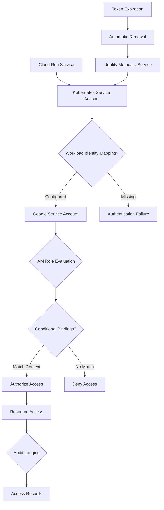

# ADR-007: Workload Identity IAM Architecture
@requirement:[EARS-REQ-IAM-001](../ears/EARS-REQ-IAM-001_service_account_authentication.md)
@prd:[PRD-INF-007](../prd/PRD-INF-007_least_privilege_iam.md)
@sys:[SYS-INF-007](../sys/SYS-INF-007_workload_identity_design.md)
@contract:[CTR-007_IAM_WORKLOAD_IDENTITY](../../../specs/contracts/CTR-007_IAM_WORKLOAD_IDENTITY.md)

## Status
**Status**: Accepted
**Date**: 2025-10-24
**Decision Makers**: [Identity & Access Management Team]
**ADR Author**: [Cline AI Assistant]
**Last Updated**: 2025-10-24

## Context

### Problem Statement
The multi-agent options trading system requires secure authentication and authorization that enables service-to-service communication while preventing credential compromise and enforcing least privilege access to sensitive trading data and operations.

### Background
Traditional service account keys present security risks through long-term credential exposure. Distributed agents require fine-grained access controls without compromising sensitive data security or operational workflows.

### Driving Forces
- Zero-trust security with ephemeral credential provisioning
- Prevention of credential compromise through short-lived tokens
- Fine-grained access controls for multi-agent trading operations
- Compliance with financial services security standards

### Constraints
- **Security**: Prevent permanent credential exposure and support auditability
- **Performance**: Minimal authentication latency for trading-critical operations
- **Complexity**: Simplified credential management without operational burden
- **Compliance**: Meet financial services audit and reporting requirements

## Decision

### Chosen Solution
Implement Workload Identity for secure, automated credential provisioning and fine-grained access control:

**Service Account Management**: Dedicated service accounts for each agent with minimal required permissions
**Workload Identity Federation**: Kubernetes service account to Google service account mapping
**Short-lived Token Provisioning**: Automated token renewal through identity metadata service
**Conditional Access**: Context-aware authorization based on service identity and request attributes

### Key Components
- **Agent Service Accounts**: Individual SA per agent (portfolio-orchestrator, strategy-agents, etc.)
- **Workload Identity Pools**: Federated identity mapping for Cloud Run services
- **Conditional Role Bindings**: Context-based permission grants
- **Credential Auditing**: Complete access logging for forensic analysis

### Implementation Approach
- Service account creation with least-privilege permissions aligned to agent responsibilities
- Workload identity configuration in Cloud Run service metadata
- Conditional IAM roles based on service labels and request context
- Automated audit logging integration with security information and event management

## Requirements Satisfied

### Primary Requirements

| Requirement ID | Description | How This Decision Satisfies It |
|----------------|-------------|-------------------------------|
| EARS-REQ-IAM-001 | Service Account Authentication | Workload identity federation |
| PRD-INF-007 | Least Privilege Access | Fine-grained permission assignments |
| SYS-INF-007 | Secure Credential Management | Short-lived token provisioning |
| CTR-007 | IAM Authorization Contracts | Conditional access and role definitions |

### Non-Functional Requirements
- **Security**: Zero permanent credential exposure with automatic token rotation
- **Performance**: Minimal authentication overhead through cached tokens
- **Auditability**: Complete access logging for compliance and investigation
- **Scalability**: Identity management scales with agent count without complexity

## Consequences

### Positive Outcomes

**Security Benefits:**
- Eliminates long-term credential exposure through ephemeral tokens
- Service account isolation prevents lateral movement between agents
- Fine-grained permissions reduce attack surface and data access risks

**Operational Benefits:**
- Automated token management reduces manual credential rotation overhead
- Clear service identity attribution enables precise audit trails
- Context-aware access controls support complex authorization scenarios

### Negative Outcomes

**Configuration Complexity:**
- Service account mapping requires careful namespace and identity configuration
- Permission assignments need continuous evaluation against agent responsibilities
- Conditional role bindings can become complex with growing access requirements

**Monitoring Requirements:**
- Token validation and renewal monitoring add to operational visibility needs
- Access pattern analysis required to detect anomalous authentication behavior
- Audit log volume increases with frequent token-based operations

## Architecture Flow

## Implementation Assessment

### Complexity Evaluation
- **Overall Complexity**: Medium - Identity mapping and role configuration
- **Development Effort**: 3-4 weeks for service account design and workload identity setup
- **Operational Complexity**: Medium - Permission management and audit monitoring

### Dependencies
- Google Kubernetes Engine or Cloud Run service identity
- Identity and Access Management (IAM) service enabled
- Security monitoring and logging infrastructure
- Conditional role binding configuration capabilities

### Resources
- **IAM Management Budget**: $50-75/month for service account and role maintenance
- **Security Monitoring Budget**: Audit log storage and analysis costs
- **Consulting Budget**: IAM design and security expertise for initial setup
- **Development Budget**: Time for permission design and testing

### Failure Modes & Recovery
- **Identity Mapping Failures**: Service startup validation with fallback authentication
- **Token Generation Issues**: Metadata service monitoring with renewal alerting
- **Permission Evaluation Errors**: Gradual rollout with fallback to restrictive permissions
- **Role Binding Conflicts**: Automated policy conflict detection and resolution

## Impact Analysis

### Affected Components
- **Direct Impact**: All Cloud Run agents require workload identity configuration
- **Authentication Flow**: Service-to-service communication through identity tokens
- **Access Control**: Resource authorization through conditional IAM roles
- **Security Monitoring**: Audit log integration for identity-related events

### Migration Strategy
- **Phase 1**: Service account design and permission baseline establishment
- **Phase 2**: Workload identity federation configuration and testing
- **Phase 3**: Conditional role binding implementation and validation
- **Phase 4**: Production deployment with monitoring and audit integration

### Testing Requirements
- **Authentication Tests**: Token validation and renewal functionality
- **Authorization Tests**: Conditional access control validation across scenarios
- **Security Tests**: Service account isolation and least privilege verification
- **Integration Tests**: End-to-end identity flow through all agent interactions

## Security

### Authentication Security
- Service account authentication through Workload Identity federation
- Short-lived tokens generated from metadata service eliminate long-term exposure
- Token validation includes audience restrictions and expiration controls

### Authorization Security
- Least privilege permissions assigned based on validated agent responsibilities
- Conditional role bindings provide context-aware access controls
- Service account isolation prevents cross-agent credential compromise

### Audit and Monitoring
- Complete audit logging for all authentication and authorization events
- Real-time monitoring of token usage patterns and unusual access attempts
- Integration with security incident response processes

## Traceability

### Upstream Sources
- **Security Requirements**: ../../../docs/architecture/gcp_infrastructure_architecture.md
- **Compliance Standards**: Financial services authentication and authorization requirements
- **Identity Management**: Secure credential handling for distributed systems

### Downstream Artifacts
- **Service Accounts**: Individual agent service account configurations and permissions
- **Workload Identity**: Kubernetes service account to Google service account mappings
- **IAM Policies**: Conditional role bindings and access control definitions
- **Audit Integration**: Security event logging and monitoring configurations

### Validation Artifacts
- **Security Assessments**: Identity and access management audit results
- **Compliance Reports**: Authentication and authorization compliance validation
- **Penetration Tests**: Service account compromise and privilege escalation validation

## Related Decisions

**Depends On**: N/A - Foundational identity management decision
**Supersedes**: Traditional service account key management
**Related**:
- ADR-006: VPC Service Controls Security Architecture
- ADR-008: Secret Manager Configuration
- ADR-041: Defense-in-Depth Security Architecture

---

**Template Version**: 1.0
**Last Reviewed**: 2025-10-24
**Next Review**: 2025-12-24
