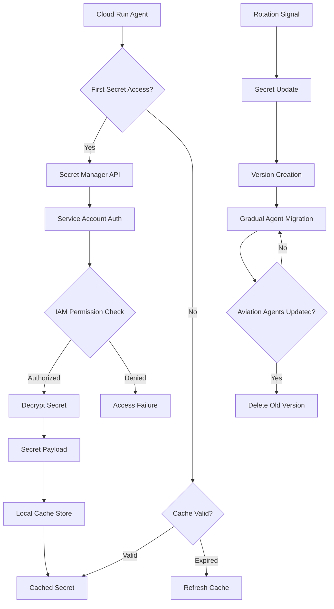

# ADR-008: Secret Manager Configuration Architecture
@requirement:[EARS-REQ-SEC-002](../ears/EARS-REQ-SEC-002_secret_management.md)
@prd:[PRD-INF-008](../prd/PRD-INF-008_credential_management.md)
@sys:[SYS-INF-008](../sys/SYS-INF-008_secret_manager_design.md)
@contract:[CTR-008_SECRET_MANAGER](../../../specs/contracts/CTR-008_SECRET_MANAGER.md)

## Status
**Status**: Accepted
**Date**: 2025-10-24
**Decision Makers**: [Security Engineering Team]
**ADR Author**: [Cline AI Assistant]
**Last Updated**: 2025-10-24

## Context

### Problem Statement
The multi-agent options trading system requires secure management of sensitive credentials, API keys, and configuration parameters while supporting automated rotation, auditability, and secure access across distributed agents without exposing secrets in code or configuration files.

### Background
Traditional credential management approaches (environment variables, configuration files) expose secrets through code repositories and deployment artifacts. Distributed agents require consistent, secure access to sensitive configuration across different deployment environments.

### Driving Forces
- Complete elimination of hardcoded secrets from codebase and configuration
- Automated secret rotation to reduce compromise window
- Granular access controls matching agent responsibilities
- Complete audit trail for secret access and rotation

### Constraints
- **Security**: Prevent secret exposure throughout development and deployment lifecycle
- **Performance**: Minimal latency for secret retrieval during agent operations
- ** Scalability**: Support hundreds of secrets across distributed agents
- **Compliance**: Meet financial services audit and encryption standards

## Decision

### Chosen Solution
Implement Google Secret Manager for centralized, secure credential and configuration management:

**Secret Versioning**: Automated rotation with versioned secrets supporting gradual rollout
**Fine-grained Access**: Agent-specific permissions through IAM service account controls
**Secret Types**: Hierarchical organization (API keys, database credentials, encryption keys)
**Integration Pattern**: Runtime secret resolution with caching and automatic rotation

### Key Components
- **Trading API Secrets**: External service credentials (Alpha Vantage, IB Gateway, Cloud Storage)
- **Database Credentials**: Cloud SQL connection secrets and certificates
- **Encryption Keys**: Customer-managed encryption keys for data protection
- **Configuration Secrets**: Environment-specific settings and feature flags

### Implementation Approach
- Secret creation through automated pipelines with access control validation
- Service account permissions aligned to agent secret requirements
- Client-side caching with TTL refresh for performance optimization
- Automated rotation schedules with health checking before secret updates

## Requirements Satisfied

### Primary Requirements

| Requirement ID | Description | How This Decision Satisfies It |
|----------------|-------------|-------------------------------|
| EARS-REQ-SEC-002 | Secret Management Architecture | Google Secret Manager implementation |
| PRD-INF-008 | Credential Security | Encrypted secret storage with access controls |
| SYS-INF-008 | Secret Rotation Design | Automated key rotation and version management |
| CTR-008 | Secret Manager Contracts | Access control and retrieval interfaces |

### Non-Functional Requirements
- **Security**: End-to-end encryption with customer-managed keys
- **Performance**: Cached secret access with minimal retrieval latency
- **Auditability**: Complete access logging for compliance requirements
- **Availability**: Globally replicated secrets with automatic failover

## Consequences

### Positive Outcomes

**Security Benefits:**
- Secrets never exposed in code, configuration, or deployment artifacts
- Automatic key rotation reduces compromise impact and window
- Fine-grained access controls prevent secret misuse across agents
- Audit trail enables forensic analysis of secret access patterns

**Operational Benefits:**
- Centralized secret management simplifies credential lifecycle management
- Automated rotation reduces manual intervention and potential human error
- Environment-specific secrets enable secure multi-environment deployments
- Service account isolation prevents cross-agent secret access

### Negative Outcomes

**Infrastructure Costs:**
- Secret Manager API costs scale with agent count and secret access frequency
- Additional complexity in secret naming and organization
- Need for sophisticated access control management

**Development Complexity:**
- Runtime secret resolution replaced hardcoded configurations
- Development environment secret access configuration
- Secret version management and update coordination

## Architecture Flow

## Implementation Assessment

### Complexity Evaluation
- **Overall Complexity**: Medium - Secret lifecycle management and access controls
- **Development Effort**: 2-3 weeks for secret organization and agent integration
- **Operational Complexity**: Low-Medium - Secret access monitoring and rotation

### Dependencies
- Google Cloud Secret Manager enabled in target regions
- Service account management and IAM permissions established
- Development environment secret access configuration
- Monitoring infrastructure for secret access patterns

### Resources
- **Secret Manager Budget**: $15-30/month for secret storage and API calls
- **Development Budget**: Time for secret integration and testing
- **Security Budget**: Audit log storage and secret access monitoring
- **IAM Management Budget**: Service account permission management costs

### Failure Modes & Recovery
- **Secret Access Failures**: Caching enables continued operation with stale secrets
- **Permission Changes**: Graceful degradation with error alerting for access issues
- **Rotation Failures**: Versioned secrets enable rollback to previous working secrets
- **Region Outages**: Global replication provides automatic regional failover

## Impact Analysis

### Affected Components
- **Direct Impact**: All agents requiring external API access or database connections
- **Configuration Management**: Secret-based configuration replaces hardcoded values
- **Development Workflow**: Local development secret access mechanisms
- **Operational Procedures**: Secret rotation and access monitoring processes

### Migration Strategy
- **Phase 1**: Secret identification and organization in Secret Manager
- **Phase 2**: Agent integration with secret retrieval and caching
- **Phase 3**: Local development environment secret access configuration
- **Phase 4**: Automated rotation processes and production monitoring

### Testing Requirements
- **Secret Integration Tests**: Agent startup and runtime secret retrieval validation
- **Rotation Tests**: Automated secret updates with agent health monitoring
- **Security Tests**: Access control validation and secret exposure prevention
- **Performance Tests**: Secret retrieval latency and caching efficiency

## Security

### Secret Protection
- AES-256 encryption with Google-managed or customer-supplied keys
- Secret payloads never persisted inlogs or error messages
- Secure deletion with cryptographic shredding of old secret versions

### Access Control
- Service account level access controls through IAM permissions
- Secret-level access refinements through resource-level IAM policies
- Temporal access restrictions through short-lived service account credentials

### Compliance and Audit
- Complete audit logging for all secret access and modification operations
- Secret version history and access patterns for forensic analysis
- Compliance with financial services data protection standards

## Traceability

### Upstream Sources
- **Security Requirements**: ../../../docs/architecture/gcp_infrastructure_architecture.md
- **Credential Management**: Financial services secure credential handling standards
- **Configuration Management**: Secure configuration for regulatory compliance

### Downstream Artifacts
- **Secret Definitions**: Secret Manager secrets and version management
- **Access Controls**: IAM policies for agent secret access permissions
- **Rotation Scripts**: Automated secret rotation and update procedures
- **Monitoring Configurations**: Secret access logging and alerting rules

### Validation Artifacts
- **Security Assessments**: Secret management audit and vulnerability scan results
- **Compliance Reports**: Regulatory compliance validation for secret handling
- **Access Audits**: Secret access pattern analysis and anomaly detection reports

## Related Decisions

**Depends On**:
- ADR-005: Terraform Infrastructure as Code
- ADR-006: VPC Service Controls Security Architecture

**Supersedes**: Environment variable and configuration file credential management
**Related**:
- ADR-007: Workload Identity IAM Architecture
- ADR-009: Cloud Storage Asset Management
- ADR-041: Defense-in-Depth Security Architecture

---

**Template Version**: 1.0
**Last Reviewed**: 2025-10-24
**Next Review**: 2025-12-24
