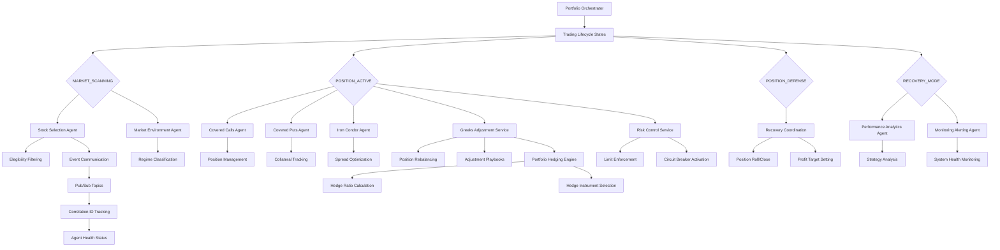

# ADR-011: Multi-Agent System Architecture
@requirement:[EARS-REQ-AGT-001](../ears/EARS-REQ-AGT-001_multi_agent_architecture.md)
@prd:[PRD-AGT-001](../prd/PRD-AGT-001_agent_coordination.md)
@sys:[SYS-AGT-001](../sys/SYS-AGT-001_multi_agent_design.md)
@contract:[CTR-011_MULTI_AGENT_SYSTEM](../../../specs/contracts/CTR-011_MULTI_AGENT_SYSTEM.md)

## Status
**Status**: Accepted
**Date**: 2025-10-24
**Decision Makers**: [Architecture Team, Agent Development Team]
**ADR Author**: [Cline AI Assistant]
**Last Updated**: 2025-10-24

## Context

### Problem Statement
The options trading system requires coordination between 11 autonomous agents with specialized responsibilities, maintaining system consistency while enabling agent independence and fault isolation across 4 trading states and complex interdependencies.

### Background
Monolithic trading systems cannot scale or specialize effectively. Distributed agents require sophisticated coordination to prevent race conditions, ensure state consistency, and maintain trading strategy integrity across market scanning, active positions, defense, and recovery modes.

### Driving Forces
- Agent specialization for complex trading logic and market conditions
- Fault isolation preventing single agent failures from cascading
- State consistency across distributed decision-making
- Scalability to handle concurrent trading operations

### Constraints
- **Coordination**: Single source of truth while enabling agent specialization
- **Performance**: Sub-second decision latency across all agent interactions
- **Consistency**: ACID transaction guarantees for portfolio state changes
- **Reliability**: Agent failures cannot compromise overall system integrity

## Decision

### Chosen Solution
Implement a hierarchical multi-agent architecture with explicit agent responsibilities and communication protocols:

**Hierarchical Organization**: 4-layer structure (Orchestration, Analysis, Execution, Support)
**Agent Specialization**: Each agent handles specific trading responsibilities with minimal overlap
**Event-Driven Communication**: Pub/Sub messaging enables loose coupling and fault tolerance
**State Management**: Centralized state with distributed cache for performance

### Key Components
- **Portfolio Orchestrator**: Central coordinator managing trading lifecycle
- **Analysis Agents**: Stock selection and market environment assessment
- **Strategy Agents**: Covered calls, covered puts, iron condor position management
- **Support Services**: Greeks adjustment, hedging, risk control, and analytics

### Implementation Approach
- Explicit agent contracts defining responsibilities and interfaces
- Event correlation IDs for tracing complex multi-agent transactions
- Agent health monitoring and automated recovery procedures
- Load balancing across agent instances during high-volume periods

## Requirements Satisfied

### Primary Requirements

| Requirement ID | Description | How This Decision Satisfies It |
|----------------|-------------|-------------------------------|
| EARS-REQ-AGT-001 | Multi-Agent Coordination | Hierarchical architecture with specialized agents |
| PRD-AGT-001 | Agent Independence | Event-driven communication preventing coupling |
| SYS-AGT-001 | Fault Isolation | Agent failures contained within individual boundaries |
| CTR-011 | Agent Communication Contracts | Standardized interfaces and protocols |

### Non-Functional Requirements
- **Scalability**: Independent agent scaling based on individual workloads
- **Performance**: Parallel agent processing reducing overall decision latency
- **Reliability**: Fault isolation preventing cascade failures across agents
- **Maintainability**: Clear agent separation of concerns simplifying updates

## Consequences

### Positive Outcomes

**System Benefits:**
- Agent specialization enables sophisticated strategies for each trading approach
- Fault isolation maintains system stability despite individual agent failures
- Independent scaling optimizes resource utilization across varying workloads
- Clear separation of concerns simplifies development and maintenance

**Development Benefits:**
- Smaller, focused codebases for each agent reduce complexity and testing scope
- Parallel development teams can work on different agents simultaneously
- Isolated deployment reduces system-wide regression risks during updates

### Negative Outcomes

**Coordination Complexity:**
- Multi-agent transactions require sophisticated correlation and error handling
- State consistency demands careful event ordering and idempotent operations
- Inter-agent dependencies create potential deadlock scenarios during coordination

**Operational Overhead:**
- 11 agents require independent monitoring, deployment, and maintenance procedures
- Team coordination needed for updates affecting multiple agents
- Resource management across distributed agent instances adds complexity

## Architecture Flow

## Implementation Assessment

### Complexity Evaluation
- **Overall Complexity**: High - Multi-agent coordination with complex state management
- **Development Effort**: 8-12 weeks for agent contracts and integration testing
- **Operational Complexity**: High - Independent deployment and monitoring of 11 agents

### Dependencies
- Event-driven communication infrastructure (Cloud Pub/Sub)
- Centralized state management (Cloud SQL with caching)
- Health monitoring and failover capabilities
- Agent discovery and load balancing mechanisms

### Resources
- **Compute Budget**: $800-1500/month across all agent instances
- **Memory Budget**: $200-400/month for agent state and caching
- **Network Budget**: Inter-agent communication through Pub/Sub
- **Storage Budget**: Minimal for individual agent operational data

### Failure Modes & Recovery
- **Agent Isolation**: Single agent failures contained without system impact
- **State Reconciliation**: Event sourcing enables state restoration and conflict resolution
- **Circuit Breakers**: Automated system protection during widespread failures
- **Manual Intervention**: Emergency procedures for critical coordination failures

## Impact Analysis

### Affected Components
- **Direct Impact**: All 11 agents implementing specialized trading logic
- **Coordination Logic**: Event routing and state synchronization mechanisms
- **Development Process**: Parallel development across multiple agent teams
- **Operations**: Independent deployment and monitoring procedures

### Migration Strategy
- **Phase 1**: Agent contract definition and communication protocols
- **Phase 2**: Core agent implementation (orchestrator and analysis agents)
- **Phase 3**: Strategy agent development and integration testing
- **Phase 4**: End-to-end testing and production deployment procedures

### Testing Requirements
- **Unit Tests**: Individual agent functionality and contract compliance
- **Integration Tests**: Agent-to-agent communication and state consistency
- **End-to-End Tests**: Complete trading lifecycle across all agents
- **Chaos Tests**: Agent failure scenarios and recovery procedures

## Security

### Agent Isolation
- Service account isolation preventing cross-agent credential access
- VPC Service Controls limiting lateral movement between agent boundaries
- Agent-specific encryption keys and secrets management

### Secure Communication
- End-to-end encrypted event communication through Pub/Sub
- Agent authentication through Workload Identity federation
- Message integrity verification and correlation ID tracking

### Audit and Monitoring
- Complete audit trails for all inter-agent communications
- Agent-specific security monitoring and threat detection
- Automated compliance reporting for multi-agent transactions

## Traceability

### Upstream Sources
- **System Architecture**: ../../../docs/architecture/option_strategy_architecture.md
- **Agent Requirements**: Detailed specifications for each of the 11 agents
- **State Management**: Trading lifecycle coordination and consistency requirements

### Downstream Artifacts
- **Agent Interfaces**: Standardized contracts and event schemas for each agent
- **Integration Tests**: Multi-agent workflow validation and coordination testing
- **Monitoring Dashboards**: Individual agent health and system-wide status tracking
- **Deployment Scripts**: Automated agent deployment and versioning procedures

### Validation Artifacts
- **System Integration Tests**: End-to-end validation across all agent interactions
- **Performance Benchmarks**: Multi-agent coordination latency and throughput measurements
- **Reliability Tests**: Agent failure isolation and system stability validations

## Related Decisions

**Depends On**:
- ADR-001: GCP Cloud Run Deployment Architecture
- ADR-002: Cloud Pub/Sub Event Architecture

**Supersedes**: Monolithic trading system architecture
**Related**:
- ADR-012: Portfolio Orchestrator Agent
- ADR-036: Option Strategy Portfolio Architecture
- ADR-041: Defense-in-Depth Security Architecture

---

**Template Version**: 1.0
**Last Reviewed**: 2025-10-24
**Next Review**: 2025-11-24
