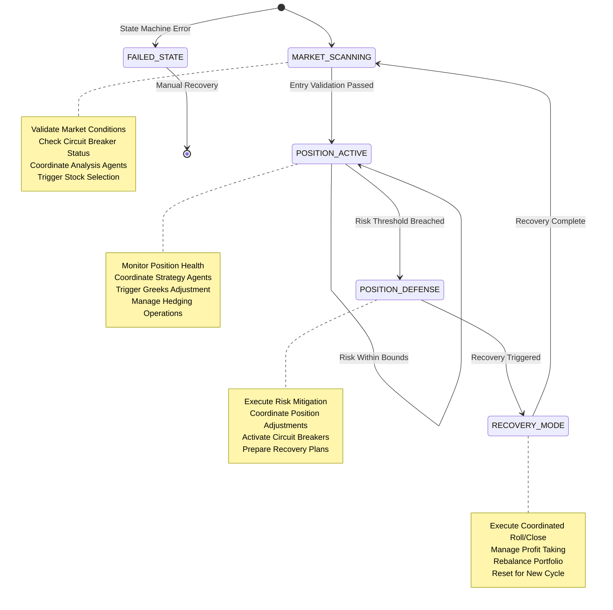

# ADR-012: Portfolio Orchestrator Agent Architecture
@requirement:[EARS-REQ-ORC-001](../ears/EARS-REQ-ORC-001_portfolio_orchestrator.md)
@prd:[PRD-AGT-002](../prd/PRD-AGT-002_orchestrator_requirements.md)
@sys:[SYS-AGT-002](../sys/SYS-AGT-002_orchestrator_design.md)
@contract:[CTR-012_PORTFOLIO_ORCHESTRATOR](../../../specs/contracts/CTR-012_PORTFOLIO_ORCHESTRATOR.md)

## Status
**Status**: Accepted
**Date**: 2025-10-24
**Decision Makers**: [Agent Development Team, Architecture Team]
**ADR Author**: [Cline AI Assistant]
**Last Updated**: 2025-10-24

## Context

### Problem Statement
The options trading system requires a central coordinator managing the unified trading lifecycle (MARKET_SCANNING → POSITION_ACTIVE → POSITION_DEFENSE → RECOVERY_MODE) across 10 specialized agents, ensuring state consistency, risk gating, and coordinated recovery without creating single points of failure.

### Background
Distributed agents risk inconsistent state management and uncoordinated actions. Traditional orchestration approaches create bottlenecks or tight coupling. The orchestrator must enable agent specialization while maintaining overall system integrity and rapid decision-making.

### Driving Forces
- Single source of truth for portfolio state transitions and risk gating
- Guaranteed state machine execution preventing inconsistent trading states
- Coordinated recovery protocols across multiple strategy types
- Real-time coordination without trading latency degradation

### Constraints
- **Performance**: Minimal orchestration overhead on sub-second trading decisions
- **Consistency**: ACID guarantees for state transitions across distributed agents
- **Reliability**: No single point of failure for critical trading operations
- **Observability**: Complete audit trail for all orchestration decisions

## Decision

### Chosen Solution
Implement Portfolio Orchestrator Agent as always-on state machine coordinator:

**State Management**: Finite state machine with guaranteed transitions and validation gates
**Risk Gating**: Pre-trade validation with circuit breaker thresholds and market condition checks
**Agent Coordination**: Event-driven triggering with correlation IDs and health monitoring
**Recovery Protocol**: Automated coordination of position roll, close, and hedge operations

### Key Components
- **State Engine**: XState-based finite state machine managing 4 trading states
- **Gating Logic**: Multi-dimensional risk validation (entry conditions, circuit breakers)
- **Agent Registry**: Dynamic agent health monitoring and failover detection
- **Event Bus Integration**: Guaranteed message delivery and dead letter handling

### Implementation Approach
- Always-on Cloud Run deployment with 2 vCPU / 4Gi RAM resource allocation
- PostgreSQL state persistence with optimistic locking for consistency
- Event sourcing for complete audit trail and state reconstruction
- Health probes and readiness checks for production reliability

## Requirements Satisfied

### Primary Requirements

| Requirement ID | Description | How This Decision Satisfies It |
|----------------|-------------|-------------------------------|
| EARS-REQ-ORC-001 | Centralized Orchestration | State machine coordination across trading lifecycle |
| PRD-AGT-002 | Risk Gating Implementation | Multi-dimensional validation before state transitions |
| SYS-AGT-002 | Recovery Coordination | Automated position management across recovery scenarios |
| CTR-012 | Orchestrator Contracts | Event interfaces for agent coordination and state reporting |

### Non-Functional Requirements
- **Performance**: <50ms additional latency to trading operations
- **Availability**: 99.99% uptime with automated failover capabilities
- **Consistency**: Transactional state transitions with rollback capabilities
- **Auditability**: Complete event history for compliance and debugging

## Consequences

### Positive Outcomes

**System Benefits:**
- Single source of truth eliminates state inconsistency between agents
- Automated risk controls prevent portfolio damage before execution
- Coordinated recovery reduces manual intervention and improves response times
- Clear system status visibility enables proactive issue resolution

**Operational Benefits:**
- Guaranteed state transitions prevent stuck or inconsistent trading states
- Circuit breaker integration provides automated extreme market protection
- Audit trail enables root cause analysis for any orchestration decisions
- Health monitoring prevents silent failures in coordination logic

### Negative Outcomes

**Complexity Trade-offs:**
- State machine complexity requires careful testing of all transition scenarios
- Event correlation adds overhead for complex multi-agent transactions
- Centralized coordination creates potential scaling and reliability considerations

**Operational Dependencies:**
- Orchestrator availability becomes critical system dependency
- Agent API contract changes require orchestrator updates
- State persistence requirements add database dependency complexity

## Architecture Flow

## Implementation Assessment

### Complexity Evaluation
- **Overall Complexity**: High - State machine coordination with distributed agent interfaces
- **Development Effort**: 6-8 weeks for state machine development and agent integration
- **Operational Complexity**: Medium - Monitoring coordination and manual intervention procedures

### Dependencies
- Cloud Pub/Sub for agent coordination and state change broadcasting
- Cloud SQL for state persistence and consistency guarantees
- Health monitoring infrastructure for agent status tracking
- Event sourcing for state reconstruction and audit trails

### Resources
- **Compute Budget**: Always-on instance at 2 vCPU / 4Gi RAM (~$300/month)
- **Memory Budget**: State caching and agent status tracking
- **Network Budget**: Frequent inter-agent coordination through Pub/Sub
- **Storage Budget**: State history and audit log retention

### Failure Modes & Recovery
- **State Corruption**: Event sourcing enables state reconstruction from audit trail
- **Agent Down**: Coordination continues with degraded functionality and alerting
- **State Lock**: Automatic deadlock detection and resolution mechanisms
- **Network Partitions**: State consistency maintained through transaction isolation

## Impact Analysis

### Affected Components
- **Direct Impact**: All 10 agents receive orchestration events and state coordination
- **State Management**: PostgreSQL schema additions for portfolio state tracking
- **Event Architecture**: New Pub/Sub topics for orchestration coordination
- **Monitoring Integration**: State machine health and transition tracking

### Migration Strategy
- **Phase 1**: State machine definition and agent interface specification
- **Phase 2**: State persistence and event sourcing implementation
- **Phase 3**: Agent integration with error handling and correlation ID tracking
- **Phase 4**: End-to-end testing and production orchestration deployment

### Testing Requirements
- **State Tests**: All state machine transitions and edge case validation
- **Integration Tests**: End-to-end agent orchestration with failure scenarios
- **Performance Tests**: Orchestration overhead measurement and optimization
- **Reliability Tests**: State consistency validation under failure conditions

## Security

### Trust Model
- Service account isolation with least privilege for cross-agent coordination
- Event correlation and validation to prevent malicious state manipulation
- Audit logging for all state transitions and coordination decisions

### Secure Communication
- Encrypted event communication through Workload Identity authentication
- Message integrity verification through correlation ID tracking
- Agent health status encryption for sensitive operational data

### Risk Controls
- Circuit breaker integration prevents system damage during orchestration issues
- Recovery protocols include security validation before position management
- Forced manual intervention capabilities for suspicious coordination patterns

## Traceability

### Upstream Sources
- **System Architecture**: ../../../docs/architecture/option_strategy_architecture.md
- **State Management**: Trading lifecycle coordination and consistency requirements
- **Risk Controls**: Circuit breaker thresholds and automated protection mechanisms

### Downstream Artifacts
- **State Machine Definition**: XState configuration for trading lifecycle management
- **Agent Interfaces**: Event contracts and health monitoring APIs
- **Coordination Logic**: State transition rules and agent triggering mechanisms
- **Monitoring Dashboards**: Orchestrator health and state transition visibility

### Validation Artifacts
- **State Transition Tests**: Complete workflow validation with all transition paths
- **Integration Tests**: Multi-agent coordination under various operating conditions
- **Performance Benchmarks**: Orchestration latency and agent trigger response times
- **Reliability Tests**: Orchestrator failure isolation and state consistency verification

## Related Decisions

**Depends On**:
- ADR-002: Cloud Pub/Sub Event Architecture
- ADR-003: Cloud SQL PostgreSQL Database

**Supersedes**: Decentralized agent coordination without central state management
**Related**:
- ADR-011: Multi-Agent System Architecture
- ADR-041: Defense-in-Depth Security Architecture
- ADR-042: Complete Observability Architecture

---

**Template Version**: 1.0
**Last Reviewed**: 2025-10-24
**Next Review**: 2025-11-24
