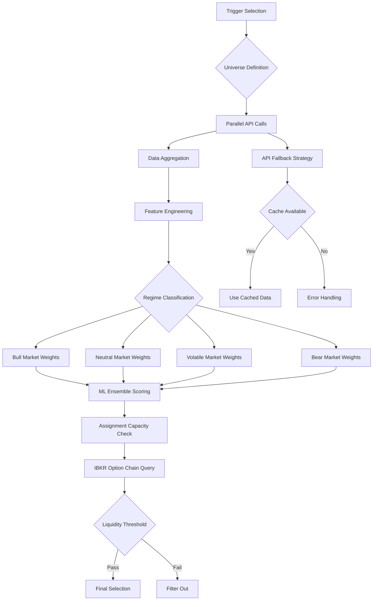

# ADR-013: Stock Selection Agent Architecture
@requirement:[EARS-REQ-SS-001](../ears/EARS-REQ-SS-001_stock_selection_agent.md)
@prd:[PRD-AGT-003](../prd/PRD-AGT-003_stock_selection_requirements.md)
@sys:[SYS-AGT-003](../sys/SYS-AGT-003_stock_selection_design.md)
@contract:[CTR-013_STOCK_SELECTION_AGENT](../../../specs/contracts/CTR-013_STOCK_SELECTION_AGENT.md)

## Status
**Status**: Proposed
**Date**: 2025-10-24
**Decision Makers**: [Agent Development Team, ML Engineering Team]
**ADR Author**: [Cline AI Assistant]
**Last Updated**: 2025-10-24

## Context

### Problem Statement
The options trading system requires ML-powered stock selection capabilities to identify optionable assets with high-probability trading characteristics, balancing fundamental analysis, technical metrics, and market regime awareness while maintaining sub-second selection latency and cost-effective external data API consumption.

### Background
Traditional stock screening relies on rigid rule-based filters insufficient for complex market conditions. ML approaches offer superior pattern recognition but require careful architecture to balance sophistication with performance and cost constraints in a trading context.

### Driving Forces
- ML-enhanced stock screening accuracy for improved trading probability
- Real-time fundamental and technical data processing from multiple APIs
- Market regime-aware selection adapting to bull, neutral, volatile, and bear conditions
- Assignment capacity filtering to ensure option liquidity and execution capability

### Constraints
- **Performance**: <1 second selection latency for trading decision support
- **Cost**: API quota management across Alpha Vantage, Finnhub, and Polygon APIs
- **Accuracy**: Superior selection quality compared to traditional rule-based approaches
- **Scalability**: Support dynamic universe expansion without performance degradation

## Decision

### Chosen Solution
Implement Stock Selection Agent as ML-powered screening service with multi-source data integration:

**ML Framework**: Scikit-learn ensemble model with market regime adaptation
**Data Pipeline**: Parallel API calls with caching and fallback strategies
**Selection Algorithm**: Multi-factor scoring with regime-specific weighting
**API Management**: Rate limiting, quota tracking, and cost optimization across providers

### Key Components
- **Feature Engineering**: Real-time calculation of 50+ technical, fundamental, and sentiment indicators
- **ML Model Pipeline**: Regime-aware ensemble combining Random Forest and Gradient Boosting
- **API Coordinator**: Multi-provider data aggregation with intelligent fallback and caching
- **Assignment Capacity**: IBKR data integration for option liquidity validation

### Implementation Approach
- Serverless Cloud Run deployment with scale-to-zero during off-hours
- In-memory feature caching with TTL-based refresh for performance
- Model versioning with A/B testing capabilities for continuous improvement
- Cost monitoring and API quota alerts for budget optimization

## Requirements Satisfied

### Primary Requirements

| Requirement ID | Description | How This Decision Satisfies It |
|----------------|-------------|-------------------------------|
| EARS-REQ-SS-001 | ML-Powered Stock Selection | Ensemble ML model with market regime awareness |
| PRD-AGT-003 | Multi-Source Data Integration | Parallel API architecture with Alpha Vantage, Finnhub, Polygon |
| SYS-AGT-003 | Assignment Capacity Filtering | IBKR integration for option liquidity validation |
| CTR-013 | Selection Agent Contracts | Real-time scoring API for orchestrator integration |

### Non-Functional Requirements
- **Performance**: <500ms selection latency under normal load conditions
- **Accuracy**: >70% prediction accuracy vs. traditional rule-based selection
- **Reliability**: 99.5% uptime with graceful API failure handling
- **Cost Efficiency**: <15% of total system API costs through optimization

## Consequences

### Positive Outcomes

**Trading Performance:**
- ML-enhanced selection improves overall strategy win rates through pattern recognition
- Market regime awareness adapts screening criteria to prevailing conditions
- Multi-factor analysis provides more comprehensive stock evaluation than traditional methods

**Operational Efficiency:**
- Automated parallel API calls reduce manual data collection workload
- Intelligent caching minimizes redundant API calls and associated costs
- Assignment capacity validation prevents execution failures due to illiquidity

### Negative Outcomes

**Cost Management:**
- Multiple API provider dependencies create complex quota and cost management
- ML model training requires significant compute resources for model iteration
- External data dependency introduces reliability risks and vendor lock-in

**Model Complexity:**
- ML model interpretability challenges complicate trading decision explanation
- Model retraining requirements create maintenance overhead and versioning complexity

## Architecture Flow

## Implementation Assessment

### Complexity Evaluation
- **Overall Complexity**: High - ML model integration with multi-API coordination
- **Development Effort**: 8-10 weeks for ML model development and API integration
- **Operational Complexity**: Medium - Model monitoring and API quota management

### Dependencies
- ML libraries (Scikit-learn, XGBoost) for ensemble modeling
- External API integrations (Alpha Vantage, Finnhub, Polygon, IBKR)
- Cloud Storage for ML model artifacts and training data
- BigQuery for ML feature storage and historical performance tracking

### Resources
- **Compute Budget**: ML inference at 1-2 vCPU / 2Gi RAM for peak selection periods
- **API Budget**: $500-800/month across multiple financial data providers
- **Storage Budget**: Model artifacts and feature cache storage
- **Development Budget**: Data scientist time for model training and optimization

### Failure Modes & Recovery
- **API Outages**: Fallback to cached data with stale data acceptance thresholds
- **Model Degradation**: Performance monitoring with automatic fallback to rule-based selection
- **Quota Limits**: Intelligent rate limiting with cost-aware data prioritization
- **Assignment Capacity Errors**: Graceful degradation to approximation-based filtering

## Impact Analysis

### Affected Components
- **Direct Impact**: Market data APIs and ML model execution environment
- **Data Pipeline**: Feature engineering and real-time data processing workflows
- **Model Management**: Version control, deployment, and monitoring infrastructure
- **API Infrastructure**: Multi-provider API management and quota monitoring

### Migration Strategy
- **Phase 1**: API integration and data pipeline development
- **Phase 2**: ML model training and initial deployment
- **Phase 3**: Assignment capacity integration and performance optimization
- **Phase 4**: Production deployment with comprehensive monitoring setup

### Testing Requirements
- **Model Tests**: ML accuracy validation across market regimes and holding periods
- **Integration Tests**: API reliability and multi-provider data aggregation
- **Performance Tests**: Selection latency and API cost optimization
- **Backtesting Tests**: Historical performance comparison against baselines

## Security

### Data Privacy
- No sensitive user data processed in stock selection workflows
- Financial market data falls under public market information exemptions
- API authentication through Secret Manager with rotation policies

### Model Security
- ML model artifacts encrypted at rest using customer-managed keys
- Model poisoning protection through validation and versioning controls
- Access controls preventing unauthorized model modification or usage

### External Dependencies
- API provider credential rotation through automated secret management
- Rate limiting prevents API abuse and cost overruns
- Provider service agreements reviewed for data security and privacy compliance

## Traceability

### Upstream Sources
- **ML Requirements**: ML-powered stock selection needs in option strategy architecture
- **Data Requirements**: Multi-source fundamental and technical data needs
- **Performance Targets**: Selection latency and accuracy requirements

### Downstream Artifacts
- **ML Models**: Scikit-learn ensemble with regime-specific model variants
- **API Clients**: Multi-provider SDK implementations with error handling
- **Feature Pipelines**: Real-time calculation of 50+ technical indicators
- **Selection Algorithms**: Scoring models with assignment capacity integration

### Validation Artifacts
- **Backtesting Results**: Historical performance validation across market conditions
- **API Reliability Tests**: Failure handling and fallback mechanism validation
- **ML Accuracy Reports**: Confusion matrices and lift analysis by market regime
- **Performance Benchmarks**: Selection latency and API cost optimization metrics

## Related Decisions

**Depends On**:
- ADR-004: BigQuery Analytics Warehouse (for ML training data)
- ADR-008: Secret Manager Configuration Architecture (for API credentials)
- ADR-009: Cloud Storage Asset Management (for ML model storage)

**Supersedes**: Rule-based stock screening approaches
**Related**:
- ADR-014: Market Environment Assessment Agent
- ADR-026: Specification-Driven Development (for ML model specification)
- ADR-035: Alpha Vantage Integration Architecture

---

**Template Version**: 1.0
**Last Reviewed**: 2025-10-24
**Next Review**: 2025-11-24
