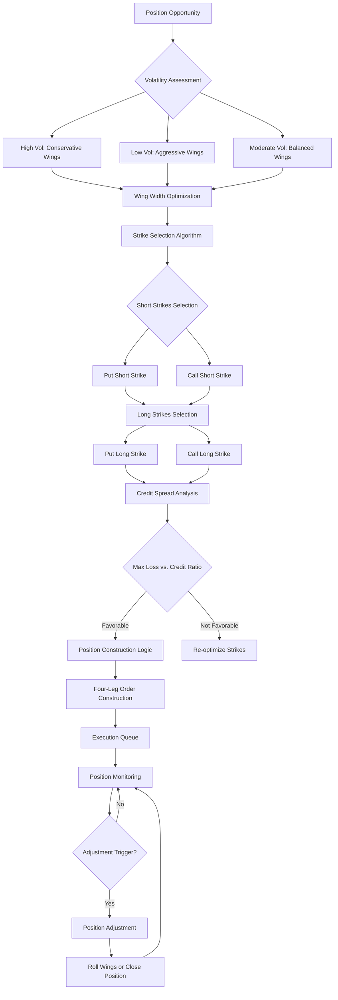

# ADR-017: Iron Condor Strategy Agent Architecture
@requirement:[EARS-REQ-IC-001](../ears/EARS-REQ-IC-001_iron_condor_agent.md)
@prd:[PRD-AGT-007](../prd/PRD-AGT-007_iron_condor_requirements.md)
@sys:[SYS-AGT-007](../sys/SYS-AGT-007_iron_condor_design.md)
@contract:[CTR-017_IRON_CONDOR_AGENT](../../../specs/contracts/CTR-017_IRON_CONDOR_AGENT.md)

## Status
**Status**: Proposed
**Date**: 2025-10-24
**Decision Makers**: [Agent Development Team, Options Strategy Team]
**ADR Author**: [Cline AI Assistant]
**Last Updated**: 2025-10-24

## Context

### Problem Statement
The options trading system requires automated iron condor strategy execution with complex four-leg option positioning, dynamic wing width optimization, credit spread management, and probability-based risk assessment while maintaining volatility-neutral positioning.

### Background
Iron condors require sophisticated multi-leg optimization balancing premium collection with risk management. Manual execution fails to capture optimal credit spreads and manage the complex risk dynamics of volatility-based strategies with multiple breakeven points.

### Driving Forces
- Premium income generation through credit spread strategies
- Risk management through limited loss exposure with multiple profit zones
- Wing width optimization for maximum premium-to-risk ratios
- Volatility-neutral positioning maintaining theta decay benefits

### Constraints
- **Risk Parameters**: Maximum loss limited to credit received minus commissions
- **Execution Complexity**: Four-leg option positioning with precise pricing synchronization
- **Adjustment Timing**: Optimal modification based on delta drift and volatility changes
- **Liquidity Requirements**: Sufficient open interest across all strike series

## Decision

### Chosen Solution
Implement Iron Condor Strategy Agent with algorithmic multi-leg optimization:

**Wing Optimization**: ML-based strike selection maximizing premium-to-risk ratios
**Credit Spread Analysis**: Real-time credit collection vs. maximum loss assessment
**Risk Probability Modeling**: Monte Carlo simulation for profit probability and risk assessment
**Position Adjustment Engine**: Automated collar management and position adjustment logic

### Key Components
- **Strike Selection Engine**: Probability-weighted multi-leg strike optimization
- **Credit Efficiency Calculator**: Risk-adjusted return assessment for condor positioning
- **Volatility Management**: Vega exposure monitoring and volatility-neutral positioning
- **Adjustment Decision Logic**: Statistical triggers for position modification and closure

### Implementation Approach
- Cloud Run deployment with high-frequency options data integration
- Multi-leg order construction with synchronous execution requirements
- Real-time position margining and risk calculation
- Automated adjustment based on probability threshold crossings

## Requirements Satisfied

### Primary Requirements

| Requirement ID | Description | How This Decision Satisfies It |
|----------------|-------------|-------------------------------|
| EARS-REQ-IC-001 | Iron Condor Execution | Four-leg options positioning with risk management |
| PRD-AGT-007 | Wing Optimization | ML-based strike selection for premium maximization |
| SYS-AGT-007 | Credit Spread Management | Risk-adjusted credit collection and loss limitation |
| CTR-017 | Strategy Agent Contracts | Multi-leg positioning and adjustment APIs |

### Non-Functional Requirements
- **Performance**: <3 second four-leg order construction and synchronization
- **Credit Efficiency**: Maximize premium collection relative to maximum loss exposure
- **Reliability**: 99.9% order synchronization and execution success
- **Adaptability**: Dynamic adjustment to changing volatility and delta conditions

## Consequences

### Positive Outcomes

**Income Generation:**
- Systematic credit collection through volatility-based positioning
- Multiple profit zones providing risk-defined return opportunities
- Theta decay benefits from time-based option value erosion

**Risk Management:**
- Defined maximum loss exposure through structured credit spreads
- Probability-based position sizing optimizing expected return
- Volatility-neutral positioning reducing directional market risk

### Negative Outcomes

**Execution Challenges:**
- Multi-leg order synchronization requiring precise timing coordination
- Complex pricing dynamics with multiple strike relationships
- Adjustment decisions requiring sophisticated risk-reward analysis

**Market Dependencies:**
- Liquidity constraints across multiple strike series
- Volatility changes significantly impacting position profitability
- Assignment risk on short strikes requiring continuous monitoring

## Architecture Flow

## Implementation Assessment

### Complexity Evaluation
- **Overall Complexity**: High - Multi-leg strategy execution and continuous risk monitoring
- **Development Effort**: 10-12 weeks for wing optimization, risk modeling, and execution management
- **Operational Complexity**: High - Multi-leg position monitoring and adjustment coordination

### Dependencies
- High-frequency options data for real-time pricing and liquidity assessment
- IBKR TWS API for multi-leg order execution and position synchronization
- Options analytics APIs for implied volatility and probability calculations
- Real-time market data for volatility and direction assessment

### Resources
- **API Budget**: $300-500/month for options data and execution APIs premium features
- **Compute Budget**: 2-4 vCPU for wing optimization algorithms and probability calculations
- **Development Budget**: Quantitative research for strategy calibration and adjustment logic
- **Data Budget**: High-frequency options data for backtesting and model validation

### Failure Modes & Recovery
- **Order Synchronization Issues**: Partial fill handling and position reconciliation algorithms
- **Volatility Spikes**: Emergency position closure with automated loss limitation
- **Wing Adjustment Failures**: Manual intervention protocols for complex position changes
- **Liquidity Dry-up**: Alternative strike selection with improved liquidity profiles

## Impact Analysis

### Affected Components
- **Direct Impact**: Iron condor strategy implementation and multi-leg execution
- **Order Management**: Complex order construction and synchronization logic
- **Risk Management**: Continuous position monitoring and probability-based adjustments
- **Execution Platform**: Multi-leg order support and position margining

### Migration Strategy
- **Phase 1**: Strategy logic development and historical probability analysis
- **Phase 2**: Multi-leg execution integration and order synchronization testing
- **Phase 3**: Position monitoring and adjustment automation development
- **Phase 4**: Production deployment with comprehensive risk management

### Testing Requirements
- **Strategy Tests**: Wing width optimization and credit efficiency backtesting
- **Integration Tests**: Multi-leg order execution and position synchronization
- **Risk Tests**: Probability distribution analysis and adjustment effectiveness
- **Liquidity Tests**: Strike selection robustness under various market conditions

## Security

### Position Security
- Strict position limits aligned with portfolio risk allocation
- Multi-leg position validation ensuring proper risk-reward relationships
- Audit trails for all strategy decisions and position modifications

### Execution Security
- Secure order execution with position size and direction validation
- Multi-leg order integrity verification before execution submission
- Compliance monitoring for options strategy regulatory requirements

### Regulatory Compliance
- Pattern day trading compliance for complex options strategies
- Position reporting requirements for risk management oversight
- Tax treatment validation for credit spread income characterization

## Traceability

### Upstream Sources
- **Strategy Requirements**: Iron condor multi-leg position management and wing optimization
- **Risk Management**: Credit spread control and probability-based position sizing
- **Performance Targets**: Credit collection and risk-adjusted return objectives

### Downstream Artifacts
- **Strategy Algorithm**: Wing width optimization and strike selection models
- **Execution Logic**: Multi-leg order construction and synchronization algorithms
- **Risk Framework**: Probability modeling and position adjustment decision rules
- **Performance Tracking**: Credit collection metrics and risk distribution analytics

### Validation Artifacts
- **Backtesting Results**: Strategy performance across different volatility regimes
- **Risk Analysis**: Maximum loss exposure and probability distribution assessment
- **Execution Validation**: Multi-leg synchronization success rates and position accuracy
- **Compliance Reports**: Regulatory requirement fulfillment for complex options strategies

## Related Decisions

**Depends On**:
- ADR-006: VPC Service Controls Security Architecture
- ADR-010: Cloud Monitoring Observability Architecture
- ADR-034: IB Gateway Integration Architecture

**Supersedes**: Manual iron condor position management and strike selection
**Related**:
- ADR-014: Market Environment Assessment Agent (volatility-based positioning)
- ADR-018: Greeks Adjustment Service (vegas exposure and delta management)
- ADR-021: Performance Analytics Agent (probability distribution tracking)

---

**Template Version**: 1.0
**Last Reviewed**: 2025-10-24
**Next Review**: 2025-11-24
