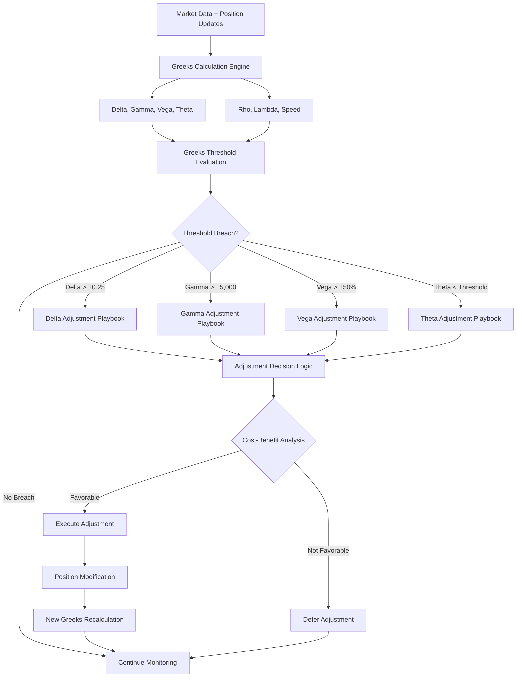

# ADR-018: Greeks Adjustment Service Architecture
@requirement:[EARS-REQ-GR-001](../ears/EARS-REQ-GR-001_greeks_adjustment_service.md)
@prd:[PRD-SRV-001](../prd/PRD-SRV-001_greeks_adjustment_requirements.md)
@sys:[SYS-SRV-001](../sys/SYS-SRV-001_greeks_adjustment_design.md)
@contract:[CTR-018_GREEKS_ADJUSTMENT_SERVICE](../../../specs/contracts/CTR-018_GREEKS_ADJUSTMENT_SERVICE.md)

## Status
**Status**: Proposed
**Date**: 2025-10-24
**Decision Makers**: [Agent Development Team, Risk Management Team]
**ADR Author**: [Cline AI Assistant]
**Last Updated**: 2025-10-24

## Context

### Problem Statement
The options trading system requires real-time position Greeks monitoring and automated adjustment capabilities to maintain target risk exposures across delta, gamma, vega, and theta parameters while executing structured playbooks for roll, close, and hedge operations.

### Background
Options position management requires continuous monitoring of Greek exposures that decay over time. Manual adjustment decisions fail to capture optimal timing and frequently result in suboptimal risk management or execution costs.

### Driving Forces
- Real-time Greeks calculation with sub-second latency requirements
- Automated adjustment playbooks reducing manual intervention
- Cost-optimized adjustment execution through intelligent timing
- Risk exposure maintenance within established tolerance bands

### Constraints
- **Performance**: Sub-second Greeks recalculation and adjustment decision-making
- **Accuracy**: Sophisticated options pricing models with accurate Greeks derivatives
- **Cost Control**: Minimize adjustment costs while maintaining target risk profiles
- **Execution Speed**: Complete adjustment cycles within market volatility windows

## Decision

### Chosen Solution
Implement Greeks Adjustment Service with real-time monitoring and automated playbooks:

**Greeks Calculation Engine**: High-performance options pricing with accurate derivative calculations
**Adjustment Decision Logic**: Rule-based and ML-enhanced adjustment triggers
**Playbook Execution Engine**: Structured workflows for roll, close, and hedge operations
**Risk Synchronization**: Real-time exposure alignment with portfolio risk limits

### Key Components
- **Pricing Engine**: Real-time options model with high-precision Greeks calculation
- **Threshold Monitor**: Continuous risk exposure tracking against tolerance bands
- **Adjustment Playbooks**: Coded strategies for different market conditions and risk scenarios
- **Execution Optimizer**: Cost-benefit analysis for adjustment timing and execution methods

### Implementation Approach
- Cloud Run deployment with GPU acceleration for complex Greeks calculations
- Real-time market data streaming integration for continuous position evaluation
- Pre-defined adjustment playbooks with parameterized execution logic
- Automated approval workflows for major position adjustments

## Requirements Satisfied

### Primary Requirements

| Requirement ID | Description | How This Decision Satisfies It |
|----------------|-------------|-------------------------------|
| EARS-REQ-GR-001 | Greeks Monitoring | Real-time position exposure calculation and alerting |
| PRD-SRV-001 | Adjustment Automation | Playbook-driven roll, close, and hedge execution |
| SYS-SRV-001 | Risk Management Integration | Portfolio-level risk synchronization and tolerance monitoring |
| CTR-018 | Adjustment Service Contracts | Greeks exposure and adjustment execution APIs |

### Non-Functional Requirements
- **Performance**: Sub-second Greeks recalculation across portfolio positions
- **Accuracy**: Options model alignment within 5% of observed market prices
- **Reliability**: 99.99% uptime for continuous risk monitoring
- **Adaptability**: Dynamic adjustment to changing market conditions and risk preferences

## Consequences

### Positive Outcomes

**Risk Management:**
- Continuous portfolio risk monitoring preventing exposure drift
- Automated adjustments maintaining consistent risk profiles
- Proactive position management reducing forced adjustment costs

**Operational Efficiency:**
- Systematic adjustment playbooks ensuring consistent execution quality
- Real-time Greeks visibility enabling data-driven adjustment decisions
- Cost optimization through intelligent adjustment timing and execution

### Negative Outcomes

**Computational Complexity:**
- Sophisticated options models require significant computational resources
- Real-time calculations create continuous processing and monitoring costs
- Model calibration requires extensive validation and market data history

**Adjustment Complexity:**
- Playbook design requires deep domain expertise and market condition coverage
- Adjustment costs can offset strategy profits if executed too frequently
- Market timing for adjustments requires sophisticated entry-point analysis

## Architecture Flow

## Implementation Assessment

### Complexity Evaluation
- **Overall Complexity**: High - Real-time options modeling and automated decision execution
- **Development Effort**: 12-16 weeks for Greeks engine, playbooks, and integration testing
- **Operational Complexity**: High - Continuous monitoring and adjustment execution management

### Dependencies
- High-frequency options market data for accurate pricing models
- GPU compute capability for complex derivatives calculations
- Broker APIs for position adjustment and execution capabilities
- Market data providers for volatility surface and underlying price feeds

### Resources
- **Compute Budget**: GPU instances for Greeks calculations during active adjustment periods
- **API Budget**: Premium market data feeds for real-time options pricing
- **Development Budget**: Options pricing expertise for model calibration and validation
- **Data Budget**: Historical options data for model training and adjustment playbooks

### Failure Modes & Recovery
- **Pricing Model Errors**: Fallback to market-observed Greeks with conservative thresholds
- **Execution Failures**: Rollback mechanisms maintaining original position exposures
- **Market Data Gaps**: Graceful degradation using last-known values with confidence scoring
- **Adjustment Conflicts**: Collision detection and coordination with other adjustment sources

## Impact Analysis

### Affected Components
- **Direct Impact**: All options positions requiring Greeks monitoring and adjustment
- **Risk Management**: Portfolio-level risk exposure calculation and monitoring
- **Execution Platform**: Position modification and adjustment order execution
- **Decision Systems**: Greeks-based adjustment triggers and playbook execution

### Migration Strategy
- **Phase 1**: Greeks calculation engine development and model validation
- **Phase 2**: Threshold monitoring and alerting system implementation
- **Phase 3**: Adjustment playbook development and execution integration
- **Phase 4**: Production deployment with comprehensive monitoring and safeguards

### Testing Requirements
- **Model Tests**: Greeks calculation accuracy validation against market observations
- **Integration Tests**: Portfolio synchronization and position adjustment execution
- **Playbook Tests**: Adjustment logic effectiveness across different market scenarios
- **Performance Tests**: Greeks calculation speed and decision-making latency

## Security

### Position Security
- Strict authorization controls for Greeks-based adjustment permissions
- Audit trails for all Greeks calculations and adjustment decisions
- Multi-level approval processes for significant position modifications

### Execution Security
- Secure order execution with position modification validation
- Greeks calculation integrity verification and tampering detection
- Regulatory compliance monitoring for automated trading adjustments

### Data Protection
- Real-time market data encryption and secure transmission
- Options pricing models protected from unauthorized access
- Greeks calculation results encrypted for sensitive risk exposure data

## Traceability

### Upstream Sources
- **Risk Management Requirements**: Greeks exposure monitoring and adjustment capabilities
- **Performance Targets**: Real-time calculation speed and adjustment execution latency
- **Cost Optimization**: Adjustment frequency and transaction cost management

### Downstream Artifacts
- **Greeks Engine**: Options pricing model with derivative calculation algorithms
- **Adjustment Playbooks**: Structured response strategies for different Greeks exposures
- **Threshold Logic**: Risk tolerance definitions and breach detection rules
- **Performance Monitoring**: Adjustment effectiveness and cost analysis dashboards

### Validation Artifacts
- **Model Validation**: Greeks calculation accuracy and numerical stability tests
- **Backtesting Results**: Adjustment playbook performance across historical periods
- **Risk Assessment**: Portfolio risk exposure maintenance and adjustment effectiveness
- **Compliance Reports**: Automated adjustment decision audit trail validation

## Related Decisions

**Depends On**:
- ADR-010: Cloud Monitoring Observability Architecture
- ADR-034: IB Gateway Integration Architecture
- ADR-035: Alpha Vantage Integration Architecture

**Supersedes**: Manual position adjustment based on periodic Greeks reviews
**Related**:
- ADR-015: Covered Calls Strategy Agent (delta adjustment needs)
- ADR-017: Iron Condor Strategy Agent (multiple Greeks management)
- ADR-019: Portfolio Hedging Engine Agent (delta exposure integration)

---

**Template Version**: 1.0
**Last Reviewed**: 2025-10-24
**Next Review**: 2025-11-24
