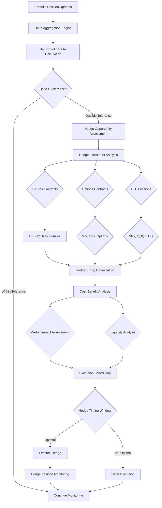

# ADR-019: Portfolio Hedging Engine Agent Architecture
@requirement:[EARS-REQ-HE-001](../ears/EARS-REQ-HE-001_portfolio_hedging_agent.md)
@prd:[PRD-AGT-008](../prd/PRD-AGT-008_hedging_engine_requirements.md)
@sys:[SYS-AGT-008](../sys/SYS-AGT-008_hedging_engine_design.md)
@contract:[CTR-019_PORTFOLIO_HEDGING_AGENT](../../../specs/contracts/CTR-019_PORTFOLIO_HEDGING_AGENT.md)

## Status
**Status**: Proposed
**Date**: 2025-10-24
**Decision Makers**: [Agent Development Team, Risk Management Team]
**ADR Author**: [Cline AI Assistant]
**Last Updated**: 2025-10-24

## Context

### Problem Statement
The options trading system requires systematic portfolio-level delta hedging capabilities to maintain overall portfolio neutrality while optimizing hedging costs through intelligent instrument selection, sizing, and timing across futures markets and volatility products.

### Background
Portfolio delta exposure from complex options positions can create significant directional risk. Manual hedging approaches are slow, inconsistent, and frequently result in over-hedging or inadequate coverage. Market volatility requires continuous hedging adjustment with sophisticated cost optimization.

### Driving Forces
- Automated delta hedging maintaining portfolio neutrality within tolerance bands
- Cost optimization through instrument selection and market impact minimization
- Real-time hedging adjustment based on changing portfolio exposures
- Integration with portfolio risk management and Greeks adjustment systems

### Constraints
- **Performance**: Sub-second hedge calculation and execution scheduling
- **Cost Efficiency**: Minimize hedging costs while maintaining risk control
- **Market Impact**: Avoid creating additional portfolio risk through problematic hedging
- **Integration**: Coordinate with existing risk management and position adjustment systems

## Decision

### Chosen Solution
Implement Portfolio Hedging Engine Agent with algorithmic delta neutralization:

**Delta Aggregation**: Real-time calculation of net portfolio delta exposure
**Hedge Optimization**: Multi-instrument analysis for optimal hedging approach
**Execution Timing**: Market impact assessment and liquidity-aware execution
**Dynamic Adjustment**: Continuous hedging maintenance with threshold-based triggers

### Key Components
- **Delta Calculator**: Real-time aggregation of all position delta exposures
- **Hedge Instrument Selector**: Algorithmic choice between futures, options, and ETF hedges
- **Sizing Optimizer**: Position sizing optimization based on market impact and costs
- **Execution Scheduler**: Market-timing optimization for hedging transactions

### Implementation Approach
- Cloud Run deployment with real-time portfolio exposure monitoring
- Integration with multiple execution venues for optimal hedge execution
- Machine learning models for hedging cost prediction and market impact assessment
- Automated approval workflows for significant hedge position adjustments

## Requirements Satisfied

### Primary Requirements

| Requirement ID | Description | How This Decision Satisfies It |
|----------------|-------------|-------------------------------|
| EARS-REQ-HE-001 | Portfolio Delta Hedging | Systematic delta neutralization automation |
| PRD-AGT-008 | Hedge Optimization | Multi-instrument hedging cost and efficacy optimization |
| SYS-AGT-008 | Risk Neutralization | Portfolio delta maintenance within tolerance bands |
| CTR-019 | Hedging Engine Contracts | Delta calculation and hedge execution APIs |

### Non-Functional Requirements
- **Performance**: Sub-second delta calculation for real-time portfolio monitoring
- **Cost Efficiency**: Minimize hedging costs while maximizing portfolio neutrality
- **Reliability**: 99.9% hedging execution success with contingency procedures
- **Adaptability**: Dynamic instrument selection based on market conditions and liquidity

## Consequences

### Positive Outcomes

**Risk Management:**
- Systematic delta neutralization preventing directional portfolio drift
- Continuous exposure monitoring with automated adjustment capabilities
- Multi-instrument hedging flexibility for different market conditions

**Cost Optimization:**
- Intelligent instrument selection minimizing hedging costs
- Dynamic sizing optimization balancing cost and effectiveness
- Market timing optimization reducing execution costs

### Negative Outcomes

**Market Impact:**
- Large hedge executions can create market impact and unfavorable pricing
- Hedging frequency can create excessive transaction costs
- Over-hedging during trending markets reducing overall portfolio performance

**Execution Complexity:**
- Multi-venue coordination requires sophisticated execution algorithms
- Hedge effectiveness assessment requires complex attribution analysis
- Market timing optimization increases system complexity and monitoring requirements

## Architecture Flow

## Implementation Assessment

### Complexity Evaluation
- **Overall Complexity**: High - Multi-instrument hedging with real-time optimization
- **Development Effort**: 10-12 weeks for delta calculation, optimization algorithms, and execution
- **Operational Complexity**: High - Continuous monitoring and market condition adaptation

### Dependencies
- Real-time portfolio position data for accurate delta calculation
- Multiple execution venues for optimal hedging instrument access
- Market data feeds for cost and liquidity assessment
- Risk management integrations for hedge effectiveness validation

### Resources
- **Compute Budget**: Real-time delta calculation and optimization algorithms
- **Data Budget**: Multiple market data feeds for hedging instrument analysis
- **Execution Budget**: Multi-venue trading costs for hedge execution
- **Development Budget**: Quantitative expertise for hedging strategy optimization

### Failure Modes & Recovery
- **Delta Calculation Errors**: Fallback to position-by-position delta summation
- **Execution Venue Failures**: Alternative venue selection with cost adjustment
- **Market Condition Changes**: Dynamic risk tolerance adjustment during high volatility
- **Hedge Ineffectiveness**: Performance monitoring with strategy adjustment triggers

## Impact Analysis

### Affected Components
- **Direct Impact**: All portfolio positions requiring delta exposure neutralization
- **Risk Management**: Net portfolio delta supervision and control mechanisms
- **Execution Platform**: Multi-instrument hedging execution capabilities
- **Cost Management**: Hedging cost optimization and performance attribution

### Migration Strategy
- **Phase 1**: Delta aggregation engine development and validation
- **Phase 2**: Hedge instrument analysis and optimization algorithms
- **Phase 3**: Execution scheduling and multi-venue integration testing
- **Phase 4**: Production deployment with comprehensive monitoring and safeguards

### Testing Requirements
- **Delta Tests**: Portfolio delta calculation accuracy and consistency validation
- **Optimization Tests**: Hedge instrument selection and sizing algorithm effectiveness
- **Execution Tests**: Multi-venue coordination and timing optimization validation
- **Risk Tests**: Hedging effectiveness and portfolio neutrality maintenance

## Security

### Position Security
- Strict authorization controls for hedging position modifications
- Hedging strategy validation preventing unintended risk concentrations
- Audit trails for all hedge calculation and execution decisions

### Execution Security
- Secure multi-venue order routing and execution monitoring
- Hedging transaction integrity verification and tampering detection
- Regulatory compliance monitoring for derivative and ETF position management

### Risk Controls
- Hedging limit enforcement preventing over-hedging scenarios
- Market impact monitoring and automatic position size limits
- Portfolio segregation controls for concentrated hedging strategies

## Traceability

### Upstream Sources
- **Risk Management Requirements**: Portfolio delta control and neutralization capabilities
- **Performance Targets**: Hedging cost minimization and execution timing optimization
- **Integration Requirements**: Coordination with position adjustment and risk management

### Downstream Artifacts
- **Delta Engine**: Real-time portfolio delta aggregation and calculation algorithms
- **Optimization Algorithms**: Multi-instrument hedging strategy selection and sizing logic
- **Execution Systems**: Hedging order scheduling and multi-venue execution management
- **Performance Monitoring**: Hedge effectiveness and cost analysis dashboards

### Validation Artifacts
- **Backtesting Results**: Historical hedging performance across different market conditions
- **Risk Assessment**: Portfolio neutrality maintenance and hedging effectiveness validation
- **Cost Analysis**: Hedging cost optimization and market impact assessment reports
- **Compliance Reports**: Regulatory requirement fulfillment for hedging strategy management

## Related Decisions

**Depends On**:
- ADR-006: VPC Service Controls Security Architecture
- ADR-010: Cloud Monitoring Observability Architecture
- ADR-034: IB Gateway Integration Architecture

**Supersedes**: Manual portfolio hedging based on periodic delta assessments
**Related**:
- ADR-018: Greeks Adjustment Service (delta exposure integration)
- ADR-020: Risk Control Service Agent (portfolio limits coordination)
- ADR-021: Performance Analytics Agent (hedge effectiveness measurement)

---

**Template Version**: 1.0
**Last Reviewed**: 2025-10-24
**Next Review**: 2025-11-24
