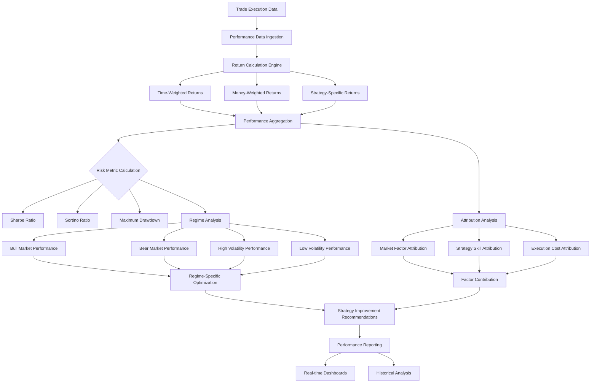

# ADR-021: Performance Analytics Agent Architecture
@requirement:[EARS-REQ-PA-001](../ears/EARS-REQ-PA-001_performance_analytics_agent.md)
@prd:[PRD-AGT-010](../prd/PRD-AGT-010_performance_analytics_requirements.md)
@sys:[SYS-AGT-010](../sys/SYS-AGT-010_performance_analytics_design.md)
@contract:[CTR-021_PERFORMANCE_ANALYTICS_AGENT](../../../specs/contracts/CTR-021_PERFORMANCE_ANALYTICS_AGENT.md)

## Status
**Status**: Proposed
**Date**: 2025-10-24
**Decision Makers**: [Agent Development Team, Quantitative Research Team]
**ADR Author**: [Cline AI Assistant]
**Last Updated**: 2025-10-24

## Context

### Problem Statement
The options trading system requires comprehensive performance measurement and attribution capabilities that analyze win rates, risk-adjusted returns, cost analysis, and strategy effectiveness across market conditions with detailed attribution analysis for continuous strategy optimization.

### Background
Complex options strategies require sophisticated performance analysis to understand profitability drivers and risk-adjusted returns. Manual performance tracking fails to provide the granularity needed for systematic strategy improvement and comparative analysis across different market regimes.

### Driving Forces
- Multi-dimensional performance measurement across all strategies and agents
- Risk-adjusted performance attribution with margin contribution analysis
- Market regime-specific performance tracking and optimization
- Cost attribution analysis separating strategy returns from execution costs

### Constraints
- **Completeness**: Performance analysis across all 11 agents and strategies
- **Accuracy**: Precise cost attribution and win rate calculation methodologies
- **Real-time**: Near real-time performance updates for active strategy evaluation
- **Granularity**: Detailed attribution analysis down to individual leg execution

## Decision

### Chosen Solution
Implement Performance Analytics Agent with comprehensive measurement and attribution:

**Performance Aggregation**: Real-time calculation of returns, win rates, and risk metrics across all strategies
**Attribution Analysis**: Multi-factor performance decomposition separating market, strategy, and execution contributions
**Regime-Specific Tracking**: Performance analysis segmented by market condition and volatility regimes
**Cost Analysis Framework**: Detailed breakdown of commission, slippage, and opportunity costs

### Key Components
- **Return Calculator**: Time-weighted and money-weighted return calculations across all strategies
- **Risk Analyzer**: Sharpe ratio, Sortino ratio, and maximum drawdown calculations
- **Cost Attributor**: Detailed cost breakdown by execution, market impact, and timing components
- **Strategy Comparator**: Comparative performance analysis across different approaches

### Implementation Approach
- BigQuery integration for scalable performance data storage and complex analytics
- Real-time calculation pipelines for live strategy evaluation during trading hours
- Historical comparison capabilities for strategy optimization and backtesting validation
- Multi-timeframe analysis supporting intraday, daily, monthly, and yearly performance views

## Requirements Satisfied

### Primary Requirements

| Requirement ID | Description | How This Decision Satisfies It |
|----------------|-------------|-------------------------------|
| EARS-REQ-PA-001 | Performance Measurement | Comprehensive return and risk metric calculation |
| PRD-AGT-010 | Attribution Analysis | Multi-factor performance decomposition and cost attribution |
| SYS-AGT-010 | Strategy Optimization | Regime-specific performance tracking and comparative analysis |
| CTR-021 | Analytics Agent Contracts | Performance calculation and attribution APIs |

### Non-Functional Requirements
- **Performance**: Sub-second calculation for critical performance metrics during trading
- **Scalability**: Support 100,000+ position performance tracking with complex analytics
- **Accuracy**: Precise cost attribution separating execution from strategy performance
- **Real-time**: Near real-time performance visibility for active strategy management

## Consequences

### Positive Outcomes

**Strategy Optimization:**
- Detailed performance attribution enabling systematic strategy improvement
- Risk-adjusted performance comparison across different approaches
- Market regime analysis identifying strategy strengths and weaknesses

**Operational Excellence:**
- Real-time performance monitoring supporting proactive intervention
- Comprehensive cost analysis optimizing execution and market impact
- Automated performance reporting reducing manual analysis workload

### Negative Outcomes

**Analysis Complexity:**
- Sophisticated attribution requiring substantial computational resources
- Complex cost allocation algorithms requiring extensive validation
- Multi-factor analysis can produce conflicting performance interpretations

**Data Dependencies:**
- High-quality execution and market data required for accurate attribution
- Historical data quality directly impacts analytical accuracy
- Real-time data feeds essential for live performance analysis

## Architecture Flow

## Implementation Assessment

### Complexity Evaluation
- **Overall Complexity**: High - Multi-dimensional performance calculation and attribution analysis
- **Development Effort**: 10-14 weeks for analytics pipeline, attribution algorithms, and reporting
- **Operational Complexity**: Medium - Performance monitoring and analytical accuracy maintenance

### Dependencies
- High-quality trade execution data for accurate cost attribution
- Historical market data for factor attribution and regime analysis
- Real-time position data for live performance calculations
- Analytical compute resources for complex attribution algorithms

### Resources
- **Compute Budget**: Analytics pipelines and complex attribution calculations
- **Storage Budget**: Performance data warehousing and historical analysis storage
- **Development Budget**: Quantitative research for attribution methodologies
- **Data Budget**: High-frequency market and execution data feeds

### Failure Modes & Recovery
- **Data Quality Issues**: Performance calculation with data quality scoring and confidence metrics
- ** Attribution Errors**: Simplified attribution approaches with warning indicators
- **Real-time Delays**: Cached performance calculations with staleness indicators
- **Computational Limits**: Sampling-based analysis for high-volume periods

## Impact Analysis

### Affected Components
- **Direct Impact**: All trading strategies requiring performance measurement and optimization
- **Strategy Development**: Historical performance data driving strategy refinement
- **Risk Management**: Risk-adjusted performance supporting informed decision-making
- **Executive Reporting**: Comprehensive performance analytics and attribution reports

### Migration Strategy
- **Phase 1**: Performance data pipeline and return calculation engine development
- **Phase 2**: Attribution analysis framework and risk metric implementations
- **Phase 3**: Regime-specific analysis and strategy comparison capabilities
- **Phase 4**: Production deployment with comprehensive analytical dashboards

### Testing Requirements
- **Calculation Tests**: Return calculation accuracy and risk metric validation
- **Attribution Tests**: Factor contribution accuracy and cost allocation verification
- **Regime Tests**: Market condition segmentation and regime-specific analysis validation
- **Reporting Tests**: Dashboard accuracy and performance visualization verification

## Security

### Sensitive Data Protection
- Performance data encryption protecting proprietary strategy results
- Access controls limiting performance visibility to authorized personnel
- Audit logging for performance analysis access and data usage

### Regulatory Compliance
- Performance reporting controls ensuring data accuracy for regulatory submissions
- Audit trails for performance calculation methodologies and data sources
- Secure storage and transmission of performance-sensitive information

### Access Governance
- Role-based access to performance analytics based on organizational need
- Granular permissions for strategy-specific and portfolio-level performance data
- Performance disclosure controls preventing competitive information leakage

## Traceability

### Upstream Sources
- **Performance Requirements**: Comprehensive measurement and attribution capabilities
- **Risk Management**: Risk-adjusted performance calculation and analysis needs
- **Strategy Optimization**: Regime-specific performance and cost attribution requirements

### Downstream Artifacts
- **Calculation Engines**: Return calculation and risk metric computation algorithms
- **Attribution Frameworks**: Multi-factor performance decomposition and cost allocation models
- **Analytical Dashboards**: Real-time and historical performance visualization systems
- **Strategy Optimization**: Performance-driven recommendations and improvement pipelines

### Validation Artifacts
- **Backtesting Results**: Historical performance calculation accuracy and attribution quality
- **Strategy Analysis**: Performance improvement recommendations effectiveness validation
- **Risk Assessments**: Risk-adjusted performance methodology validation and calibration
- **Reporting Audits**: Performance data accuracy and regulatory compliance verification

## Related Decisions

**Depends On**:
- ADR-004: BigQuery Analytics Warehouse (for analytical performance data)
- ADR-010: Cloud Monitoring Observability Architecture (for performance monitoring)
- ADR-011: Multi-Agent System Architecture

**Supersedes**: Manual performance tracking and periodic strategy analysis
**Related**:
- ADR-013: Stock Selection Agent (performance-based stock selection optimization)
- ADR-020: Risk Control Service Agent (risk-adjusted performance integration)
- ADR-026: Specification-Driven Development (for analytical model specifications)

---

**Template Version**: 1.0
**Last Reviewed**: 2025-10-24
**Next Review**: 2025-11-24
