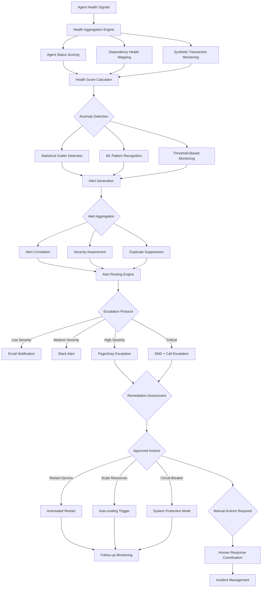

# ADR-022: Monitoring Alerting Agent Architecture
@requirement:[EARS-REQ-MA-001](../ears/EARS-REQ-MA-001_monitoring_alerting_agent.md)
@prd:[PRD-AGT-011](../prd/PRD-AGT-011_monitoring_alerting_requirements.md)
@sys:[SYS-AGT-011](../sys/SYS-AGT-011_monitoring_alerting_design.md)
@contract:[CTR-022_MONITORING_ALERTING_AGENT](../../../specs/contracts/CTR-022_MONITORING_ALERTING_AGENT.md)

## Status
**Status**: Proposed
**Date**: 2025-10-24
**Decision Makers**: [Agent Development Team, Operations Team]
**ADR Author**: [Cline AI Assistant]
**Last Updated**: 2025-10-24

## Context

### Problem Statement
The options trading system requires comprehensive system health monitoring and intelligent alerting capabilities that track agent performance, detect system anomalies, and coordinate incident response across 11 distributed agents with appropriate escalation protocols and automated remediation actions.

### Background
Distributed systems create monitoring complexity with multiple failure points and inter-dependencies. Manual monitoring fails to detect early warning signals and coordinate appropriate responses across the complex trading ecosystem.

### Driving Forces
- Unified monitoring across all 11 agents and supporting infrastructure
- Intelligent anomaly detection using ML-based thresholding and pattern recognition
- Coordinated alerting with escalation protocols matching incident severity
- Automated remediation actions for common failure scenarios

### Constraints
- **Completeness**: Monitor all system components with no monitoring gaps
- **Intelligence**: Sophisticated anomaly detection beyond simple threshold violations
- **Response**: Automated escalation and remediation reducing manual intervention
- **Performance**: Monitoring overhead must not impact trading system performance

## Decision

### Chosen Solution
Implement Monitoring Alerting Agent with intelligent health surveillance and automated response:

**Multi-Agent Health Tracking**: Comprehensive monitoring of all 11 agents with health scoring
**Anomaly Detection Engine**: ML-powered pattern recognition for early issue identification
**Coordinated Alerting**: Severity-based escalation with intelligent aggregation
**Automated Remediation**: Pre-defined response actions for common failure modes

### Key Components
- **Health Monitor**: Agent health scoring with dependency mapping and synthetic transaction monitoring
- **Anomaly Detector**: ML-based pattern recognition for infrastructure and trading anomalies
- **Alert Coordinator**: Intelligent alert aggregation and escalation management
- **Remediation Engine**: Automated response actions with approval workflows

### Implementation Approach
- Real-time agent communication monitoring and health status tracking
- ML-powered anomaly detection using historical performance baselines
- Multi-channel alerting integration (Slack, PagerDuty, email) with severity routing
- Automated remediation playbooks with human-in-the-loop approval for critical actions

## Requirements Satisfied

### Primary Requirements

| Requirement ID | Description | How This Decision Satisfies It |
|----------------|-------------|-------------------------------|
| EARS-REQ-MA-001 | System Health Monitoring | Comprehensive agent and infrastructure monitoring |
| PRD-AGT-011 | Anomaly Detection | ML-powered pattern recognition and intelligent alerting |
| SYS-AGT-011 | Incident Response Coordination | Escalation protocols and automated remediation |
| CTR-022 | Monitoring Agent Contracts | Health monitoring and alert management APIs |

### Non-Functional Requirements
- **Completeness**: 100% system coverage with agent dependency tracking
- **Accuracy**: High-confidence anomaly detection with minimal false positives
- **Speed**: Sub-second anomaly detection with immediate alert generation
- **Automation**: Automated remediation for common failure scenarios

## Consequences

### Positive Outcomes

**Operational Excellence:**
- Early anomaly detection enables proactive issue resolution
- Intelligent alerting reduces alert fatigue through aggregation and prioritization
- Automated remediation decreases mean time to resolution for common issues

**System Reliability:**
- Comprehensive health monitoring provides complete system visibility
- Agent dependency tracking prevents cascading failure blind spots
- Predictive maintenance through anomaly pattern recognition

### Negative Outcomes

**Alert Management:**
- Sophisticated alerting can create alert fatigue if not carefully tuned
- False positive anomaly detection requires continuous model calibration
- Complex escalation protocols can create confusion during crisis management

**Resource Overhead:**
- Comprehensive monitoring requires significant computational resources
- ML anomaly detection models demand training and maintenance effort
- Multiple communication channels increase configuration complexity

## Architecture Flow

## Implementation Assessment

### Complexity Evaluation
- **Overall Complexity**: High - Multi-agent monitoring with intelligent anomaly detection and remediation
- **Development Effort**: 12-16 weeks for monitoring pipelines, ML models, and alerting frameworks
- **Operational Complexity**: High - Alert management, anomaly model tuning, and remediation orchestration

### Dependencies
- Comprehensive telemetry from all 11 agents and infrastructure components
- Historical monitoring data for ML anomaly detection model training
- Alert destination services with API integrations (PagerDuty, Slack, email)
- Remediation execution capabilities through infrastructure APIs

### Resources
- **Compute Budget**: ML anomaly detection and real-time monitoring analysis
- **Storage Budget**: Historical monitoring data for pattern analysis and model training
- **API Budget**: Alerting service integrations and notification deliveries
- **Development Budget**: ML engineering for anomaly detection and monitoring expertise

### Failure Modes & Recovery
- **Alert System Failure**: Backup monitoring notification channels with escalation protocols
- **Anomaly Model Drift**: Continuous model validation with fallback to rule-based monitoring
- **Remediation Conflicts**: Conflict detection and prioritization for automated actions
- **Communication Failures**: Multi-channel redundancy for critical alert delivery

## Impact Analysis

### Affected Components
- **Direct Impact**: All agents requiring comprehensive health monitoring and alerting
- **Infrastructure**: Monitoring infrastructure and alerting integration points
- **Operations**: Incident response workflows and escalation procedures
- **Development**: System observability and monitoring instrumentation requirements

### Migration Strategy
- **Phase 1**: Base monitoring infrastructure and agent health tracking development
- **Phase 2**: Anomaly detection model development and alert routing implementation
- **Phase 3**: Automated remediation playbook development and testing
- **Phase 4**: Production deployment with comprehensive alert tuning and training

### Testing Requirements
- **Monitoring Tests**: Agent health tracking and metric collection validation
- **Alerting Tests**: Alert generation, aggregation, and routing mechanism testing
- **Anomaly Tests**: ML model accuracy and false positive rate validation
- **Remediation Tests**: Automated response effectiveness and safety mechanism testing

## Security

### Monitoring Data Protection
- Alert content encryption to protect sensitive system and trading information
- Access controls limiting monitoring data to authorized operations personnel
- Audit logging for monitoring system access and configuration changes

### Alert Security
- Notification channel authentication and encryption for secure alert delivery
- Alert content sanitization preventing sensitive information disclosure
- Integration security ensuring third-party alert services are securely configured

### Incident Response Security
- Remediation action authorization controls preventing malicious automated actions
- Incident information classification and handling according to data protection policies
- Secure communication channels for human response coordination

## Traceability

### Upstream Sources
- **Monitoring Requirements**: Comprehensive health monitoring and alerting capabilities
- **Operational Excellence**: System reliability and proactive issue detection needs
- **Incident Management**: Coordinated response and escalation protocol requirements

### Downstream Artifacts
- **Monitoring Engines**: Agent health tracking and anomaly detection algorithms
- **Alerting Systems**: Intelligent alert aggregation and routing infrastructure
- **Remediation Systems**: Automated response playbooks and approval workflows
- **Dashboard Interfaces**: Operational monitoring views and alert management interfaces

### Validation Artifacts
- **Monitoring Coverage**: System observability completeness and gap analysis
- **Alert Effectiveness**: Alert accuracy, response times, and false positive rate metrics
- **Incident Analysis**: Mean time to detection and resolution improvement measurements
- **Remediation Validation**: Automated response effectiveness and safety testing results

## Related Decisions

**Depends On**:
- ADR-010: Cloud Monitoring Observability Architecture (base monitoring infrastructure)
- ADR-011: Multi-Agent System Architecture (agent communication and health monitoring)
- ADR-027: BDD Behavior-Driven Development (alerting scenario specifications)

**Supersedes**: Individual agent monitoring without system-wide coordination
**Related**:
- ADR-012: Portfolio Orchestrator Agent (system state monitoring integration)
- ADR-020: Risk Control Service Agent (risk-based alert escalation)
- ADR-028: CI/CD Pipeline Architecture (deployment monitoring integration)

---

**Template Version**: 1.0
**Last Reviewed**: 2025-10-24
**Next Review**: 2025-11-24
