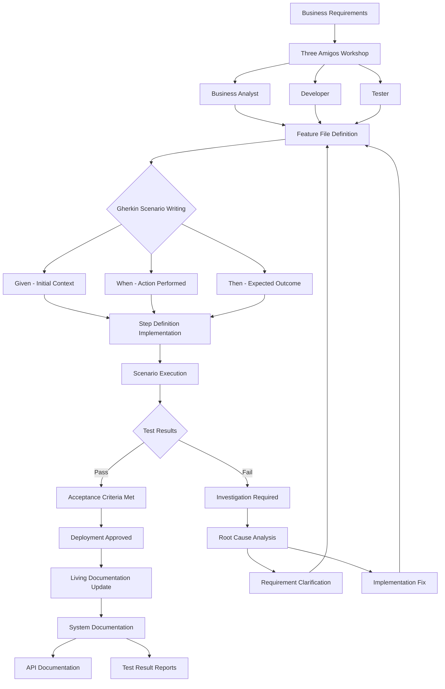

# ADR-024: BDD Behavior-Driven Development Architecture
@requirement:[EARS-REQ-BDD-001](../ears/EARS-REQ-BDD-001_behavior_driven_development.md)
@prd:[PRD-BDD-001](../prd/PRD-BDD-001_requirement_specifications.md)
@sys:[SYS-BDD-001](../sys/SYS-BDD-001_bdd_implementation.md)
@contract:[CTR-024_BDD_BEHAVIOR_DRIVEN_DEVELOPMENT](../../../specs/contracts/CTR-024_BDD_BEHAVIOR_DRIVEN_DEVELOPMENT.md)

## Status
**Status**: Accepted
**Date**: 2025-10-24
**Decision Makers**: [Development Methodology Team, BA Team]
**ADR Author**: [Cline AI Assistant]
**Last Updated**: 2025-10-24

## Context

### Problem Statement
The options trading system requires executable specification practices connecting business requirements with technical implementation across distributed agents, ensuring requirement traceability while supporting rapid feature development in complex financial domain.

### Background
Traditional requirement documentation creates disconnects between business intent and technical implementation. Complex options strategies require precise behavior specification with automated validation to prevent interpretation gaps and implementation defects.

### Driving Forces
- Executable specifications bridging business and technical requirements
- Universal language enabling collaboration across stakeholders
- Automated validation ensuring specification to implementation fidelity
- Living documentation maintaining accuracy with system evolution

### Constraints
- **Collaboration**: Cross-functional team participation in specification development
- **Maintainability**: Specification evolution matching system development pace
- **Automation**: Executable scenarios providing continuous validation
- **Traceability**: Complete linkage from requirements to implemented behaviors

## Decision

### Chosen Solution
Implement Behavior-Driven Development framework with structured scenario specification:

**Gherkin Syntax**: Natural language scenarios with structured Given/When/Then format
**Specification Pipeline**: Automated generation and execution of behavioral tests
**Cross-Platform Coverage**: Multi-language BDD framework integration
**Living Documentation**: Automated documentation generation from executable specifications

### Key Components
- **Feature Files**: Structured scenarios defining agent and system behaviors
- **Step Definitions**: Automated implementation connecting natural language to code
- **Test Execution**: Parallel scenario execution with comprehensive reporting
- **Documentation Generation**: Automated specification and test result documentation

### Implementation Approach
- Feature file organization mirroring agent and component boundaries
- Step definition libraries providing reusable behavioral assertions
- CI/CD integration ensuring scenarios execute on every deployment
- Three amigos approach involving business, development, and testing stakeholders

## Requirements Satisfied

### Primary Requirements

| Requirement ID | Description | How This Decision Satisfies It |
|----------------|-------------|-------------------------------|
| EARS-REQ-BDD-001 | Executable Business Rules | Gherkin scenarios testing actual system behavior |
| PRD-BDD-001 | Natural Language Specifications | Business-readable yet technically executable specifications |
| SYS-BDD-001 | Automated Validation | Continuous scenario execution ensuring requirement compliance |
| CTR-024 | BDD Specification Contracts | Standard scenario formats and execution guarantees |

### Non-Functional Requirements
- **Clarity**: 100% readable by non-technical stakeholders while remaining executable
- **Coverage**: All business-critical paths covered by executable scenarios
- **Execution Speed**: Scenarios completing within pipeline time constraints
- **Maintenance**: Specification evolution matching development velocity

## Consequences

### Positive Outcomes

**Collaboration Excellence:**
- Common language enabling business and technical team alignment
- Early requirement validation preventing downstream defects
- Living documentation serving as system documentation and acceptance criteria

**Quality Assurance:**
- Automated acceptance testing providing continuous validation
- Ambiguity elimination through concrete scenario definition
- Regression prevention through executable specification maintenance

### Negative Outcomes

**Learning Curve:**
- Gherkin syntax requires team training and practice
- Mindset shift from traditional testing to behavior specification
- Initially slower feedback cycles during framework adoption

**Maintenance Burden:**
- Scenario maintenance required with system and business rule changes
- Step definition complexity can become unwieldy without proper abstraction
- False negative scenarios require careful validation and maintenance

## Architecture Flow

## Implementation Assessment

### Complexity Evaluation
- **Overall Complexity**: Medium-High - Framework adoption and scenario maintenance complexity
- **Development Effort**: 8-12 weeks for framework implementation, training, and initial scenario development
- **Operational Complexity**: Medium - Scenario maintenance and result interpretation

### Dependencies
- BDD framework selection (Cucumber, Behave, SpecFlow) based on technology stack
- Feature file management and version control integration
- Test execution infrastructure for automated scenario running
- Documentation generation tools for living documentation

### Resources
- **Training Budget**: Team training on BDD practices and Gherkin syntax
- **Development Budget**: Framework implementation and tool integration
- **Maintenance Budget**: Scenario evolution and step definition updates
- **Execution Budget**: Test infrastructure resources for scenario execution

### Failure Modes & Recovery
- **Scenario Maintenance Drift**: Automated outdated scenario detection and update workflows
- **Framework Dependency Issues**: BDD tool maintenance and version consistency
- **Cross-Team Coordination**: Three amigos workshop scheduling and participation tracking
- **Execution Time Growth**: Scenario performance monitoring and selective execution strategies

## Impact Analysis

### Affected Components
- **Direct Impact**: All requirement specification and acceptance testing processes
- **Development Workflow**: Feature development with executable acceptance criteria
- **Team Interaction**: Enhanced collaboration between business and technical teams
- **Quality Process**: Shift from manual testing to automated acceptance validation

### Migration Strategy
- **Phase 1**: BDD framework selection and team training initialization
- **Phase 2**: Pilot feature implementation with BDD approach
- **Phase 3**: Framework expansion and step definition library development
- **Phase 4**: Organization-wide adoption with coaching and tooling maturity

### Testing Requirements
- **Framework Tests**: BDD tool integration and execution reliability testing
- **Scenario Tests**: Step definition accuracy and scenario completeness validation
- **Performance Tests**: Scenario execution time and resource utilization measurement
- **Coverage Tests**: Requirement to scenario mapping completeness analysis

## Security

### Specification Security
- Non-sensitive scenario descriptions preventing business logic exposure
- Test data management preventing production information leakage
- Access control for BDD framework configuration and scenario authoring

### Validation Security
- Secure test environment isolation preventing test system compromise
- Credential management for external service integration testing
- Audit logging for scenario execution and result validation

### Compliance Testing
- Regulatory requirement scenario validation for compliance testing
- Security control behavior specification and validation
- Audit trail scenario completeness for governance requirements

## Traceability

### Upstream Sources
- **Business Requirements**: Executable specifications connecting intent to implementation
- **Quality Standards**: Acceptance testing and requirement validation methodologies
- **Collaboration Needs**: Cross-functional team communication and alignment requirements

### Downstream Artifacts
- **Feature Scenarios**: Executable behavior specifications in Gherkin format
- **Step Libraries**: Reusable step definition implementations
- **Test Reports**: Automated scenario execution results and trends
- **Living Documentation**: Generated system behavior and API documentation

### Validation Artifacts
- **Coverage Analysis**: Requirement to scenario traceability and gap identification
- **Effectiveness Metrics**: Defect prevention and requirement understanding improvement
- **Adoption Metrics**: Team participation and BDD practice maturity assessment
- **Business Value**: Time-to-market improvement and defect reduction measurements

## Related Decisions

**Depends On**:
- ADR-023: Quality Assurance Framework (testing infrastructure integration)
- ADR-026: Specification-Driven Development (requirement specification linkage)

**Supersedes**: Manual acceptance criteria and documentation-based requirement validation
**Related**:
- ADR-025: API Contract Design (interface behavior specification)
- ADR-028: CI/CD Pipeline Architecture (automated scenario execution)
- ADR-029: Configuration Management (test environment specification)

---

**Template Version**: 1.0
**Last Reviewed**: 2025-10-24
**Next Review**: 2025-11-24
