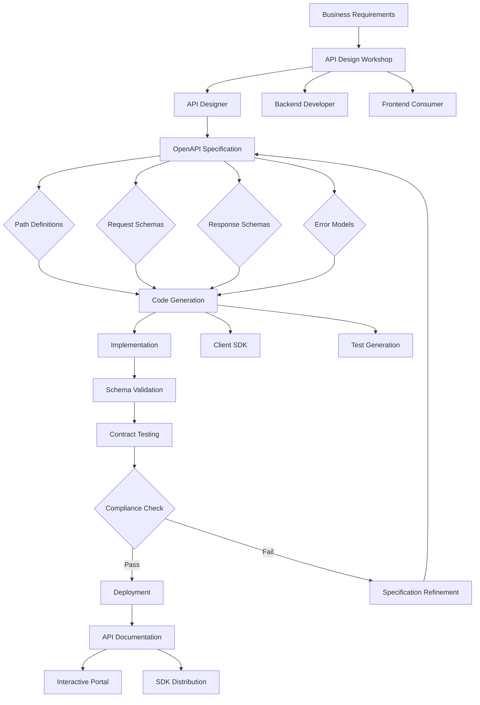

# ADR-025: API Contract Design Architecture
@requirement:[EARS-REQ-API-001](../ears/EARS-REQ-API-001_api_contract_design.md)
@prd:[PRD-API-001](../prd/PRD-API-001_interface_specifications.md)
@sys:[SYS-API-001](../sys/SYS-API-001_contract_definitions.md)
@contract:[CTR-025_API_CONTRACT_DESIGN](../../../specs/contracts/CTR-025_API_CONTRACT_DESIGN.md)

## Status
**Status**: Accepted
**Date**: 2025-10-24
**Decision Makers**: [API Design Team, Integration Team]
**ADR Author**: [Cline AI Assistant]
**Last Updated**: 2025-10-24

## Context

### Problem Statement
The options trading system requires precise API contract definitions across 11 agents ensuring interoperability, version compatibility, and consumer-producer decoupling while maintaining fast evolution in financial markets requiring interface flexibility.

### Background
Distributed agent architecture creates complex integration points requiring standardized interface definitions. Poor API contracts lead to interoperability issues, breaking changes, and maintenance overhead that impedes development velocity.

### Driving Forces
- Interface standardization enabling seamless agent interoperability
- Backward compatibility maintaining system stability during evolution
- Consumer-producer decoupling supporting independent agent development
- Comprehensive documentation facilitating third-party integrations

### Constraints
- **Evolution**: Interface changes without breaking existing integrations
- **Performance**: Efficient serialization and communication protocols
- **Documentation**: Self-documenting APIs with comprehensive contract definitions
- **Validation**: Runtime contract validation with clear error messaging

## Decision

### Chosen Solution
Implement comprehensive API contract design with OpenAPI specification framework:

**OpenAPI Specifications**: Version-controlled API definitions for all agent interfaces
**Contract-First Design**: API specifications preceding implementation
**Schema Validation**: Runtime request/response validation with detailed error reporting
**Version Management**: Semantic versioning with backward compatibility guarantees

### Key Components
- **OpenAPI Definitions**: Comprehensive agent interface specifications
- **Request/Response Schemas**: Structured data models for all API interactions
- **Error Handling**: Standardized error responses with actionable messaging
- **Documentation Portal**: Interactive API documentation with examples

### Implementation Approach
- Schema-driven development with OpenAPI code generation
- Contract testing ensuring specification-implementation fidelity
- API versioning with deprecation notices for non-breaking changes
- Consumer-driven contracts for critical integration validation

## Requirements Satisfied

### Primary Requirements

| Requirement ID | Description | How This Decision Satisfies It |
|----------------|-------------|-------------------------------|
| EARS-REQ-API-001 | Interface Standardization | OpenAPI contracts defining all agent interactions |
| PRD-API-001 | Contract-First Development | Specifications preceding implementation |
| SYS-API-001 | Schema Validation | Runtime contract enforcement with error details |
| CTR-025 | API Specification Contracts | Version-controlled interface definitions |

### Non-Functional Requirements
- **Interoperability**: Standardized contracts enabling seamless agent communication
- **Documentation**: Self-documenting APIs with interactive exploration
- **Evolution**: Version management supporting interface evolution
- **Validation**: Comprehensive runtime verification with clear error reporting

## Consequences

### Positive Outcomes

**Integration Excellence:**
- Standardized interfaces reducing integration complexity and errors
- Contract-first approach ensuring implementation meets consumer needs
- Comprehensive validation catching issues before production deployment

**Development Velocity:**
- Code generation from specifications accelerating development
- Clear interface contracts enabling parallel development
- Self-documenting APIs reducing support and integration time

### Negative Outcomes

**Specification Overhead:**
- Complex schema definitions requiring expertise and maintenance
- Specification updates requiring coordinated consumer updates
- Version management complexity with backward compatibility challenges

**Generator Limitations:**
- Code generation may not capture all business logic nuances
- Generated code may require customization and manual optimization
- Framework limitations for highly specialized requirements

## Architecture Flow

## Implementation Assessment

### Complexity Evaluation
- **Overall Complexity**: Medium-High - Specification design and maintenance complexity
- **Development Effort**: 6-10 weeks for specification framework, training, and initial API design
- **Operational Complexity**: Low-Medium - Specification maintenance and documentation publishing

### Dependencies
- OpenAPI/Swagger framework compatibility across technology stacks
- Code generation tools for multiple languages and frameworks
- Documentation generation and publishing platforms
- API testing tools for contract validation

### Resources
- **Design Budget**: API design expertise and workshop facilitation
- **Tooling Budget**: OpenAPI tools, documentation platforms, and testing frameworks
- **Training Budget**: Team training on API design and OpenAPI specification
- **Development Budget**: Code generation tools and customization work

### Failure Modes & Recovery
- **Specification Drift**: Automated specification validation and synchronization checks
- **Version Compatibility**: Semantic versioning enforcement and compatibility testing
- **Documentation Lag**: Automated documentation generation and deployment
- **Generator Updates**: Regular tool evaluation and migration planning

## Impact Analysis

### Affected Components
- **Direct Impact**: All agent interfaces and inter-agent communications
- **Development Workflow**: API-first development with specification preceding implementation
- **Integration Testing**: Contract testing ensuring component interoperability
- **Documentation**: Automated API documentation and developer experience

### Migration Strategy
- **Phase 1**: OpenAPI framework selection and team training
- **Phase 2**: Core API specifications development with proof-of-concept
- **Phase 3**: Code generation pipeline and testing framework establishment
- **Phase 4**: Organization-wide adoption with API governance processes

### Testing Requirements
- **Specifications Tests**: OpenAPI schema validation and completeness checking
- **Contract Tests**: Consumer-driven contract testing for critical integrations
- **Compatibility Tests**: Version compatibility validation and migration testing
- **Documentation Tests**: API documentation accuracy and usability validation

## Security

### Interface Security
- Authentication and authorization specification in API contracts
- Input validation schema preventing injection and malformed requests
- Secure communication protocol specifications and compliance

### Data Protection
- Sensitive data field identification and masking in specifications
- Encryption requirements for data in transit and at rest
- Audit logging specification for API access and operations

### Access Management
- API key and token management specified in authentication sections
- Rate limiting and throttling controls defined in contract specifications
- Compliance requirements integrated into API design and documentation

## Traceability

### Upstream Sources
- **Integration Requirements**: Standardized interfaces for distributed component communication
- **Quality Standards**: Contract-first approach ensuring requirement implementation accuracy
- **Development Efficiency**: Code generation and automation reducing manual implementation effort

### Downstream Artifacts
- **OpenAPI Specifications**: Version-controlled API definitions in YAML/JSON format
- **Generated Code**: SDK libraries and server stubs for multiple programming languages
- **Documentation Sites**: Interactive API documentation with examples and testing capabilities
- **Test Suites**: Contract testing frameworks ensuring API compliance

### Validation Artifacts
- **Coverage Reports**: API specification completeness and design quality metrics
- **Usage Analytics**: API adoption and satisfaction measurement through documentation portal
- **Quality Metrics**: Contract test results and API stability measurements
- **Compliance Reports**: Security and standards compliance validation for API designs

## Related Decisions

**Depends On**:
- ADR-026: Specification-Driven Development (requirement to implementation linkage)
- ADR-027: BDD Behavior-Driven Development (API behavior specification)

**Supersedes**: Ad-hoc API design and handwritten API documentation
**Related**:
- ADR-023: Quality Assurance Framework (contract testing integration)
- ADR-029: Configuration Management (environment-specific API configurations)
- ADR-030: IB Gateway Integration Architecture (brokerage API contracts)

---

**Template Version**: 1.0
**Last Reviewed**: 2025-10-24
**Next Review**: 2025-11-24
