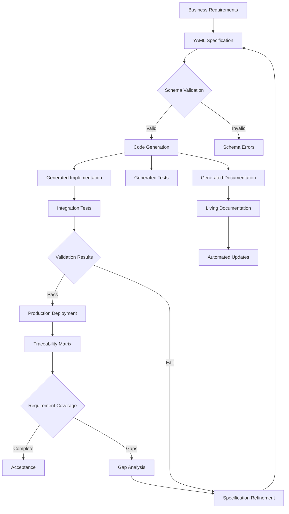

# ADR-026: Specification-Driven Development Architecture
@requirement:[EARS-REQ-SDD-001](../ears/EARS-REQ-SDD-001_specification_driven_development.md)
@prd:[PRD-SDD-001](../prd/PRD-SDD-001_sdd_methodology.md)
@sys:[SYS-SDD-001](../sys/SYS-SDD-001_sdd_implementation.md)
@contract:[CTR-026_SPECIFICATION_DRIVEN_DEVELOPMENT](../../../specs/contracts/CTR-026_SPECIFICATION_DRIVEN_DEVELOPMENT.md)

## Status
**Status**: Accepted
**Date**: 2025-10-24
**Decision Makers**: [Software Architecture Team, Development Leadership]
**ADR Author**: [Cline AI Assistant]
**Last Updated**: 2025-10-24

## Context

### Problem Statement
The options trading system requires comprehensive software development methodology ensuring specification precision, automated validation, and bidirectional traceability across 11 agents while supporting rapid evolution in complex financial domain requiring accuracy over iteration speed.

### Background
Traditional development approaches create gaps between specification and implementation leading to defects, misalignment, and maintenance overhead. Complex distributed systems require systematic approaches ensuring requirement fidelity throughout development lifecycle.

### Driving Forces
- Specification precision with automated implementation validation
- Bidirectional traceability from requirements to deployed code
- Consistent implementation patterns across distributed agents
- Quality assurance through specification-driven validation

### Constraints
- **Accuracy**: High-fidelity implementation of business and technical requirements
- **Traceability**: Complete chains from requirements to code to validation
- **Consistency**: Standardized patterns across all 11 agents
- **Automation**: Automated validation reducing manual verification effort

## Decision

### Chosen Solution
Implement Specification-Driven Development framework with YAML-based specifications:

**YAML Specifications**: Structured requirement definitions with validation schemas
**Code Generation**: Automated implementation generation from specifications
**Validation Framework**: Specification-driven testing ensuring fidelity
**Traceability Matrix**: Automated requirement-to-implementation mapping

### Key Components
- **Specification Schema**: Structured YAML format for requirements and behaviors
- **Code Generators**: Automated implementation creation from specifications
- **Validation Engine**: Specification compliance checking and gap analysis
- **Traceability Tools**: Automated relationship mapping and impact analysis

### Implementation Approach
- Specification-first development with YAML schema validation
- Code generation pipelines producing tested implementations
- Continuous validation ensuring specification-implementation alignment
- Traceability automation maintaining requirement relationships

## Requirements Satisfied

### Primary Requirements

| Requirement ID | Description | How This Decision Satisfies It |
|----------------|-------------|-------------------------------|
| EARS-REQ-SDD-001 | Specification Fidelity | Automated validation ensuring implementation accuracy |
| PRD-SDD-001 | Traceability Framework | Bidirectional mapping from specifications to code |
| SYS-SDD-001 | Code Generation | Automated implementation from validated specifications |
| CTR-026 | SDD Specification Contracts | Structured YAML formats and validation schemas |

### Non-Functional Requirements
- **Fidelity**: High-confidence implementation matching specification intent
- **Efficiency**: Code generation reducing manual development effort
- **Maintainability**: Specification changes automatically updating implementations
- **Quality**: Automated validation preventing specification drift

## Consequences

### Positive Outcomes

**Development Quality:**
- Specification precision with automated validation preventing defects
- Consistent implementation patterns across all agents
- Bidirectional traceability providing complete requirement visibility

**Operational Efficiency:**
- Code generation significantly reducing manual implementation time
- Automated validation catching issues early in development cycle
- Specification evolution enabling rapid adaptation to business changes

### Negative Outcomes

**Learning Curve:**
- YAML specification creation requiring structured thinking
- Schema complexity requiring developer training and practice
- Mental model shift from code-first to specification-first thinking

**Generator Limitations:**
- Code generation may not handle complex business logic nuances
- Generated code requiring customization and optimization
- Framework evolution requiring specification and generator updates

## Architecture Flow

## Implementation Assessment

### Complexity Evaluation
- **Overall Complexity**: High - Specification design and generation framework complexity
- **Development Effort**: 12-16 weeks for framework development, training, and adoption
- **Operational Complexity**: Medium-High - Specification maintenance and generator evolution

### Dependencies
- YAML processing libraries and validation frameworks
- Code generation tools supporting target languages
- Testing frameworks for generated code validation
- Version control and continuous integration pipelines

### Resources
- **Framework Development**: Specification parser and generator implementation
- **Tooling Budget**: YAML validators, code generators, and traceability tools
- **Training Budget**: Team training on SDD methodology and YAML specification
- **Maintenance Budget**: Framework evolution and tooling updates

### Failure Modes & Recovery
- **Specification Errors**: Schema validation preventing invalid specifications
- **Generator Failures**: Fallback to manual implementation with specification alignment
- **Validation Gaps**: Comprehensive test generation covering all specification paths
- **Evolution Complexity**: Framework versioning and migration planning

## Impact Analysis

### Affected Components
- **Direct Impact**: All requirement capture and implementation processes
- **Development Workflow**: Specification-first approach with generated code basis
- **Quality Process**: Automated validation ensuring specification compliance
- **Maintenance Process**: Specification updates automatically propagating changes

### Migration Strategy
- **Phase 1**: SDD framework selection and team training initialization
- **Phase 2**: Specification schema development and validation testing
- **Phase 3**: Code generation pipeline implementation and optimization
- **Phase 4**: Organization-wide adoption with governance and compliance processes

### Testing Requirements
- **Specification Tests**: YAML schema validation and completeness checking
- **Generator Tests**: Code generation accuracy and language compatibility testing
- **Validation Tests**: Specification-implementation alignment and requirement coverage testing
- **Evolution Tests**: Specification changes and code regeneration validation

## Security

### Specification Security
- Specification confidentiality preventing business logic exposure
- Version control security ensuring specification integrity
- Access controls for specification creation and modification

### Generated Code Security
- Code generation templates incorporating secure coding practices
- Automated security testing for generated implementations
- Vulnerability scanning integration into generation pipelines

### Validation Security
- Secure test data management preventing sensitive information exposure
- Isolated test environments protecting production systems
- Specification validation ensuring secure implementation patterns

## Traceability

### Upstream Sources
- **Quality Standards**: Specification precision and implementation fidelity requirements
- **Development Efficiency**: Automated code generation reducing manual development effort
- **Compliance Needs**: Bidirectional traceability for regulatory and audit requirements

### Downstream Artifacts
- **YAML Specifications**: Version-controlled requirement definitions
- **Generated Code**: Implementation files automatically created from specifications
- **Test Suites**: Comprehensive validation ensuring specification compliance
- **Traceability Reports**: Requirement-to-code mapping and coverage analysis

### Validation Artifacts
- **Coverage Metrics**: Specification completeness and implementation accuracy measurements
- **Quality Reports**: Automated validation results and defect prevention metrics
- **Efficiency Metrics**: Development time reduction and productivity improvements
- **Compliance Records**: Specification-to-implementation traceability documentation

## Related Decisions

**Depends On**:
- ADR-024: BDD Behavior-Driven Development (executable specifications)
- ADR-025: API Contract Design (interface specifications)

**Supersedes**: Code-first development with manual requirement mapping
**Related**:
- ADR-023: Quality Assurance Framework (validation framework integration)
- ADR-028: CI/CD Pipeline Architecture (generation pipeline integration)
- ADR-035: Alpha Vantage Integration Architecture (specification examples)

---

**Template Version**: 1.0
**Last Reviewed**: 2025-10-24
**Next Review**: 2025-11-24
