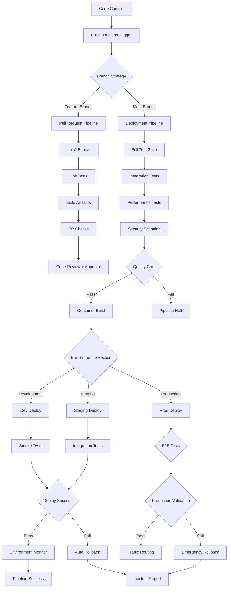

# ADR-028: CI/CD Pipeline Architecture
@requirement:[EARS-REQ-CIC-001](../ears/EARS-REQ-CIC-001_cicd_pipeline_architecture.md)
@prd:[PRD-CIC-001](../prd/PRD-CIC-001_continuous_delivery.md)
@sys:[SYS-CIC-001](../sys/SYS-CIC-001_pipeline_implementation.md)
@contract:[CTR-028_CICD_PIPELINE_ARCHITECTURE](../../../specs/contracts/CTR-028_CICD_PIPELINE_ARCHITECTURE.md)

## Status
**Status**: Accepted
**Date**: 2025-10-24
**Decision Makers**: [DevOps Team, Development Teams]
**ADR Author**: [Cline AI Assistant]
**Last Updated**: 2025-10-24

## Context

### Problem Statement
The options trading system requires automated CI/CD pipeline architecture enabling rapid, reliable deployment of 11 agents across multiple environments while maintaining quality gates, security validation, and rollback capabilities with zero-downtime releases in financial markets requiring strict oversight.

### Background
Manual deployment processes create inconsistency, human error, and slow release cycles. Financial systems require automated, auditable release processes with extensive validation gates and immediate rollback capabilities for market-sensitive operations.

### Driving Forces
- Automated deployment reducing release cycle time from days to minutes
- Consistent deployment process eliminating environment-related issues
- Quality gates preventing defective releases with comprehensive validation
- Security validation integrated into deployment pipeline

### Constraints
- **Security**: Pipeline access control and secret management integration
- **Quality**: Comprehensive testing and validation gates before production
- **Performance**: Fast pipeline execution fitting agile development cycles
- **Reliability**: Pipeline stability with monitoring and failure recovery mechanisms

## Decision

### Chosen Solution
Implement comprehensive GitHub Actions CI/CD pipeline with environment-specific deployment:

**Pipeline Stages**: Source control, build, test, security, deploy, monitor
**Environment Promotion**: Development → Staging → Production with quality gates
**Automated Testing**: Unit, integration, performance, and security testing integration
**Deployment Strategies**: Blue-green deployments for zero-downtime releases

### Key Components
- **GitHub Actions Workflows**: YAML-defined pipeline orchestration
- **Quality Gates**: Automated testing and approval requirements
- **Security Scanning**: Container and code vulnerability assessments
- **Multi-Environment Deployment**: Environment-specific configuration and rollback

### Implementation Approach
- Monorepo structure with agent-specific build and deployment workflows
- Branch protection rules enforcing quality gate requirements
- Automated artifact versioning and dependency management
- Comprehensive monitoring and alerting for pipeline health

## Requirements Satisfied

### Primary Requirements

| Requirement ID | Description | How This Decision Satisfies It |
|----------------|-------------|-------------------------------|
| EARS-REQ-CIC-001 | Automated Delivery | Complete CI/CD pipeline for agent deployment |
| PRD-CIC-001 | Quality Gates | Comprehensive validation before production deployment |
| SYS-CIC-001 | Security Integration | Vulnerability scanning and security approval integration |
| CTR-028 | Pipeline Contracts | Workflow definitions and quality gate specifications |

### Non-Functional Requirements
- **Speed**: 15-30 minute pipeline execution for development cycles
- **Reliability**: 99.9% pipeline success rate with comprehensive error handling
- **Security**: Secure credential management and audit-trailed deployments
- **Scalability**: Pipeline accommodating new agents without architecture changes

## Consequences

### Positive Outcomes

**Development Velocity:**
- Automated deployment reducing time-to-production from days to hours
- Parallel pipelining enabling multiple teams to deploy simultaneously
- Self-service deployment increasing developer autonomy

**Quality Assurance:**
- Automated testing catching issues early in development cycle
- Consistent deployment eliminating environment-related defects
- Quality gates preventing flawed code reaching production

### Negative Outcomes

**Pipeline Complexity:**
- Complex workflow orchestration requiring coordinated maintenance
- Branch protection rules creating merge conflicts during development
- Multi-environment management requiring careful configuration isolation

**Maintenance Overhead:**
- Pipeline evolution requiring updates across all agents and workflows
- Secret rotation requiring coordinated pipeline and application updates
- Performance monitoring requiring continuous pipeline optimization

## Architecture Flow

## Implementation Assessment

### Complexity Evaluation
- **Overall Complexity**: High - Multi-environment pipeline orchestration
- **Development Effort**: 8-12 weeks for pipeline design, implementation, and validation
- **Operational Complexity**: Medium - Pipeline monitoring and bottleneck resolution

### Dependencies
- GitHub repository with Actions enabled and appropriate permissions
- Google Cloud Build for container building and security scanning
- Terraform for infrastructure provisioning in pipeline workflows
- Secret management integration for deployment credentials

### Resources
- **GitHub Actions Budget**: Actions minutes usage for pipeline execution
- **Cloud Build Budget**: Container building and security scanning costs
- **Storage Budget**: Artifact storage and pipeline caching
- **Development Budget**: Pipeline authoring and optimization expertise

### Failure Modes & Recovery
- **Pipeline Capacity**: Queue management and parallel execution optimization
- **Secret Failures**: Local testing environment setup and pipeline secret validation
- **Deployment Failures**: Automated rollback with comprehensive incident reporting
- **Environment Conflicts**: Lock mechanisms preventing concurrent environment deployments

## Impact Analysis

### Affected Components
- **Direct Impact**: All agent development, testing, and deployment workflows
- **Development Process**: Code review, quality gates, and release management
- **Testing Integration**: Automated testing execution and reporting
- **Deployment Process**: Multi-environment deployment orchestration

### Migration Strategy
- **Phase 1**: Core CI/CD pipeline design and GitHub Actions setup
- **Phase 2**: Agent-specific workflow implementation and testing
- **Phase 3**: Quality gate implementation and security scanning integration
- **Phase 4**: Multi-environment deployment and rollback validation

### Testing Requirements
- **Pipeline Tests**: Workflow execution validation and error handling testing
- **Quality Gate Tests**: Test failure handling and approval workflow validation
- **Performance Tests**: Pipeline execution time and resource usage optimization
- **Integration Tests**: Cross-agent and cross-environment deployment coordination

## Security

### Pipeline Security
- Protected branch rules requiring code review and status checks
- Service account authentication for deployment operations
- Audit logging for all pipeline actions and credential usage

### Artifact Security
- Signed container images preventing tampering in supply chain
- Vulnerability scanning integration rejecting insecure builds
- Secret management protecting sensitive configuration and credentials

### Access Control
- Repository-based access control for pipeline configuration
- Deployment role separation requiring separate approvals for production
- Pipeline hardening preventing injection attacks and unauthorized execution

## Traceability

### Upstream Sources
- **Quality Requirements**: Automated testing and deployment validation needs
- **Security Standards**: Secure deployment and credential management requirements
- **Agility Requirements**: Rapid release cycles with quality assurance

### Downstream Artifacts
- **Pipeline Workflows**: GitHub Actions YAML definitions for each deployment type
- **Quality Checks**: Automated testing and scanning configuration
- **Deployment Scripts**: Environment-specific deployment and rollback procedures
- **Monitoring Dashboards**: Pipeline metrics and deployment status tracking

### Validation Artifacts
- **Pipeline Metrics**: Build time, success rate, and bottleneck analysis
- **Deployment Records**: Automated deployment tracking and change management
- **Quality Reports**: Test coverage, vulnerability scanning, and approval compliance
- **Compliance Audits**: Deployment security and process compliance validation

## Related Decisions

**Depends On**:
- ADR-023: Quality Assurance Framework (testing integration)
- ADR-027: Containerization Strategy (container build automation)

**Supersedes**: Manual deployment processes and environment-specific scripts
**Related**:
- ADR-005: Terraform Infrastructure as Code (infrastructure deployment)
- ADR-010: Cloud Monitoring Observability Architecture (deployment monitoring)
- ADR-029: Configuration Management (environment configuration)

---

**Template Version**: 1.0
**Last Reviewed**: 2025-10-24
**Next Review**: 2025-11-24
