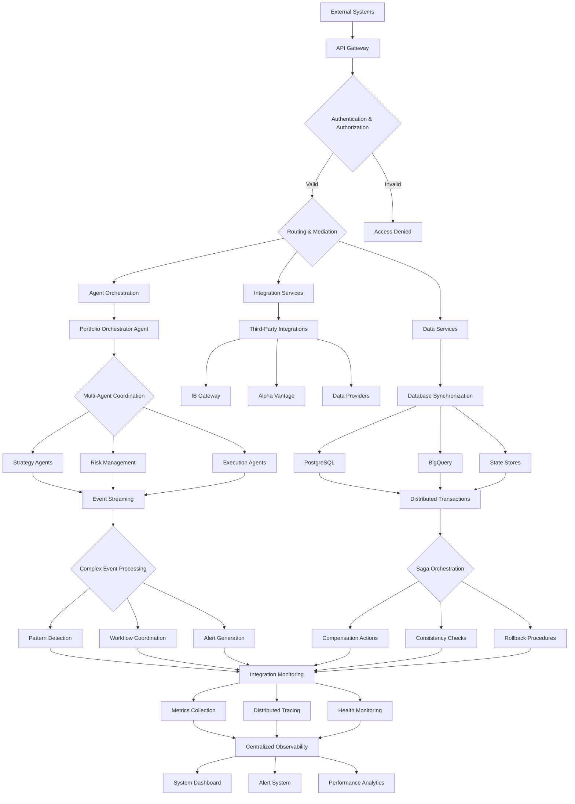

# ADR-034: System Integration Architecture
@requirement:[EARS-REQ-SIA-001](../ears/EARS-REQ-SIA-001_system_integration.md)
@prd:[PRD-SIA-001](../prd/PRD-SIA-001_integration_framework.md)
@sys:[SYS-SIA-001](../sys/SYS-SIA-001_integration_implementation.md)
@contract:[CTR-034_SYSTEM_INTEGRATION](../../../specs/contracts/CTR-034_SYSTEM_INTEGRATION.md)

## Status
**Status**: Accepted
**Date**: 2025-10-24
**Decision Makers**: [System Architecture Team, Integration Team]
**ADR Author**: [Cline AI Assistant]
**Last Updated**: 2025-10-24

## Context

### Problem Statement
The options trading system requires comprehensive system integration architecture ensuring seamless interoperability across 11 agents, multiple data sources, infrastructure components, and external integrations while maintaining data consistency, transaction integrity, and performance optimization in complex distributed environment.

### Background
Complex distributed systems create integration challenges requiring sophisticated orchestration, data synchronization, and transaction management. Event-driven architecture with asynchronous processing demands comprehensive integration patterns ensuring reliability, observability, and maintainability across multiple technology boundaries.

### Driving Forces
- Seamless component interoperability enabling complex trading workflows
- End-to-end transaction integrity across distributed operations
- Comprehensive observability providing complete system visibility
- Performance optimization maintaining sub-second trading capabilities

### Constraints
- **Performance**: Integration overhead not exceeding system performance budgets
- **Reliability**: Integration layer providing 99.99% data consistency and availability
- **Maintainability**: Integration patterns supporting evolutionary architecture changes
- **Scalability**: Integration infrastructure scaling with system growth requirements

## Decision

### Chosen Solution
Implement comprehensive system integration with orchestration, mediation, and synchronization patterns:

**Orchestration Layer**: Central coordination of complex multi-agent workflows
**Integration Patterns**: Event-driven messaging, API mediation, and data synchronization
**Transaction Management**: Distributed saga patterns ensuring consistency across operations
**Observability Integration**: Unified monitoring, tracing, and logging across all components

### Key Components
- **Integration Bus**: Centralized communication hub with routing, transformation, and mediation
- **Transaction Coordinator**: Distributed transaction orchestration with saga pattern implementation
- **Data Synchronization**: Real-time data replication and conflict resolution across components
- **Integration Monitoring**: End-to-end observability with performance metrics and health tracking

### Implementation Approach
- API Gateway providing unified access layer with authentication, rate limiting, and routing
- Event streaming platform enabling asynchronous communication and complex event processing
- Service mesh managing inter-service communication with automated retries and circuit breaking
- Integration testing framework validating end-to-end workflows and data consistency

## Requirements Satisfied

### Primary Requirements

| Requirement ID | Description | How This Decision Satisfies It |
|----------------|-------------|-------------------------------|
| EARS-REQ-SIA-001 | System Integration | Comprehensive integration architecture enabling component interoperability |
| PRD-SIA-001 | Orchestration Framework | Coordination of complex trading workflows across distributed agents |
| SYS-SIA-001 | Transaction Integrity | Distributed transaction management with consistency guarantees |
| CTR-034 | Integration Contracts | Standard integration patterns and reliability guarantees |

### Non-Functional Requirements
- **Reliability**: 99.99% message delivery with guaranteed integration consistency
- **Performance**: <1ms integration latency overhead maintaining trading performance
- **Observability**: Complete system visibility with distributed tracing and monitoring
- **Scalability**: Integration layer scaling supporting system growth and peak loads

## Consequences

### Positive Outcomes

**Operational Excellence:**
- Seamless workflow coordination enabling complex trading scenarios
- Unified observability providing complete system visibility and debugging capabilities
- Automated transaction management ensuring data consistency across failures

**Development Velocity:**
- Standardized integration patterns accelerating new component development
- Reusable integration components reducing implementation effort and errors
- Comprehensive testing frameworks ensuring integration quality and reliability

### Negative Outcomes

**Complexity Management:**
- Integration layer complexity requiring specialized architectural knowledge
- Orchestration logic maintenance requiring careful coordination across components
- Distributed transaction management adding operational complexity and monitoring needs

**Performance Overhead:**
- Integration layer processing introducing latency across critical paths
- Monitoring and tracing overhead increasing resource consumption
- Synchronization mechanisms requiring careful tuning to avoid bottleneck formation

## Architecture Flow

## Implementation Assessment

### Complexity Evaluation
- **Overall Complexity**: High - Distributed integration orchestration and transaction management
- **Development Effort**: 14-18 weeks for integration framework, orchestration, and testing
- **Operational Complexity**: Medium-High - Integration monitoring and transaction management oversight

### Dependencies
- API Gateway infrastructure for unified access and routing
- Event streaming platform for asynchronous communication and processing
- Service mesh implementation for inter-service communication management
- Distributed tracing and monitoring tools for end-to-end observability

### Resources
- **Orchestration Budget**: Integration orchestration and coordination system development
- **Infrastructure Budget**: API gateway, service mesh, and event streaming platform costs
- **Monitoring Budget**: Distributed tracing, observability, and alerting system resources
- **Development Budget**: Integration pattern implementation and cross-component coordination

### Failure Modes & Recovery
- **Integration Failures**: Circuit breaker patterns and graceful degradation procedures
- **Transaction Deadlocks**: Saga compensation workflows with manual intervention capabilities
- **Message Queue Full**: Backpressure management and queue size optimization strategies
- **Synchronization Conflicts**: Conflict resolution algorithms and consistency verification

## Impact Analysis

### Affected Components
- **Direct Impact**: All system components requiring inter-component communication and coordination
- **Data Flow**: Synchronization and consistency management across distributed components
- **Transaction Management**: Distributed operation orchestration and consistency guarantees
- **Observability**: End-to-end monitoring, tracing, and performance visibility

### Migration Strategy
- **Phase 1**: Integration foundation with API gateway and messaging infrastructure
- **Phase 2**: Orchestration patterns implementation and agent coordination
- **Phase 3**: Distributed transaction and consistency management integration
- **Phase 4**: Comprehensive monitoring, observability, and testing framework deployment

### Testing Requirements
- **Integration Tests**: End-to-end workflow validation and component interoperability testing
- **Orchestration Tests**: Complex workflow coordination and multi-agent scenario testing
- **Transaction Tests**: Distributed transaction consistency and failure recovery validation
- **Performance Tests**: Integration overhead measurement and scalability testing

## Security

### Integration Security
- Secure communication channels with encryption and mutual authentication
- Message integrity verification preventing tampering and injection attacks
- Service isolation preventing unauthorized cross-component access and data leakage

### Transaction Security
- Secure transaction contexts maintaining integrity across distributed operations
- Audit trail preservation for transaction investigation and compliance requirements
- Secure rollback procedures protecting against malicious transaction manipulation

### Access Control
- Granular access controls for integration endpoints and message routing
- Authentication and authorization integration with centralized identity management
- Secure credential management for third-party integration access and API keys

## Traceability

### Upstream Sources
- **Interoperability Requirements**: Seamless component interaction and data sharing needs
- **Reliability Requirements**: Consistent data flows and transaction integrity demands
- **Observability Requirements**: Complete system visibility and debugging capabilities

### Downstream Artifacts
- **Integration Frameworks**: API gateway, service mesh, and event streaming infrastructures
- **Orchestration Systems**: Workflow coordination and multi-agent orchestration engines
- **Transaction Managers**: Distributed transaction coordination with saga pattern implementation
- **Monitoring Systems**: End-to-end observability with distributed tracing and alerting

### Validation Artifacts
- **Integration Testing Results**: Component interoperability and workflow validation reports
- **Performance Measurement**: Integration overhead and system throughput optimization data
- **Transaction Success Rates**: Distributed operation consistency and reliability metrics
- **Observability Coverage**: Monitoring completeness and alert effectiveness measurements

## Related Decisions

**Depends On**:
- ADR-002: Cloud Pub/Sub Messaging Architecture (event-driven communication infrastructure)
- ADR-003: Cloud SQL PostgreSQL Architecture (distributed transaction management)
- ADR-011: Multi-Agent System Architecture (agent coordination and interaction patterns)

**Supersedes**: Point-to-point integrations and manual component coordination
**Related**:
- ADR-025: API Contract Design (integration contract specifications)
- ADR-028: CI/CD Pipeline Architecture (integration testing automation)
- ADR-033: Compliance Monitoring Architecture (transaction audit trail integration)

---

**Template Version**: 1.0
**Last Reviewed**: 2025-10-24
**Next Review**: 2025-11-24
