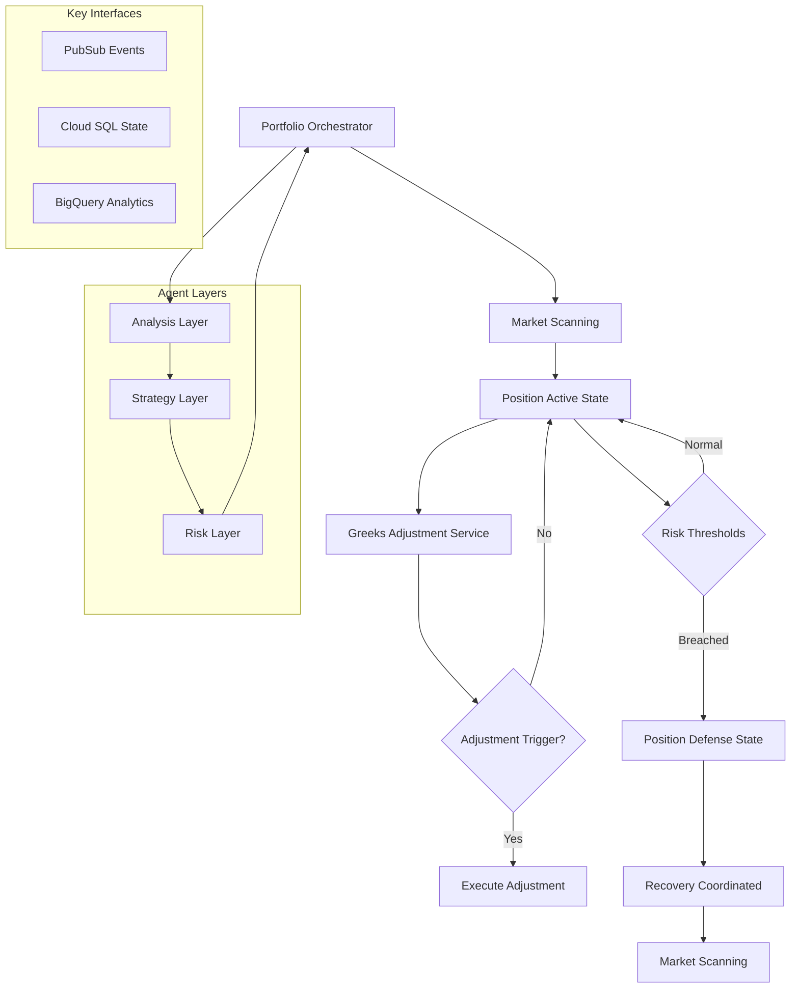

# ADR-036: Option Strategy Portfolio Architecture

## Status
**Status**: Accepted
**Date**: 2025-10-24
**Decision Makers**: [Architecture Team]
**ADR Author**: [Cline AI Assistant]
**Last Updated**: 2025-10-24

## Context

### Problem Statement
The options trading system requires a unified architecture to manage a portfolio of 11 autonomous agents supporting 4 trading states: MARKET_SCANNING → POSITION_ACTIVE → POSITION_DEFENSE → RECOVERY_MODE. Each agent must operate independently while maintaining coordinated risk management, real-time Greeks monitoring, and automated position adjustment capabilities.

### Background
The system must integrate 11 specialized agents (Orchestrator, Stock Selection, Market Assessment, Covered Calls, Covered Puts, Iron Condor, Greeks Adjustment, Portfolio Hedging, Risk Controls, Performance Analytics, Monitoring) with complex inter-dependencies and state transitions.

### Driving Forces
- Sub-second decision latency requirements for live trading
- 99.5% uptime across market hours
- Complete auditability and regulatory compliance
- Cost efficiency with scale-to-zero capabilities

### Constraints
- **Performance**: <1 second decision latency, 11 concurrent agents
- **Reliability**: Real-time Greeks monitoring and automated adjustment
- **Compliance**: Complete traceability and audit trails
- **Budget**: Serverless-first with cost optimization

## Decision

### Chosen Solution
Implement a hierarchical multi-agent architecture with four distinct layers:

**Layer 1 (Orchestration)**: Single Portfolio Orchestrator Agent with state machine
**Layer 2 (Analysis)**: Stock Selection and Market Environment Assessment Agents
**Layer 3 (Execution)**: Three Strategy Agents + Greeks Adjustment Service
**Layer 4 (Risk & Control)**: Centralized Risk Management + Support Services

### Key Components
- **Portfolio Orchestrator**: Central state machine managing trading lifecycle
- **Strategy Agents**: Covered Calls, Covered Puts, Iron Condor with dedicated logic
- **Greeks Adjustment Service**: Real-time position monitoring and automated playbooks
- **Risk Controls**: Portfolio-level limits, correlation gates, circuit breakers

### Implementation Approach
- Event-driven communication via Google Cloud Pub/Sub
- Serverless deployment on Google Cloud Run
- State management externalized to Cloud SQL
- Analytics and telemetry via BigQuery and Cloud Monitoring

## Requirements Satisfied

### Primary Requirements

| Requirement ID | Description | How This Decision Satisfies It |
|----------------|-------------|-------------------------------|
| PRD-001 | Portfolio Orchestrator | Layer 1 Orchestrator Agent |
| PRD-002-004 | Greeks Adjustment System | Dedicated adjustment service with playbooks |
| PRD-005-007 | Position Management | Automated roll, close, hedge adjustments |
| EARS-001 | Orchestrator Requirements | State machine with 4-state lifecycle |

### Non-Functional Requirements
- **Performance**: Sub-second latency through event-driven async processing
- **Scalability**: 0-5 auto-scaling instances per agent
- **Reliability**: Defense-in-depth controls with circuit breaker isolation
- **Observability**: Complete telemetry across all components

## Consequences

### Positive Outcomes

**Architectural Benefits:**
- Clear separation of concerns across 4 functional layers
- Event-driven decoupling enables independent agent scaling
- Centralized orchestration provides single source of truth
- Automated recovery protocols reduce manual intervention

**Requirements Satisfaction:**
- Satisfies all 32 PRD requirements through mapped agent responsibilities
- EARS requirements met through orchestrated state transitions
- Complete traceability maintained through event correlation IDs

### Negative Outcomes

**Complexity Trade-offs:**
- Multi-agent coordination requires sophisticated event routing
- State consistency challenges with distributed agents
- Increased operational complexity with 11 concurrent services

**Costs:**
- Development: Extended timeline for agent specialization (4 months)
- Operational: Higher resource usage during market hours
- Monitoring: Complex alerting across multiple service boundaries

## Architecture Flow

## Implementation Assessment

### Complexity Evaluation
- **Overall Complexity**: High - Coordinating 11 specialized agents with complex state transitions
- **Development Effort**: 12-16 weeks for complete implementation and testing
- **Testing Complexity**: End-to-end workflow testing across all state transitions

### Dependencies
- Google Cloud Run for serverless deployment
- Cloud Pub/Sub for event-driven communication
- Cloud SQL for transactional state management
- BigQuery for analytics data

### Resources
- **Compute**: 2-4 vCPUs per agent during active trading
- **Memory**: 2-4GB RAM per agent based on workload
- **Storage**: 100GB Cloud SQL + multi-terabyte BigQuery

### Failure Modes & Recovery
- Agent isolation prevents cascade failures
- Circuit breaker patterns with automated recovery
- State reconciliation protocols for consistency
- Manual intervention capabilities for critical failures

## Impact Analysis

### Affected Components
- **Direct Impact**: All 11 agents requiring coordinated deployment
- **Infrastructure**: GCP services (Cloud Run, Pub/Sub, Cloud SQL)
- **Monitoring**: Extended dashboards for multi-agent health
- **Operations**: Complex deployment and rollback procedures

### Migration Strategy
- **Phase 1**: Orchestrator and analysis layer deployment
- **Phase 2**: Strategy agent rollout with risk controls
- **Phase 3**: Greeks adjustment and portfolio hedging
- **Phase 4**: Full production with monitoring and alerting

### Testing Requirements
- **Unit Tests**: Individual agent functionality
- **Integration Tests**: Agent-to-agent event flows
- **End-to-End Tests**: Complete trading lifecycle scenarios
- **Performance Tests**: Sub-second latency validation
- **Chaos Tests**: Agent failure scenario simulation

## Security

### Authentication & Authorization
- Service account least privilege for each agent role
- Workload Identity for secure GCP service access
- Mutual TLS for inter-service communication

### Data Protection
- End-to-end encryption for all data in transit
- Encrypted storage with customer-managed keys
- PII masking and data minimization

### Security Monitoring
- Real-time threat detection across all agents
- Complete audit trails with correlation IDs
- Automated security event response

## Traceability

### Upstream Sources
- **Product Strategy**: 32 PRD requirements mapping to agent functions
- **Requirements**: 11 EARS engineering specifications
- **Architecture Documents**: ../../../docs/architecture/option_strategy_architecture.md

### Downstream Artifacts
- **Specifications**: Service YAML specifications for each agent
- **Contracts**: OpenAPI definitions for inter-agent APIs
- **Test Scenarios**: BDD feature files for agent behaviors
- **Implementation**: Python code for all 11 agents

### Validation Artifacts
- **Performance Benchmarks**: Latency and throughput targets
- **Security Assessments**: Penetration testing results
- **Reliability Testing**: Chaos engineering reports

## Related Decisions

**Depends On**:
- ADR-037: GCP Infrastructure Architecture
- ADR-039: Event-Driven Messaging Architecture
- ADR-041: Defense-in-Depth Security Architecture

**Supersedes**: N/A - New architecture design
**Related**:
- ADR-038: Orchestrator Agent Architecture
- ADR-042: Complete Observability Architecture

---

**Template Version**: 1.0
**Last Reviewed**: 2025-10-24
**Next Review**: 2025-11-24
