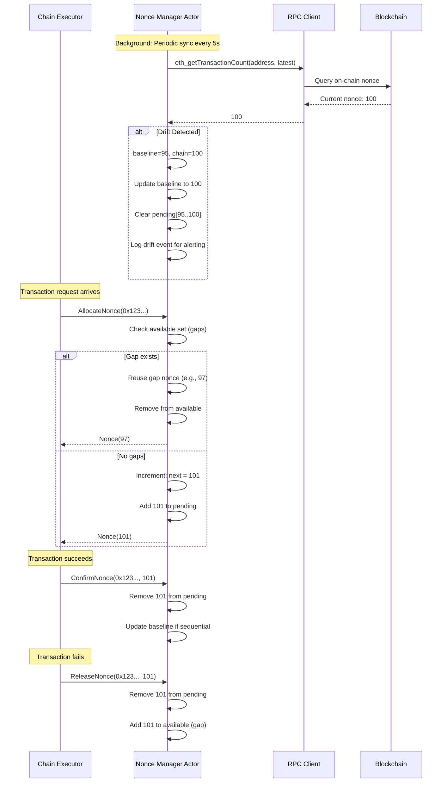

# ADR-001: Nonce Management Strategy

**Status**: Proposed  
**Date**: 2024-01-XX  
**Deciders**: Staff Engineer Candidate, Jacquin Mininger  

## Context

EVM transactions require monotonically increasing nonces per (chain_id, address) pair. The challenges:

- **Concurrency**: At peak load (10-20 concurrent requests per chain), must allocate unique nonces without bottleneck
- **Correctness**: Duplicate nonces cause transaction replacement; gaps block all subsequent transactions
- **Drift**: Manual transactions or system restarts can desync local state from on-chain reality
- **Recovery**: Failed transactions create gaps that must be detected and filled

## Decision

Implement a **per-chain, per-address actor-based nonce manager** using optimistic allocation with periodic on-chain synchronization and proactive gap detection.

**Key Principles**:
1. **Optimistic Allocation**: Allocate from local counter without RPC call (sub-millisecond latency)
2. **Periodic Sync**: Background task queries on-chain nonce every 5 seconds to detect drift
3. **Gap Tracking**: Maintain set of released nonces (failures) for reuse before incrementing
4. **Isolation**: Per-chain nonce managers prevent cross-chain interference

### Open Questions

1. How should we recover or restart our actors, should we persist state to disk or re-query on startup? Should we shutdown them or keep them running (but it will continuously grow)? (create actor on demand and shutdown idle ones?)
2. Should we have some actor manager to oversee lifecycle and resource allocation?
3. How costly is querying on-chain nonce for many addresses, should we limit the number of addresses we track?

## Architecture

## Data Structures

// ...existing code from original document...

## Implementation

See [full implementation details in original ADR document](../ADR-MultiChain-Executor.md#implementation-strategy).

Key components:
- Global memory allocator setup (mimalloc)
- Metrics singleton with Prometheus
- Actor lifecycle management
- Optimistic allocation with backpressure
- Periodic synchronization with error handling

## Trade-offs

**Chosen: Optimistic Allocation + Periodic Sync**

*Advantages*:
- ✅ Sub-millisecond allocation latency
- ✅ No RPC call per allocation (99%+ of cases)
- ✅ Automatic drift detection and correction
- ✅ Gap reuse prevents nonce fragmentation

*Disadvantages*:
- ⚠️ Requires careful state management
- ⚠️ Drift can cause temporary allocation failures
- ⚠️ Memory grows with number of active addresses

**Alternative: Query-Per-Allocation** - Rejected

*Why Rejected*:
- ❌ RPC latency: 50-200ms per allocation
- ❌ Becomes bottleneck at scale
- ❌ Unnecessary load on RPC endpoints
- ✅ Guaranteed correctness (only benefit)

## Metrics & Monitoring

Key metrics to monitor:
- `nonce_allocations_total` - Track allocation rate
- `nonce_drift_detected_total` - Alert on frequent drift
- `nonce_gaps_filled_total` - Track gap reuse efficiency
- `nonce_sync_duration_seconds` - Monitor sync performance

Alert conditions:
- Drift detected >5 times in 5 minutes → Manual intervention needed
- Sync duration >1s consistently → RPC performance issue
- Active addresses >10,000 → Consider sharding or cleanup

## Related ADRs

- [ADR-003: Concurrency Model](./003-concurrency-model.md) - Actor framework usage
- [ADR-005: Confirmation Tracking](./005-confirmation-tracking.md) - Nonce confirmation flow

## References

- [Ethereum Yellow Paper: Transaction Nonces](https://ethereum.github.io/yellowpaper/paper.pdf)
- [EIP-2718: Typed Transaction Envelope](https://eips.ethereum.org/EIPS/eip-2718)
