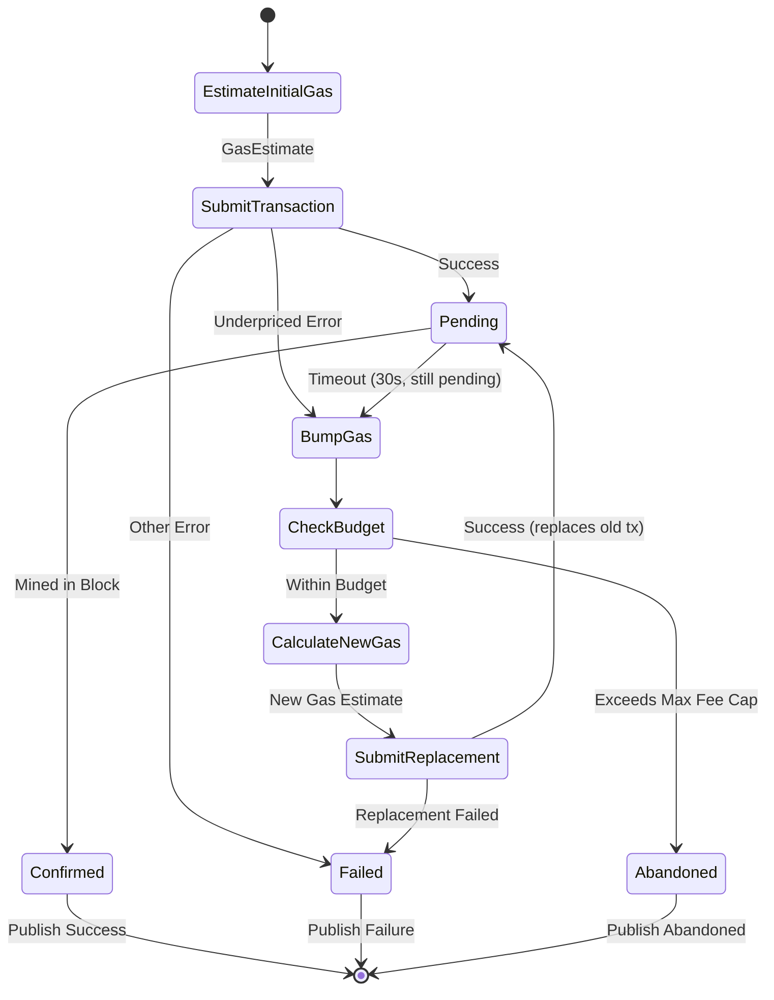

# ADR-002: Heterogeneous Gas Pricing Strategy

**Status**: Proposed  
**Date**: 2024-01-XX  
**Deciders**: Staff Engineer Candidate, Jacquin Mininger  

## Context

Different EVM chains use incompatible gas pricing models:

**Legacy Chains (BSC)**:
- Single `gasPrice` field
- Must exceed current network conditions
- Simple but less efficient during congestion

**EIP-1559 Chains (Ethereum, Arbitrum, Base, Optimism)**:
- `maxFeePerGas` = cap on total gas price
- `maxPriorityFeePerGas` = tip to validators
- `baseFee` = network-determined base fee (burned)
- Formula: `maxFeePerGas = baseFee * multiplier + priorityFee`

**Challenges**:
- Gas prices fluctuate 10x within minutes during congestion (Ethereum: 20 → 200 gwei)
- Underpriced transactions return `TransactionUnderpriced` errors
- Overpricing wastes capital (at 10k tx/day, 10% overpayment = significant cost)
- Must maintain next-block execution speed while minimizing cost

## Decision

Implement a **per-chain gas oracle with adaptive estimation and progressive fee bumping**, using different strategies for legacy vs. EIP-1559 chains.

**Key Principles**:
1. **Initial Estimate**: Query network conditions, apply conservative buffer
2. **Progressive Bumping**: Exponential backoff on underpriced errors
3. **Budget Caps**: Abandon transactions exceeding maximum fee threshold
4. **Chain-Specific Tuning**: Different parameters per chain based on volatility

## Architecture



## Data Structures

```rust
use ahash::AHashSet;
use derivative::Derivative;

/// Gas pricing strategy per chain type
pub enum GasStrategy {
    Legacy(LegacyGasOracle),
    Eip1559(Eip1559GasOracle),
}

impl GasStrategy {
    pub fn for_chain(chain_id: u32, rpc: Arc<RpcClient>) -> Self {
        match chain_id {
            56 => Self::Legacy(LegacyGasOracle::new(chain_id, rpc)),
            1 | 42161 | 8453 | 10 => Self::Eip1559(Eip1559GasOracle::new(chain_id, rpc)),
            _ => panic!("Unsupported chain: {}", chain_id),
        }
    }
    
    pub async fn estimate(&self) -> Result<GasEstimate, GasError> {
        match self {
            Self::Legacy(oracle) => oracle.estimate().await,
            Self::Eip1559(oracle) => oracle.estimate().await,
        }
    }
}

/// EIP-1559 gas oracle with adaptive estimation
pub struct Eip1559GasOracle {
    chain_id: u32,
    rpc: Arc<RpcClient>,
    
    /// Config
    config: Arc<parking_lot::RwLock<Eip1559Config>>,
    
    /// Historical base fee samples (last 10 blocks)
    /// Using crossbeam for lock-free queue
    base_fee_history: Arc<crossbeam::queue::ArrayQueue<U256>>,
    
    /// Metrics
    metrics: &'static GasMetrics,
}

#[derive(Clone, Debug, serde::Deserialize, serde::Serialize, Derivative)]
#[derivative(Default)]
struct Eip1559Config {
    /// Priority fee percentile to target (50 = median, 75 = aggressive)
    #[derivative(Default(value = "50"))]
    priority_percentile: u8,
    
    /// Base fee multiplier for maxFeePerGas (default: 2.0)
    #[derivative(Default(value = "2.0"))]
    #[serde(default = "default_base_fee_multiplier")]
    base_fee_multiplier: f64,
    
    /// Fee bump multiplier on underpriced errors (default: 1.1 = 10%)
    #[derivative(Default(value = "1.1"))]
    #[serde(default = "default_bump_multiplier")]
    bump_multiplier: f64,
    
    /// Maximum fee cap in gwei (e.g., 500 for Ethereum)
    #[derivative(Default(value = "500"))]
    max_fee_gwei: u64,
    
    /// Maximum bump attempts before abandoning
    #[derivative(Default(value = "5"))]
    max_bump_attempts: u8,
}

fn default_base_fee_multiplier() -> f64 { 2.0 }
fn default_bump_multiplier() -> f64 { 1.1 }

/// Legacy (pre-EIP-1559) gas oracle
pub struct LegacyGasOracle {
    chain_id: u32,
    rpc: Arc<RpcClient>,
    config: LegacyConfig,
}

#[derive(Clone, Debug, serde::Deserialize, serde::Serialize, Derivative)]
#[derivative(Default)]
struct LegacyConfig {
    /// Safety buffer multiplier (default: 1.1 = 10% over current)
    #[derivative(Default(value = "1.1"))]
    buffer_multiplier: f64,
    
    /// Fee bump multiplier
    bump_multiplier: f64,
    
    /// Maximum gas price in gwei
    #[derivative(Default(value = "20"))]
    max_gas_price_gwei: u64,
    
    /// Maximum bump attempts
    #[derivative(Default(value = "5"))]
    max_bump_attempts: u8,
}

/// Gas price estimate for a transaction
#[derive(Debug, Clone)]
pub struct GasEstimate {
    /// For legacy: gasPrice. For EIP-1559: maxFeePerGas
    pub max_fee: U256,
    
    /// For EIP-1559 only: maxPriorityFeePerGas
    pub priority_fee: Option<U256>,
    
    /// Estimated gas limit for the transaction
    pub gas_limit: U256,
    
    /// Total estimated cost (max_fee * gas_limit)
    pub estimated_cost: U256,
    
    /// Chain model used
    pub model: GasModel,
}

#[derive(Debug, Clone, Copy)]
pub enum GasModel {
    Legacy,
    Eip1559,
}

/// State tracking for progressive fee bumping
#[derive(Debug, Clone)]
pub struct FeeBumpState {
    /// Original estimate
    initial: GasEstimate,
    
    /// Current attempt number (0 = initial submission)
    attempts: u8,
    
    /// Total time elapsed since first submission
    elapsed: Duration,
    
    /// Current gas estimate
    current: GasEstimate,
    
    /// Timestamp of last bump
    last_bump: Instant,
}

#[derive(Debug, thiserror::Error)]
pub enum GasError {
    #[error("RPC error: {0}")]
    RpcError(String),
    
    #[error("Gas estimation failed: {0}")]
    EstimationFailed(String),
    
    #[error("Exceeds budget: attempted {attempted} gwei > max {max} gwei")]
    ExceedsBudget { attempted: u64, max: u64 },
    
    #[error("Max bump attempts reached: {0}")]
    MaxAttemptsReached(u8),
}
```

## Chain-Specific Configuration

```rust
pub fn default_config_for_chain(chain_id: u32) -> GasStrategy {
    match chain_id {
        // Ethereum Mainnet: High volatility, aggressive bumping
        1 => GasStrategy::Eip1559(Eip1559GasOracle {
            config: Eip1559Config {
                priority_percentile: 50,
                base_fee_multiplier: 2.0,  // Conservative: 2x base fee
                bump_multiplier: 1.15,     // Aggressive: 15% per bump
                max_fee_gwei: 500,         // Up to 500 gwei
                max_bump_attempts: 5,
            },
            // ...
        }),
        
        // Arbitrum: Low base fees, fast blocks
        42161 => GasStrategy::Eip1559(Eip1559GasOracle {
            config: Eip1559Config {
                priority_percentile: 50,
                base_fee_multiplier: 1.5,  // Less conservative
                bump_multiplier: 1.10,     // Standard: 10% per bump
                max_fee_gwei: 5,           // Arbitrum rarely exceeds 1 gwei
                max_bump_attempts: 5,
            },
            // ...
        }),
        
        // Base: Similar to Optimism
        8453 => GasStrategy::Eip1559(Eip1559GasOracle {
            config: Eip1559Config {
                priority_percentile: 50,
                base_fee_multiplier: 1.5,
                bump_multiplier: 1.10,
                max_fee_gwei: 10,
                max_bump_attempts: 5,
            },
            // ...
        }),
        
        // Optimism: L2 with low fees
        10 => GasStrategy::Eip1559(Eip1559GasOracle {
            config: Eip1559Config {
                priority_percentile: 50,
                base_fee_multiplier: 1.5,
                bump_multiplier: 1.10,
                max_fee_gwei: 10,
                max_bump_attempts: 5,
            },
            // ...
        }),
        
        // BSC: Legacy pricing, medium volatility
        56 => GasStrategy::Legacy(LegacyGasOracle {
            config: LegacyConfig {
                buffer_multiplier: 1.10,   // 10% buffer
                bump_multiplier: 1.10,     // 10% per bump
                max_gas_price_gwei: 20,    // BSC rarely exceeds 10 gwei
                max_bump_attempts: 5,
            },
            // ...
        }),
        
        _ => panic!("Unsupported chain: {}", chain_id),
    }
}
```

### Bumping Schedule Example

For Ethereum with 15% bump multiplier and 50 gwei initial:

| Attempt | Multiplier | Gas Price | Cumulative Time | Trigger |
|---------|-----------|-----------|-----------------|---------|
| 0 (initial) | 1.0x | 50 gwei | 0s | Initial submission |
| 1 | 1.15x | 57.5 gwei | 30s | Timeout or underpriced |
| 2 | 1.32x | 66.1 gwei | 60s | Still pending |
| 3 | 1.52x | 76.0 gwei | 90s | Still pending |
| 4 | 1.75x | 87.4 gwei | 120s | Still pending |
| 5 | 2.01x | 100.5 gwei | 150s | Still pending |
| - | - | Abandoned | 180s | Exceeds budget or max attempts |

## Trade-offs

**Chosen: Adaptive Estimation + Progressive Bumping**

*Advantages*:
- ✅ **Cost efficiency**: Only pays what's needed under normal conditions
- ✅ **Adaptability**: Responds to network congestion automatically
- ✅ **Speed**: Initial estimate gets mined in next block 90%+ of the time
- ✅ **Safety net**: Progressive bumping ensures eventual inclusion

*Disadvantages*:
- ⚠️ **Complexity**: Requires per-chain tuning and monitoring
- ⚠️ **Delays**: May miss initial block during extreme congestion, requires 30s+ for bumps
- ⚠️ **Budget risk**: May abandon transactions that spike above cap

**Alternative: Always Overpay (99th Percentile)** - Rejected

*Why Rejected*:
- ❌ **Wastes 20-30% on gas** during normal operation
- ❌ **Not sustainable** at 10k tx/day (significant capital drain)
- ✅ Guarantees next-block inclusion (only benefit)

**Alternative: External Gas Price API (e.g., EthGasStation)** - Partial Adoption

*Decision*:
- ⚠️ **Introduces external dependency** (downtime risk)
- ⚠️ **Adds latency** (API roundtrip: 50-200ms)
- ✅ May provide better estimates during extreme congestion
- **Use as supplementary data source, not primary**

## Metrics & Monitoring

Key metrics:
- `gas_estimates_total` - Estimation rate per chain
- `gas_bumps_total` - Fee bump frequency
- `gas_exceeded_budget_total` - Abandoned transactions
- `gas_price_gwei` - Current gas price gauge

Alert conditions:
- `gas_exceeded_budget_total` > 10 in 1 hour → Gas spike, review budget caps
- `gas_bumps_total` > 50 in 10 min → Network congestion, increase initial estimates
- `gas_price_gwei` > 300 (Ethereum) → Extreme congestion, consider pausing

## Operational Considerations

**Cost Tracking**:
- Monitor daily gas spend per chain
- Track cost per transaction (target: <$X for profitable swaps)
- Alert on anomalous spend (e.g., 2x daily average)

**Dynamic Budget Adjustment**:
- During extreme congestion, may temporarily increase `max_fee_gwei`
- Requires manual approval for increases >50%
- Log all budget adjustments for post-mortem analysis

## Related ADRs

- [ADR-003: Concurrency Model](./003-concurrency-model.md) - Transaction execution flow
- [ADR-004: Error Handling](./004-error-handling.md) - Gas-related error retries

## References

- [EIP-1559: Fee Market Change](https://eips.ethereum.org/EIPS/eip-1559)
- [Ethereum Gas Price Oracle Research](https://arxiv.org/abs/2106.14912)