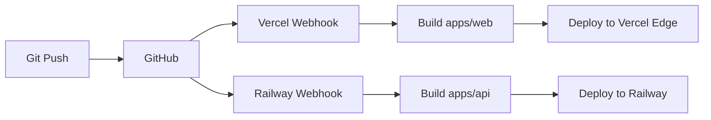

# ADR-003: Deploy with Vercel + Railway

## Status
**Accepted** - January 2, 2026

## Context

Axiom Intelligence Studio is a monorepo with:
- **Frontend**: Next.js 15 application
- **Backend**: FastAPI Python application
- **Services**: PostgreSQL, Qdrant, Meilisearch, Redis

We need a deployment strategy that:
- Supports automatic deployments from GitHub
- Handles both Node.js and Python runtimes
- Provides managed databases
- Is cost-effective for a portfolio project
- Enables preview deployments for PRs

### Options Considered

| Option | Pros | Cons |
|--------|------|------|
| **Vercel + Railway** | Best-in-class for each runtime, auto-deploy | Two platforms to manage |
| **Vercel only** | Single platform | Python support limited (serverless only) |
| **Railway only** | Single platform, good Python support | Next.js not optimized |
| **AWS (ECS/Lambda)** | Full control, enterprise standard | Complex setup, expensive |
| **Render** | Simple, supports both | Slower builds, less Next.js optimization |
| **Fly.io** | Good performance, global | More DevOps overhead |

## Decision

Use **Vercel** for the Next.js frontend and **Railway** for the FastAPI backend and databases.

### Rationale

1. **Vercel for Next.js**: Created by the Next.js team, provides optimal performance:
   - Automatic ISR, SSR, edge functions
   - Image optimization
   - Built-in analytics
   - Best-in-class preview deployments

2. **Railway for Python**: Excellent Python/FastAPI support:
   - Auto-detects from `pyproject.toml`
   - Native PostgreSQL, Redis
   - Easy Qdrant/Meilisearch via Docker
   - Simple environment management

3. **Monorepo Support**: Both platforms handle monorepo deployments:
   ```
   Vercel  → apps/web/  (Root Directory setting)
   Railway → apps/api/  (Root Directory setting)
   ```

4. **Cost-Effective**: Free tiers cover development, reasonable pricing for production.

5. **No Docker Required**: Both platforms build from source:
   - Vercel: `next build` from package.json
   - Railway: Railpack builds from pyproject.toml

## Consequences

### Positive
- Optimal performance for each runtime
- Zero-config deployments
- Automatic preview environments
- Managed databases included
- Easy scaling when needed

### Negative
- Two platforms to manage
- Cross-platform environment variables
- Preview URL coordination needed

### Mitigations
- Use GitHub Actions for coordinated deployments
- Document all environment variables clearly
- Use Vercel's `relatedProjects` for preview URL linking

## Implementation Notes

### Vercel Configuration

**File**: `apps/web/vercel.json`
```json
{
  "buildCommand": "cd ../.. && pnpm turbo build --filter=@axiom/web",
  "installCommand": "cd ../.. && pnpm install",
  "framework": "nextjs"
}
```

**Dashboard Settings**:
- Root Directory: `apps/web`
- Build Command: (use vercel.json)
- Output Directory: `.next`

### Railway Configuration

**File**: `apps/api/railway.json`
```json
{
  "$schema": "https://railway.com/railway.schema.json",
  "build": {
    "builder": "RAILPACK",
    "watchPatterns": ["apps/api/**", "packages/**"]
  },
  "deploy": {
    "startCommand": "uvicorn src.main:app --host 0.0.0.0 --port $PORT",
    "healthcheckPath": "/health",
    "restartPolicyType": "ON_FAILURE"
  }
}
```

**Railway Services**:
1. **axiom-api**: FastAPI backend
2. **axiom-postgres**: PostgreSQL database
3. **axiom-redis**: Redis cache
4. **axiom-qdrant**: Qdrant (Docker template)
5. **axiom-meilisearch**: Meilisearch (Docker template)

### Environment Variables

**Vercel (Frontend)**:
```
NEXT_PUBLIC_API_URL=https://axiom-api.up.railway.app
```

**Railway (Backend)**:
```
DATABASE_URL=${{Postgres.DATABASE_URL}}
REDIS_URL=${{Redis.REDIS_URL}}
QDRANT_URL=http://${{Qdrant.RAILWAY_PRIVATE_DOMAIN}}:6333
MEILISEARCH_URL=http://${{Meilisearch.RAILWAY_PRIVATE_DOMAIN}}:7700
OPENROUTER_API_KEY=sk-or-...
FRONTEND_URL=https://axiom.vercel.app
```

### Deployment Flow



## References
- [Vercel Monorepos](https://vercel.com/docs/monorepos)
- [Railway Monorepos](https://docs.railway.app/guides/monorepo)
- [Vercel + Railway Guide](https://docs.railway.app/guides/vercel)
