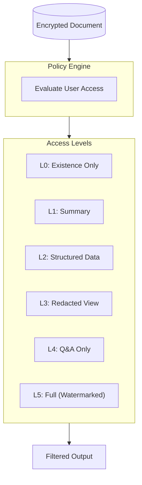
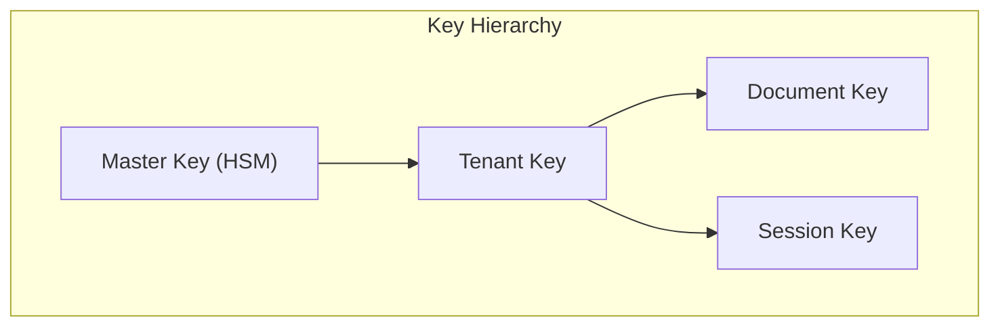
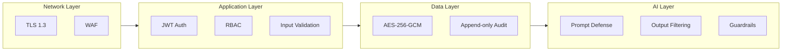

# ADR-003: Security Model

**Status:** Accepted
**Date:** January 2026
**Author:** Chris Therriault

---

## Context

Secure Reader handles highly sensitive M&A documents. Our security model must:
1. Ensure documents are never exposed to unauthorized users
2. Provide cryptographic enforcement of access policies
3. Create complete audit trails
4. Support graduated access levels
5. Defend against AI-specific attacks (prompt injection)

---

## Decision

### Core Principle: AI as the Only Reader

```
Document → Encryption → AI Reads → Policy Applied → User Gets Compliant Output

User NEVER sees raw document. Only AI does.
```

### Access Level Architecture



| Level | Name | User Sees |
|-------|------|-----------|
| L0 | Existence | "A document matching your query exists" |
| L1 | Summary | High-level summary only |
| L2 | Structured | Extracted data points |
| L3 | Redacted | Full doc with [REDACTED] sections |
| L4 | Q&A | Answers to specific questions |
| L5 | Full | Complete document (watermarked) |

### Encryption Model



| Key Type | Rotation | Storage |
|----------|----------|---------|
| Master | Annual | HSM |
| Tenant | Quarterly | Key Vault |
| Document | Never (immutable) | Key Vault |
| Session | Per session | Memory only |

### Defense in Depth



### Prompt Injection Defense

We implement a 5-layer defense:

1. **Input Sanitization** - Remove suspicious patterns
2. **Spotlighting** - Delimit user input from system prompts
3. **Context Isolation** - Separate document content from instructions
4. **Output Validation** - Guardrails AI for output checking
5. **Behavioral Limits** - Constrain AI actions

```python
# Spotlighting example
SYSTEM_PROMPT = """
You are analyzing a document for an authorized user.

<document>
{document_content}
</document>

<user_query>
{user_query}
</user_query>

Rules:
1. Only answer based on the document content
2. Never reveal the full document text
3. Apply access level {access_level} restrictions
"""
```

### Audit Logging

Every action is logged with:
- Timestamp (UTC)
- User ID
- Organization ID
- Document ID
- Action type
- Access level applied
- Query content (hashed)
- Response summary
- Policy decisions

```python
@dataclass
class AuditEntry:
    timestamp: datetime
    user_id: UUID
    org_id: UUID
    document_id: UUID
    action: str
    access_level: int
    query_hash: str
    response_tokens: int
    policy_decisions: list[PolicyDecision]
    ip_address: str
    user_agent: str
```

---

## Alternatives Considered

### Traditional RBAC Only

**Rejected because:**
- Binary access (all or nothing)
- No graduated access levels
- Cannot support clean room compliance

### DRM-Based Approach

**Rejected because:**
- User still sees document
- Can be bypassed (screenshots)
- No comprehension capability

### Blockchain for Audit

**Rejected because:**
- Overengineered for use case
- Performance overhead
- Append-only log sufficient

---

## Consequences

### Positive

- Documents never directly exposed
- Cryptographic policy enforcement
- Complete audit trail
- Supports regulatory compliance

### Negative

- Added latency for AI processing
- Higher operational complexity
- Requires careful prompt engineering

### Neutral

- Industry-novel approach
- Requires user education

---

## References

- [Security Architecture](../../06-SECURITY-ARCHITECTURE.md)
- [OWASP LLM Top 10](https://owasp.org/www-project-top-10-for-large-language-model-applications/)
