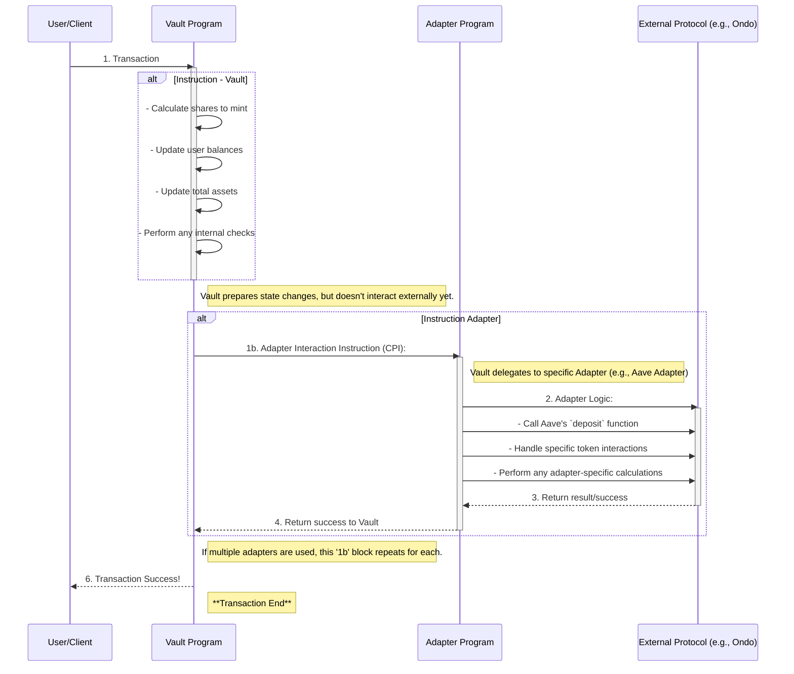
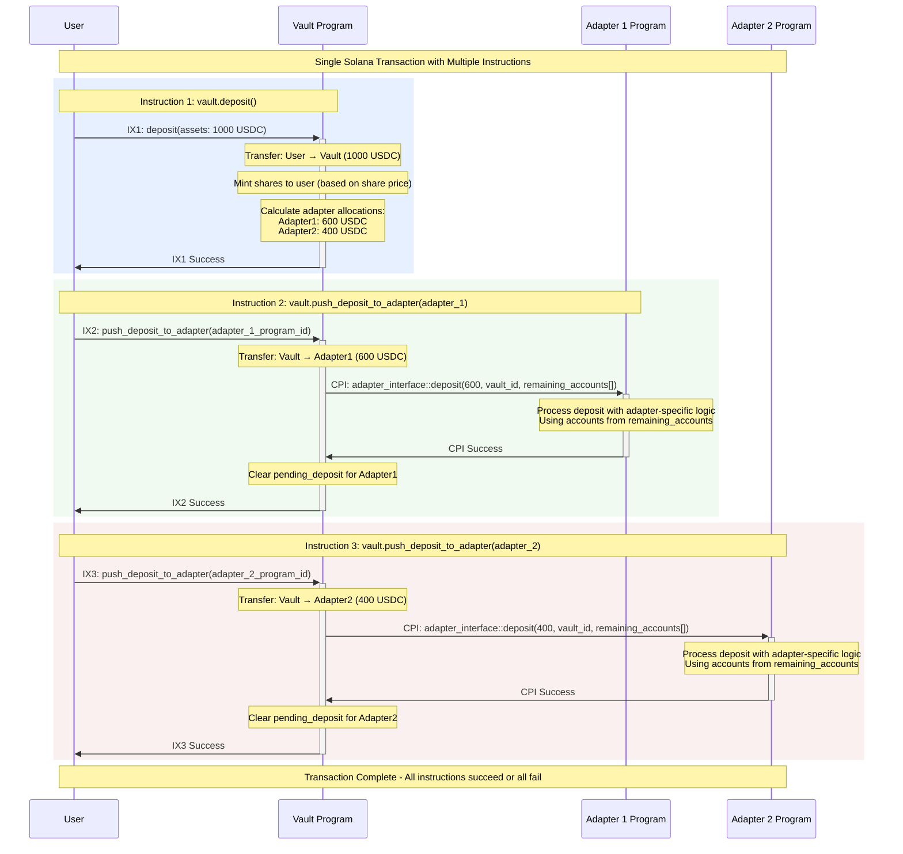

# ADR-003: Vault-Adapter Communication Architecture

## Status

Active

## Context

The Perena metavault system requires a flexible architecture where vaults can dynamically work with multiple adapters that invest user funds into various yield-generating instruments. A core challenge in Solana development is that all accounts a transaction will interact with must be provided upfront in the instruction, creating complications when different adapters require varying numbers of Program Derived Addresses (PDAs) for their operations.

For example, if one adapter's `deposit` method requires 3 Accounts while another requires 7 Accounts, the vault must have a strategy for handling these differences in Cross Program Invocation (CPI) calls.

The primary requirements are:

- **Dynamic adapter addition**: Vault instances should support adding adapters without requiring vault code updates
- **Varying account requirements**: Different adapters may need different numbers of accounts for the same operation
- **Flexible implementation**: Adapters should have freedom in how they implement their investment strategies

## Possible Solutions

1. **Strict Account Standardization** - Force all adapters to implement methods with identical signatures and fixed numbers of accounts, similar to Token2022/TokenSPL interface standardization. <br>
   **Pros:** Complete standardization, predictable interface, type-safe <br>
   **Cons:** Limits adapter flexibility, may require additional transactions for complex operations

2. **Dynamic Account Query Pattern** - Each adapter provides metadata about required account counts either CPI calls or registry lookups before the actual operation. <br>
   **Pros:** Flexible account handling, allows adapter implementation diversity <br>
   **Cons:** Additional CPI overhead, no compile-time account validation, potential for runtime errors

3. **Event-Driven Pattern** - Adapters emit events instead of performing direct state changes, with off-chain services handling actual operations. <br>
   **Pros:** Minimal on-chain coupling, extremely flexible off-chain processing <br>
   **Cons:** No direct on-chain state updates, requires off-chain infrastructure

4. **Multiple Instructions per Transaction** - Break complex operations into multiple instructions within the same transaction, with each adapter operation as a separate instruction. <br>
   **Pros:** Full flexibility for adapters, client controls account provision, no dynamic account discovery needed <br>
   **Cons:** Client responsibility for transaction completeness, potential for partial execution

5. **Static Adapters known at compile time** - All adapters must be known at vault compile time, with explicit handling for each adapter type using pattern matching. <br>
   **Pros:** Maximum flexibility, type-safe, complete account validation <br>
   **Cons:** Requires vault code updates for new adapters, increased maintenance overhead

## Solution

We selected **Approach 5: Multiple Instructions per Transaction** as our architecture for vault-adapter communication.

this mean that in the future, to add a new instrument, an adapter would be created, and a client which can supply the relevant accounts for `initialize` `deposit` `get_nav` and `withdraw` methods, without modifying existing vault code.

In general this means that the vault would have an instruction to perform certain actions on its own state, and then another instruction which it would use to perform a CPI call on an individual adapter.
E.g. The vault has one method - `initialize` which initializes its own state and sets itself up, and then `initialize_adapter` which then runs the `initialize` method on the adapter

This approach provides several key benefits:

- **Adapter Flexibility**: Each adapter can define its own account requirements and implementation
- **Client Control**: Clients have full visibility into adapter requirements and provide appropriate accounts
- **Transaction Atomicity**: If client correctly builds the instructions for the vault, all operations occur within a single transaction

#### Client Orchestration

Its important to keep in mind, that clients are now in charge of constructing transactions with the appropriate instruction sequence based on which adapters are connecting to the vault.

While, if transactions are constructed correctly, the transactions are atomic, it is important to keep in mind that we need to still design and build for when instructions are not combined together, or in the right order.

It will also be important to think through a good design for our client SDK that means that additional adapters can be added to the SDK simply.

### Vault Adapter interaction Overview

The vault-adapter interaction follows a **dual-instruction pattern** where many vault operation that requires adapter participation is split into separate instructions within the same transaction:

1. **Vault State Instruction**: The vault performs its internal state management (e.g., minting shares, calculating allocations, updating balances)
2. **Adapter Interaction Instruction**: An instruction that will call the appropriate adapter instruction through CPI to execute the corresponding adapter-specific logic. This instruction will be **reused** in the **transaction**, **once** per adapter.

This separation allows the vault to maintain its core functionality independently while enabling flexible adapter implementations. The key insight is that the vault prepares the necessary state changes first, then delegates to each adapter in subsequent instructions.



#### Core Operations Pattern

| Vault Operation | Vault Instruction                                                              | Adapter Instruction(s)                                                                   |
| --------------- | ------------------------------------------------------------------------------ | ---------------------------------------------------------------------------------------- |
| **Initialize**  | `initialize` - Sets up vault state, share mint, adapter registry               | `initialize_adapter` - Calls adapter's `initialize` method with vault context            |
| **NAV Refresh** | No action specific to only the vault                                           | Direct CPI to adapter's `get_nav` method                                                 |
| **Deposit**     | `deposit` - Transfers user funds to vault, mints shares, calculates allocation | `push_deposit_to_adapter` - Transfers funds to adapter, calls adapter's `deposit` method |
| **Withdraw**    | `withdraw` - Burns user shares, calculates withdrawal amounts                  | `initiate_adapter_withdrawal` - Calls adapter's `withdraw` method to begin unwinding     |
| **Claim**       | No action specific to only the vault                                           | Direct CPI to adapter's `claim` method which pulls requested funds from adapter          |

This pattern ensures that the vault can evolve independently of adapter implementations while maintaining strong consistency guarantees through Solana's transaction atomicity.

### Adapter "Trait" Implementation Details

This section outlines the methods that the vault expects to have on the adapters and their functionality as well as some conditions to be aware off.

Unfortunately we don't have a way to gaurantee that a solana program implements a set of methods with the correct arguments at the point of initialization. But not implementing the exact interface will result in failure in communication from the vault to adapters

#### Adapter Interface

All adapters implement a standardized interface defined in program [ adapter_interface ](anchor/programs/adapter_interface/src/lib.rs).
Unfortunately because of the nature of solana, we have no way to enforce at connection time that adapters implement the following interface.

At a high level we expect the following methods to be implemented on the adapter

```rust
/// Used to initialize the conection between the vault to the adapter, the idea would be any states that the program
/// Needs to produce for the intance that connects to the vault is set here
pub fn initialize(_ctx: Context<Initialize>, _vault: Pubkey) -> Result<()>

/// Used to return back the current NAV for the adpater.
/// @arg u64 - value in the asset token the adapter is currently holding.
/// @arg i64 - timestamp that the NAV was computed or updated.
pub fn get_nav(_ctx: Context<GetNav>, _vault: Pubkey) -> Result<u64, i64>

/// Used to send funds to the adapter to invest
/// It is essential that the adapter is able to evalute correclty that the funds have been sent to an
/// asset account which belongs to the adapter or that the adapter was expecting
pub fn deposit(_ctx: Context<Deposit>, _vault: Pubkey, _amount: u64) -> Result<()>

/// Used to begin unwinding funds from the investment.
/// @arg i64 - timestamp at which the funds will be available to withdraw
pub fn withdraw(_ctx: Context<Claim>, _vault: Pubkey) -> Result<(i64)>
```

#### Transaction Flow

An example of a complete transaction (deposit) that contains multiple instructions executed atomically would look as follows:



**Instruction Breakdown:**

```
Transaction:
├── Instruction 1: vault.deposit(user_funds)
│   ├── Transfers funds: user → vault
│   ├── Mints shares to user
│   └── Sets pending_deposit amounts per adapter
├── Instruction 2: vault.push_deposit_to_adapter(adapter_1)
│   ├── Transfers funds: vault → adapter_1
│   ├── CPI: adapter_1.deposit(amount, remaining_accounts)
│   └── Clears pending_deposit for adapter_1
└── Instruction 3: vault.push_deposit_to_adapter(adapter_2)
    ├── Transfers funds: vault → adapter_2
    ├── CPI: adapter_2.deposit(amount, remaining_accounts)
    └── Clears pending_deposit for adapter_2
```

#### Key Implementation Features

**Account Flexibility**: The `remaining_accounts` pattern allows adapters to specify any number and type of accounts required for their specific investment strategy.

**Atomic Execution**: All instructions must succeed within the transaction, preventing partial execution states, however this is dependent on the client, the vault is designed so that if only one instruction is added, the vault will still be able to carry on.

**Adapter Validation**: The vault validates adapter program IDs and ensures only registered adapters can receive funds.

### Decision Rationale

**Why Multiple Instructions?**

- Eliminates the need for runtime account discovery
- Provides adapters complete implementation freedom
- Maintains transaction atomicity while distributing complexity
- Scales well with varying adapter account requirements

**Why Client Responsibility?**

- Clients have full context about required adapters and their account needs
- Reduces on-chain computation and CPI overhead
- Enables sophisticated client-side transaction construction
- Aligns with Solana's account model philosophy

**Why Standardized Interface?**

- Ensures consistent vault-adapter communication
- Allows for future adapter additions without vault changes
- Provides clear development guidelines for adapter implementers

This architecture successfully balances the competing requirements of flexibility, and implementation simplicity while working within Solana's account model constraints.
