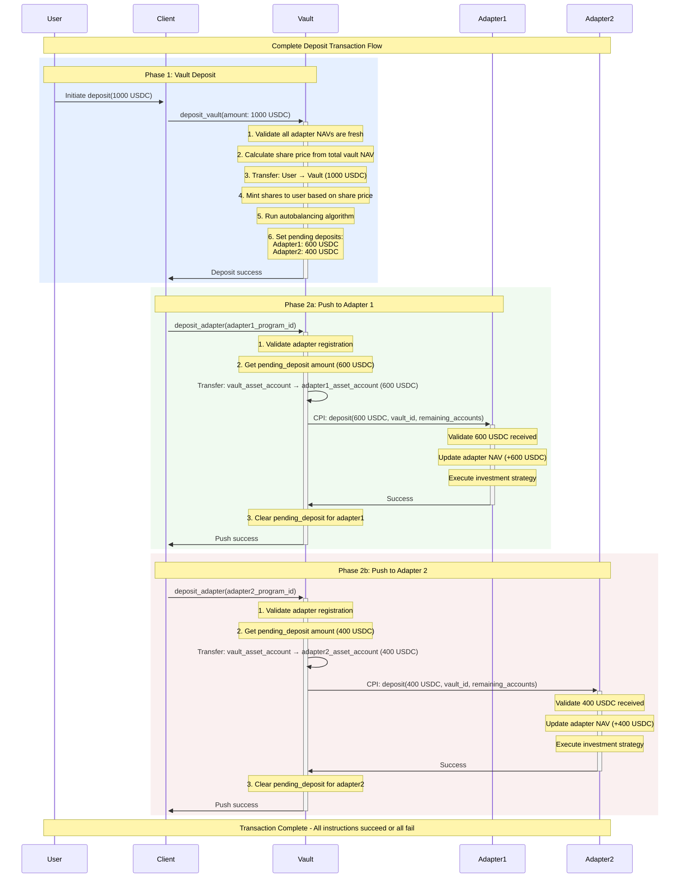

# ADR-004: Deposit Flow Architecture

## Status

Active

## Context

Building upon ADR-003's vault-adapter communication architecture, this document details the specific implementation of the deposit flow within the Perena metavault system. The deposit flow represents one of the core operations where users provide assets to the vault in exchange for shares, with the vault then allocating those assets across multiple adapters according to their target weights and current balances.

The deposit flow must handle several critical operations:

- **Asset Transfer**: Moving user funds into the vault's custody
- **Share Calculation and Minting**: Computing the correct number of shares based on current vault valuation
- **Allocation Strategy**: Determining how much of the deposit should go to each adapter based on target weights and current balances
- **Adapter Distribution**: Transferring allocated funds to individual adapters through CPI calls

This flow exemplifies the dual-instruction pattern established in ADR-003, where vault state management is separated from adapter-specific operations to maintain flexibility and atomicity.

## Decision

The deposit flow implements a **two-phase execution model**. These phases can be bundled into a single transaction for atomicity or executed separately (leaving `pending_deposit` recorded in vault state until pushed):

1. **Phase 1 - Vault Deposit**: A single `deposit_vault(amount)` instruction that handles all vault-level operations
2. **Phase 2 - Adapter Distribution**: One `deposit_adapter(adapter_program_id)` instruction per adapter receiving funds

### Vault Deposit Flow

#### Phase 1: Key Vault Operations:

1. NAV Validation

- Enforces two freshness checks before any valuation:
  - Adapter-level: each adapter's `update_timestamp` must be within its `nav_max_staleness_seconds` and not in the future
  - Operation-level cache freshness: each adapter's `nav_last_cache_update_ts` must be within `OPERATION_MAX_STALENESS_SECONDS = 60s`
- If any check fails, the operation errors (e.g., `StaleNavData`, `InvalidAdapterTimestamp`, or `RefreshRequired`), requiring a NAV refresh prior to deposit

2. Share Price Calculation

- Computes total assets as: `vault_asset_account.amount + sum(adapters.nav_cached)`
- Share price uses 6-decimal precision: \( share_price = floor((total_assets \times 1,000,000) / total_shares) \)
- When no shares exist, default share price is `1_000_000` (i.e., 1.0 with 6 decimals)

3. Asset and Share Management

- Transfers depositor assets to the vault's asset ATA using SPL `transfer_checked`
- Mints shares to the depositor using Token-2022 `mint_to_checked` with the vault PDA as mint authority
- Shares to mint: \( shares = floor((deposit_amount \times 1,000,000) / share_price) \); must be > 0 (`FailedCalculateSharePrice` otherwise)

4. Allocation Planning

- Requires at least one adapter (`NoAdaptersRegistered`) and that all `target_weight` values sum to exactly 1,000,000 PPM (`InvalidAdapterWeights`)
- Builds a `RebalanceParams` with the deposit `amount`, current `nav_cached` per adapter, and `target_weight` proportions
- Uses an autobalancing algorithm that selects between:
  - Balanced mode: proportional-by-weights when within the default 5% threshold (`50,000` PPM)
  - Rebalancing mode: delta-based allocation toward targets when imbalance exceeds the threshold
- Deterministic remainder handling: any leftover unit after flooring is assigned to the adapter with the largest weight/delta
- Updates each adapter's `pending_deposit` according to the computed plan (adapter order must match `vault.adapters`)

#### Phase 2: Key Adapter Operations:

When the vault invokes `deposit_adapter` for a specific adapter, the vault:

1. Locates the adapter by program ID in `vault.adapters` and checks the adapter program is executable (`InvalidAdapterProgram`)
2. Reads the adapter's `pending_deposit`; if zero, returns success (no-op)
3. Transfers funds from the vault asset ATA to the adapter asset account using PDA-signed `transfer_checked`
4. Calls the adapter via CPI: adapter `deposit(vault_id, amount)` with its required remaining accounts
5. Clears `pending_deposit` and increments the adapter's `nav_cached` by the deposited amount

Adapter responsibilities upon CPI `deposit`:

1. Fund Validation

- Reload its asset account to verify the expected funds were actually received
- Compare received amount against the `amount` parameter to prevent fund loss
- Error if funds don't match expectations

2. State Updates

- Update internal state/NAV to reflect new assets under management
- Maintain consistency between expected and actual balances

3. Investment Execution

- Deploy received funds according to the adapter's investment strategy
- This could involve staking, lending, providing liquidity, or other yield-generating activities
- Update any strategy-specific state or external protocol positions

### Inputs and Parameters

The following summarizes the inputs each instruction uses. Field names mirror on-chain accounts and configuration.

- **`deposit_vault(amount: u64)` accounts**:
  - `share_mint` (Token-2022): equals `vault_state.share_mint`; mint authority is the vault PDA
  - `vault_asset_account` (ATA of `asset_mint`, authority = vault PDA): created if needed
  - `asset_mint`: equals `vault_state.asset_mint`
  - `depositor` (signer)
  - `depositor_asset_account` (ATA of `asset_mint` for `depositor`)
  - `user_share_account` (ATA of `share_mint` for `depositor`): created if needed
  - `vault_state` (PDA): contains `adapters`, weights, cached NAV, fees
  - `share_token_program` (Token-2022), `asset_token_program` (SPL Token or Token-2022 via interface), `associated_token_program`, `system_program`

- **`deposit_adapter()` accounts**:
  - `vault_asset_account` (ATA of `asset_mint` for vault PDA)
  - `asset_mint`: equals `vault_state.asset_mint`
  - `payer` (signer)
  - `adapter_asset_account` (adapter's asset token account)
  - `vault_state` (PDA)
  - `adapter_program` (executable)
  - `asset_token_program`, `associated_token_program`, `system_program`
  - Remaining accounts required by the specific adapter's CPI

### Complete Deposit Flow with Adapter Distribution



## Security Considerations

### Validation Requirements

**NAV Freshness (two levels)**:

- Adapter-level: `current_time - update_timestamp <= nav_max_staleness_seconds` and no future timestamps (`InvalidAdapterTimestamp`)
- Operation-level: `current_time - nav_last_cache_update_ts <= OPERATION_MAX_STALENESS_SECONDS (60s)`; otherwise `RefreshRequired`

**Adapter Registration**: The vault checks adapter registration by searching its internal `adapters` array for the provided adapter program ID using `get_adapter_index_by_pubkey()`. Only adapters found in this registry can receive deposit allocations.

**Weight Validation**: The vault validates adapter weights by summing all `target_weight` values in the adapters array and ensuring they equal exactly 1,000,000 PPM (representing 100%). This validation occurs during the deposit operation before allocation calculations.

**Executable Program Check**: `deposit_adapter` verifies the adapter program account is marked executable (`InvalidAdapterProgram`).

**Atomic Execution**: Bundling `deposit_vault` and the corresponding `deposit_adapter` calls in one transaction ensures atomicity. If executed separately, the system remains consistent via `pending_deposit` until funds are pushed.

### Error Handling

**Fund Validation**: Adapters are responsible for validating that expected funds were actually received, providing protection against incorrect account configurations.

**Overflow Protection**: All mathematical operations use checked arithmetic to prevent overflow attacks or unexpected behavior.

**Transaction Reversion**: If any instruction fails, the entire transaction reverts, ensuring no partial state changes occur.

### Assumptions and Invariants

- The autobalancer returns orders aligned with the order of `vault.adapters`; otherwise `AutobalanceIncorrectOrdering` is raised
- Default imbalance threshold is 50,000 PPM (5%) when not explicitly overridden
- After a successful `deposit_adapter`, the vault increments `adapter.nav_cached` by the transferred amount; authoritative NAV should be refreshed via `refresh_nav` when needed
- `pending_deposit` tracks funds awaiting push; `deposit_adapter` is a no-op if `pending_deposit` is zero
- Share tokens use Token-2022; the asset token program is accepted via a token interface (SPL Token or Token-2022)
- The vault and user ATAs required for the operation are created on demand where applicable

## Transaction Example

For a 1000 USDC deposit into a vault with two adapters (60%/40% target weights):

```
Transaction Instructions:
├── Instruction 1: vault.deposit_vault(1000 USDC)
│   ├── Validates NAVs are fresh
│   ├── Calculates share price from total vault NAV
│   ├── Transfers 1000 USDC: user → vault
│   ├── Mints appropriate shares to user
│   └── Sets pending deposits: adapter_1(600 USDC), adapter_2(400 USDC)
├── Instruction 2: vault.deposit_adapter(adapter_1)
│   ├── Transfers 600 USDC: vault → adapter_1
│   ├── CPI calls adapter_1.deposit(600, vault_id, accounts)
│   └── Clears adapter_1 pending_deposit
└── Instruction 3: vault.deposit_adapter(adapter_2)
    ├── Transfers 400 USDC: vault → adapter_2
    ├── CPI calls adapter_2.deposit(400, vault_id, accounts)
    └── Clears adapter_2 pending_deposit
```

This deposit flow architecture provides a robust foundation for user deposits while maintaining the flexibility and security requirements of the Perena metavault system, following the established dual-instruction pattern that separates vault state management from adapter-specific operations.
