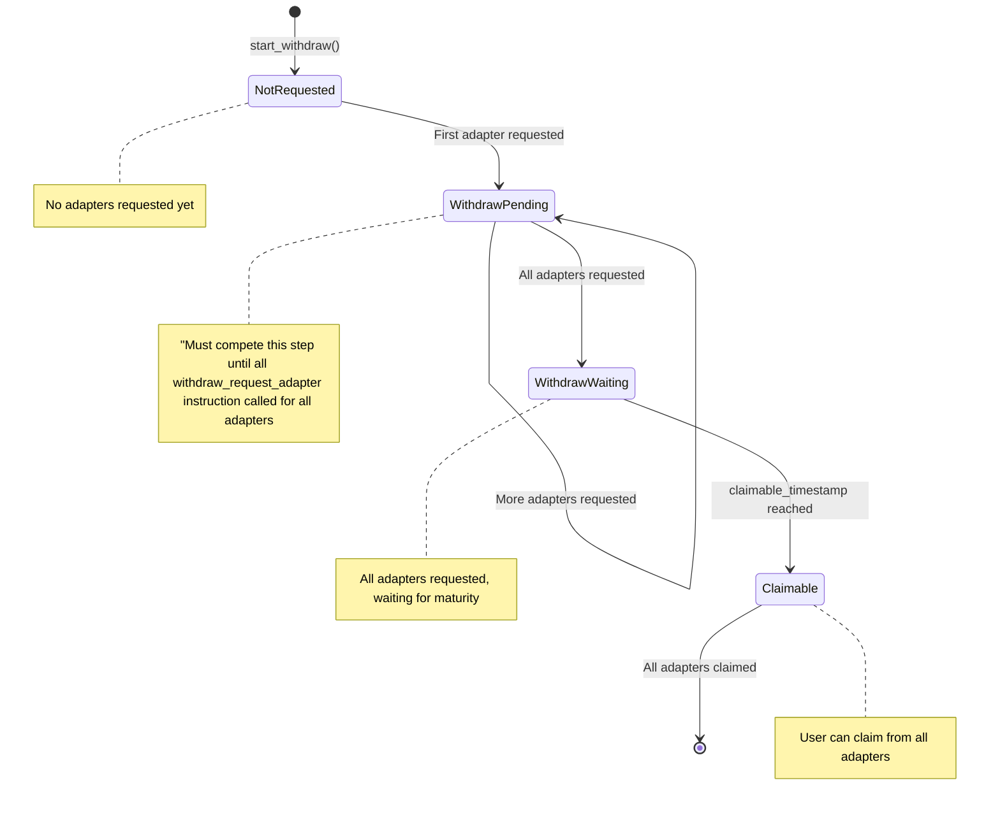
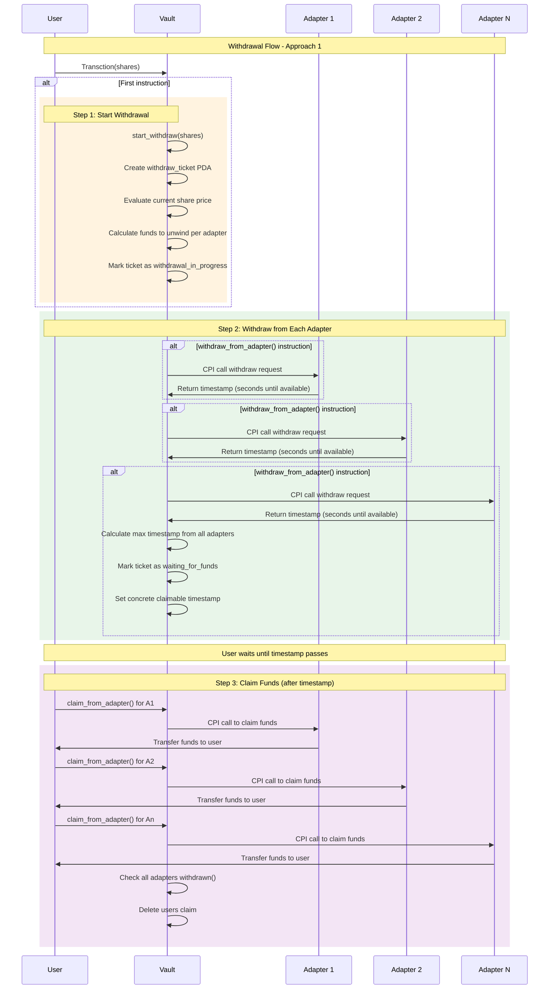

# ADR-005 - Withdraw and Claim Flow

## Status

active

## Context

Building up ADR-003's vault-adapter communication architecture, this document details the specific implementation
of the deposit flow within the Perena metavault system.
In the withdraw flow, users will request a withdrawal, and receive a ticket that they can use to claim the funds
once the withdrawal is completed.

Because adapters can have varying maturities before funds are returned back, the user needs to wait until the
longest maturity before releasing all of the funds.

This isn't the most capital efficient, a more ideal scenario would be finding out the longest maturity date,
and then asking all adapters to have the funds ready by the longest maturity date.
This gies the adapters more time to keep funds invested earning a yield, increasing capital efficiency.

### Concerns

A couple of concerns that need to be addressed:

#### How to receive timestap gaurantees of when the adapter funds can be returned

In general it is assumed that the adapter would provide the time at which it would be able to fulfill withdrawal
requests at the time of withdrawal.

An approach of having a withdraw request in a pending state was deemed unpalatable for users, since they wouldn't know when the funds would be avavailable.
A better experience would be having the adapters provide a worst case scenario timestamp, so that the user is aware for how long it would take for their funds to be available.

For this reason adapters are required to be able to provide a timestamp after which the funds would be available to pull funds out

#### Making sure all adapters have been informed of the request

A real concern of design is to try and produce atomicity of a withdrawal request - either the entirety of the withdraw request are in progress or none.
However, because of the nature of our design for vault and adapter communication (see [adr-003](adr/003-vault-adapter-communication.md))
the client is incharge of producing a transaction which orchestrates in the correct order and that all the Instructions are combined together.

Since the smart contracts cannot enforce this, we will have to have the withdrawal marked as in process until the withdraw claim has a timestsamp received from all adapters, before informing the user that their withdraw_request completed succesfully and is now in the process of being unwound from adapters

This way it is in the users interest to craft the txn correctly. If they don't then they won't be getting access to any yield, while the remaining adapters are still getting yield on the inveseted funds, to the benefit of all users.

#### Fund custody during withdrawal waiting period

Once adapters unwind their positions, it's unclear whether the freed funds should be immediately transferred to the vault for centralized
custody, or remain with each adapter until the user initiates the final claim.

This decision impacts gas costs, security, and the complexity of
the claiming process - centralized custody simplifies claiming but requires additional transfers, and actions from the adapter and maybe an adapter admin, while distributed custody reduces intermediate transfers but requires the user to claim from each adapter individually.

We think it makes sense for users to pay for the gas cost of transfering their funds from adapters or even underlying yield instruments
after their withdraw request is claimable

## Solution

The vault performs a CPI call to the adapter, and if the adapter was succesfully able to register the withdraw request, it will return a u64 - seconds it would take before it can gaurantee that the funds would be available.
The caller would need to make sure to call these withdraw requests for all adapters, otherwise the withdraw_request cannot be considered to be started.

### RedemptionTicket State Diagram

The following state diagram illustrates the lifecycle of a RedemptionTicket and its associated adapter withdrawals:

For the user to claim the funds, they will use

Order of actions:

1. User makes a request claim they call the `start_withdraw(shares: u64)` instruction. This:
   - creates the withdraw_ticket pda for the user
   - evalutes the current share price
   - works out how much funds to unwind from each adapter based on weighting and if rebalancing needs to occur,
   - marks the ticket as `withdrawal_in_progress`

2. For each of the adapters connected to the vault, the user call the `withdraw_from_adapter()` instruction. This:
   - performs the withdraw CPI call on the adapter, which returns the timestamp after which the funds will be available.
   - If this call means that all the adapters have been called, then the ticket as marked as - `waiting_for_funds`, and a concrete timestamp after which the claim will be claimable will be available.

3. User waits until passed the timestamp for the withdraw_request claim

4. User beings to claim on each individual adapter,
   - For each adapter the amount to withdraw will be in the ticket, and so can be communicated to the adapter.
   - Funds directly to the users account.

